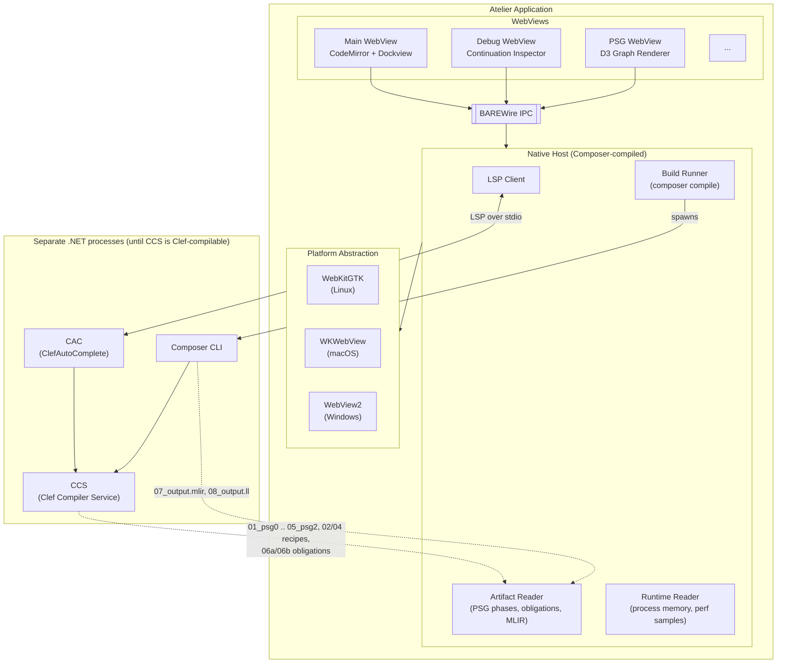

# Atelier

> **Note:** This project is currently in the preliminary design phase. The documentation describes the intended architecture and features. Implementation has not yet begun.

**Frontend direction:** While WREN uses F# compiled to JavaScript, standardize on Fickl and Ranvier. References below to Partas.Solid and Fable document the earlier WrenHello baseline. Clef-to-JavaScript through JSIR is a later target, with its own implementation and conformance gates. See the [visualization strategy](docs/05_webgpu.md).

**The Fidelity Framework IDE - Self-Hosting via WRENStack**

Atelier (French for "workshop" or "studio") is the professional development environment for the Fidelity ecosystem and the commercial home of the Clef toolchain. It is designed to be **self-hosting** using the [WREN Stack](https://speakez.tech/blog/wren-stack/) (**W**ebView + **R**eactive + **E**mbedded + **N**ative). WrenHello demonstrates a Composer-compiled Clef host and an F#/Fable frontend. Atelier's selected Fickl and Ranvier frontend and eventual Clef self-hosting remain to be established (see [Self-Hosting WRENStack](#self-hosting-wrenstack)).

As a Clef IDE, Atelier is designed to witness the Clef Compiler Service's Program Semantic Graph into views: PSG visualization, nanopass inspection, proof-obligation surfacing, and delimited continuation debugging. It computes no semantic fact of its own. As a WRENStack application, it will combine a reactive WebView frontend, a Composer-compiled native host and BAREWire communication.

While FidelityUI (a future native UI model) is planned, WRENStack provides an interim path using proven web technology with native-quality performance.

## Self-Hosting WRENStack

Atelier is both the **tool** and the **demonstration**:

- **As a Clef IDE**: A witness of the Clef Compiler Service's saturated PSG, including PSG visualization, nanopass inspection, proof-obligation surfacing, and delimited continuation debugging
- **As a WRENStack application**: A lean, native foundation with a reactive web frontend, proving the architecture it supports

The self-hosting aspect is intentional: Atelier will be used to develop Fidelity applications, including future versions of Atelier itself. This creates a tight feedback loop where improvements to the compiler directly benefit the IDE, and IDE requirements drive compiler evolution.

Self-hosting holds today for one part of the application and is a goal for the other two:

- **Native host**: Clef compiled by Composer to machine code, no .NET runtime in the shipped host. This half is proven by the WrenHello exemplar.
- **Front end**: Fickl and Ranvier are the selected F#-to-JavaScript direction. WrenHello's Partas.Solid/Fable frontend is the current integration baseline; migration and package compatibility remain to be established. Composer's JSIR pathway is the later Clef frontend target, with its language and reactive coverage subject to implementation and conformance.
- **Compiler services**: CCS (the Clef Compiler Service) and CAC (ClefAutoComplete, the LSP server) are .NET processes. A Composer-compiled host cannot link them. Atelier reaches them through two channels only: CAC as a child process over standard LSP, and the artifact files CCS and Composer write beside a build. This is the second half of the self-hosting gap and closes only when CCS is Clef-compilable.

Like its namesake bird, WRENStack applications are designed to be lightweight and quick to start. Atelier embodies this philosophy - a craftsman's tool that respects computational resources while providing the sophisticated tooling that compiler development demands.

The host boxes name what the host does with facts, not where facts come from. Every semantic fact the views show is read from the saturated PSG that CCS produced; the Artifact Reader and the LSP client transport, they do not infer. No host-facing API or LSP method exposes the graph today; the artifacts are files on disk, and a serialization contract for a non-.NET consumer is a CCS-owned contract item, not something Atelier defines.

## Why Atelier?

Modern development environments are computationally profligate. Electron apps bundle entire browser runtimes, consuming gigabytes of memory to display text. VSCode, while feature-rich, carries the weight of universal compatibility at the cost of specialized excellence.

Atelier takes a different path: purpose-built tooling for the Fidelity ecosystem, with deep integration into the Clef toolchain: the Clef Compiler Service's PSG and the MLIR Composer witnesses from it.

| Capability | VSCode/Electron | NeoVim | Atelier |
|------------|-----------------|--------|---------|
| Memory footprint | ~500MB+ | ~50MB | ~80MB target (native + WebView) |
| Startup time | 2-5 seconds | <100ms | <200ms target |
| PSG visualization | Plugin (limited) | Not practical | Planned D3 integration |
| Delimited continuation debugging | Not supported | Not supported | Planned first-class support |
| Multi-WebView architecture | Varies by application | N/A | Planned coordinated WebViews; isolation depends on host |
| WebGPU compute | Limited | N/A | Planned direct access |

### Guiding Design Principles

1. **Computational Responsibility**: Justify every byte of memory, every CPU cycle
2. **Compiler-Aware Tooling**: Witness the Clef Compiler Service's PSG and Composer's witnessed MLIR; compute no semantic fact in the IDE
3. **Native Performance**: Target native compilation of the host by Composer, no managed runtime in the shipped host (the front-end toolchain is interim .NET, see above)
4. **Web-Class UI**: Use Ranvier's reactive model with an admitted editor component
5. **Multi-WebView Architecture**: Explore isolation for debugging, monitoring and visualization under each host's actual scheduling capabilities

## The WREN Stack Advantage

The WREN Stack eliminates the false choice between native performance and modern UI:

- **WebView as rendering surface**: System WebView (WebKitGTK, WKWebView, WebView2) instead of bundled Chromium
- **Reactive UI in the WebView**: Ranvier state in an F# frontend compiled with Fickl. WrenHello's earlier frontend provides host and bridge evidence; the selected frontend and package compatibility require validation. Clef through Composer's JSIR pathway is a later target.
- **Embedded assets**: HTML, CSS, and assets frozen into the binary's read-only memory
- **Native Clef logic**: Compiled through Composer to machine code, communicating via BAREWire IPC

The goal is a responsive application with low startup and resource costs. The [visualization strategy](docs/05_webgpu.md) defines measurements against named baselines.

## Technology Stack

### Frontend (WebView)
- **Fickl and Ranvier**: Selected F#-to-JavaScript compiler and reactive model; their integration in Atelier remains to be validated
- **WrenHello baseline**: Its earlier Partas.Solid/Fable frontend provides a host and bridge reference for the transition to Fickl and Ranvier
- **CodeMirror 6**: Modern editor; the LSP client for CAC. A Lezer grammar for Clef is coloring-only: every structural or semantic fact (folding by meaning, structure-aware navigation, diagnostics) comes from CCS through LSP and the PSG, never from the Lezer tree. That grammar would be a third grammar of Clef beside CCS's parser (the authority) and the TextMate grammar in clef-grammar that Lattice consumes; deriving it from clef-grammar bounds the maintenance cost
- **Dockview**: Candidate for panel docking and floating windows, with an adapter for the selected reactive frontend
- **D3.js**: PSG graph visualization
- **xterm.js**: Terminal emulation with WebGL renderer

### Backend (Native)
- **Composer-compiled host**: No .NET runtime in the shipped host binary
- **BAREWire**: Shared typed encoding, schema and framing for .NET, JavaScript and native Clef. WrenHello's integrated BAREWire transport is a separate step from its current script-message bridge.
- **CAC (ClefAutoComplete)**: The Clef language server, a .NET process reached over standard LSP as a child process; not linked into the host
- **Toolchain artifacts**: The files CCS and Composer write beside a build, read from disk: `01_psg0.json`, `02_intrinsic_recipes.json`, `03_psg1.json`, `04_saturation_recipes.json`, `05_psg2.json`, `06a_obligations.json`, `06b_obligations.smt2`, `07_output.mlir`, `08_output.ll`
- **PTY integration**: Native terminal support

### Platform Layer
- Inspired by WRY/Tauri abstraction patterns
- Platform WebViews reached through Layer 2 binding libraries (Fidelity.WebKit, Fidelity.WebView, Fidelity.Gtk3; generated by Farscape) with opaque `CHandle<'T>` boundary handles; which binding a call resolves to is settled in the saturated PSG from the target's platform description
- Script message handlers for bidirectional communication

## Envisioned Capabilities

Every capability below is a view of facts that the Clef Compiler Service settles in the saturated PSG. Atelier renders; it does not compute. Nothing in this section is built.

### PSG Visualization

Atelier contemplates providing real-time visualization of CCS's **Program Semantic Graph** - the hypergraph that carries native types, coeffect annotations, obligations, and semantic relationships from elaboration through saturation.

What the viewer would show is what CCS already writes when intermediate emission is enabled: `01_psg0.json` (elaborated), `02_intrinsic_recipes.json` (intrinsic recipe fan-out and fold-in), `03_psg1.json`, `04_saturation_recipes.json` (Baker's saturation recipes), `05_psg2.json` (saturated), with the `02a`/`04a` recipe diagnostics beside them. Nodes carry `Type`, `ArenaAffinity`, `LayoutHint`, and `Metadata`; hyperedges carry an `EdgeClass` (Structural, Reference, Provenance, Obligation) and an `EdgeRole`. Coeffects are node annotations read from the graph, never recomputed in the viewer.

The goal: watch your code transform from syntax to elaboration to saturation (recipe fan-out and fold-in) to the saturated PSG with its obligations, and then to the MLIR that Composer's Alex witnesses from it (`07_output.mlir`). The Photographer Principle, the Zipper, and Templates are Alex's vocabulary for its side of the witness; they are not the PSG's structure and not Atelier's.

### Proof Obligation Surfacing

Obligations are graph citizens minted by Baker at saturation, not by any tool downstream. CCS renders them as a ledger (`06a_obligations.json`) and solver-ready SMT-LIB (`06b_obligations.smt2`) that cvc5 discharges by refutation; Composer's build-time twin reads the same records from the same graph and declares the same anchor names, so the two verdicts pair one for one. Atelier is designed to show obligation status per node, the SMT text, the cvc5 verdict, and the design-time/build-time pairing. The ledger exists in CCS today (Increment 1, built and verified); the view does not, and continuous surfacing as source is edited is Lattice's to carry over LSP.

### Delimited Continuation Debugging

The design calls for first-class debugging support for delimited continuations, the substrate under Clef's async model. The settled form is the suspension recipe: segments at cuts, a frame (an environment node with a state-machine slot class and a discriminant), a delimiter edge per cut, witnessed as a discriminant, a byte frame, and `scf.index_switch`. Plans include stepping across segments, inspecting the frame, and visualizing the control flow that traditional debuggers cannot represent. Every frame and segment fact, including the frame's layout as literal offsets, is a PSG fact; the host's runtime reader interprets process memory only through those layout facts, never through a second layout source. The suspension recipe is not yet built in CCS (PSG to PHG plan, Phase 3), so this capability waits on it.

### Multi-WebView Architecture

Atelier can explore separate WebViews for editing, debugging, visualization and terminals. Their actual process, crash and scheduling isolation depends on the host. Measure editor responsiveness while visualization and GPU work run; a separate WebView alone does not establish independence.

### WRENStack Design-Time Experience

The earlier Fable/Partas.Solid design considered [WRENStack.Tooling](https://github.com/speakeztechnologies/WRENStack.Tooling). Its compatibility with the selected Fickl/Ranvier frontend needs validation. Its design-time features include:

- **Source Maps** - Debug F# source, not generated JavaScript
- **Signal Inspector** - Browser devtools integration for SolidJS signals
- **Component Navigation** - Jump between F# component definitions and usage
- **HMR State Preservation** - Hot reload without losing signal state

Atelier should establish source maps, reactive inspection, component navigation and state-preserving development workflows for the selected frontend. The future Clef/JSIR experience needs its own compiler and tooling support.

## Documentation

See the [docs/](./docs/) folder for detailed documentation:

- [00_architecture.md](./docs/00_architecture.md): WREN architecture deep dive
- [01_webview_abstraction.md](./docs/01_webview_abstraction.md): Platform WebView lessons from WRY
- [02_solid_components.md](./docs/02_solid_components.md): Earlier Solid component design and editor integration reference
- [03_unique_features.md](./docs/03_unique_features.md): Delimited continuations, PSG visualization
- [04_multi_webview.md](./docs/04_multi_webview.md): Multi-WebView architecture
- [05_webgpu.md](./docs/05_webgpu.md): WREN graphics and interactive visualization
- [06_reactive_frontend.md](./docs/06_reactive_frontend.md): Fickl and Ranvier frontend architecture
- [07_lezer_parsing.md](./docs/07_lezer_parsing.md): Lezer, CodeMirror's incremental parsing foundation
- [08_tooling_integration.md](./docs/08_tooling_integration.md): Performance tooling, hardware collection and display against PSG layout facts
- [09_flow_loss_analysis.md](./docs/09_flow_loss_analysis.md): Data-flow parallelism analysis and hardware partnership strategy
- [12_hypergraph_visualization.md](./docs/12_hypergraph_visualization.md): Joint relationships, interactive 3D and layered spline views
- [13_visualization_integrity.md](./docs/13_visualization_integrity.md): Data, resource and evidence integrity from application to GPU
- [14_wren_webgpu_bindings.md](./docs/14_wren_webgpu_bindings.md): Xantham bindings, WREN hosts and renderer integration
- [15_visualization_roadmap.md](./docs/15_visualization_roadmap.md): Product horizons, acceptance cases and performance measurement
- [16_xantham_gpu_binding_playbook.md](./docs/16_xantham_gpu_binding_playbook.md): D3 and WebGPU binding implementation and validation

## Related Projects

| Project | Description |
|---------|-------------|
| Clef Compiler Service (CCS) | The Clef front end; builds and saturates the PSG, the sole semantic authority |
| [Composer](https://github.com/FidelityFramework/Composer) | Clef AOT compiler; Alex witnesses the PSG into MLIR |
| [ClefAutoComplete (CAC)](https://github.com/FidelityFramework/ClefAutoComplete) | Clef language server (LSP); a .NET process today |
| [lattice-vscode](https://github.com/FidelityFramework/lattice-vscode) / [lattice-vim](https://github.com/FidelityFramework/lattice-vim) | Lattice editor clients for CAC |
| [BAREWire](https://github.com/FidelityFramework/BAREWire) | Schema-driven binary serialization and platform description |
| [Fidelity.WebKit](https://github.com/FidelityFramework/Fidelity.WebKit) / [Fidelity.WebView](https://github.com/FidelityFramework/Fidelity.WebView) | Farscape-generated Layer 2 bindings for the platform WebView (Linux x86_64 today) |
| [WRENStack.Tooling](https://github.com/speakeztechnologies/WRENStack.Tooling) | Design-time tooling for Fable-built WRENStack front ends |
| [Ranvier](https://github.com/ranvier-org/Ranvier) | Selected reactive model for WREN's Fickl-compiled frontend |

## The Name

*Atelier* - a workshop or studio, especially for an artist or designer. A space where craft meets creation.

This editor is our workshop for building the Fidelity ecosystem: a tool made by compiler developers, for compiler developers, embodying the same principles of computational responsibility and native performance that define the framework itself.

## License

Dual-licensed under Apache 2.0 and a commercial license. See [LICENSE](LICENSE) and [Commercial.md](Commercial.md) for details.
