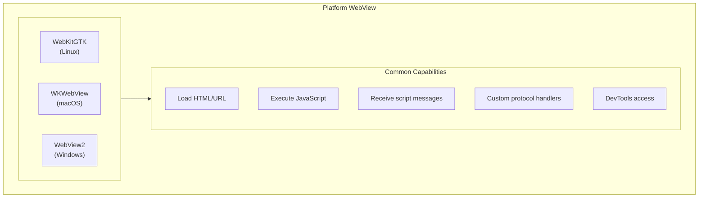
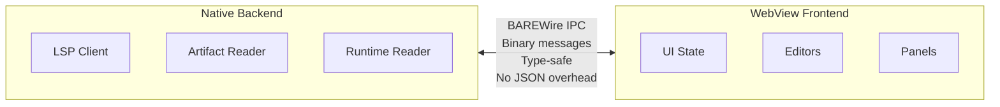
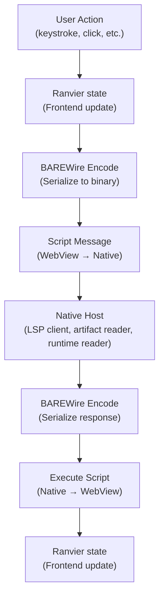
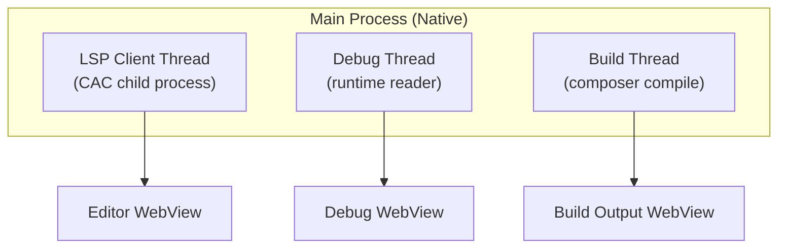

# 00 - WREN Architecture

**Frontend direction:** WREN's F#-to-JavaScript path standardizes on Fickl and Ranvier. The SolidJS and Fable examples in this chapter record the earlier design and WrenHello baseline; a retained view toolkit requires an adapter to the selected reactive contract. Clef's JSIR frontend remains a later implementation target. The [visualization strategy](05_webgpu.md) sets the initial integration and measurement gates.

## The WREN Stack

**W**ebView + **R**eactive + **E**mbedded + **N**ative

WREN represents a pragmatic approach to desktop application architecture. Rather than embedding a full browser runtime (Electron) or constraining ourselves to native-only UI toolkits (GTK widgets, Qt), WREN leverages the platform's existing WebView infrastructure with a Composer-compiled native backend.

### WRENStack in the Fidelity Ecosystem

WRENStack is a **SpeakEZ product** that uses Fidelity/Composer - it is not an extension of Fidelity itself. The architectural boundary is important:

```
Fidelity (UI-agnostic framework) ◄── uses (no coupling) ── WRENStack (product)
```

WRENStack is an interim solution for SpeakEZ's business needs while **FidelityUI** (a future native UI model) matures. Atelier uses WRENStack to bootstrap itself, demonstrating the pattern it supports.

## Why WREN?

### The Electron Problem

Electron applications bundle Chromium (~150MB) and Node.js (~30MB) into every application. A "Hello World" in Electron ships as a 180MB+ binary that consumes 300-500MB of RAM at runtime.

This is computationally irresponsible.

### The Native-Only Problem

Pure native toolkits (GTK, Qt, native F#/WinForms) offer efficiency but lack the rich, expressive UI capabilities that web technologies provide. Building a sophisticated code editor UI in pure GTK is possible but requires enormous effort.

### The WREN Solution

Every modern operating system ships with a WebView component:
- **Linux**: WebKitGTK (GTK4 integration)
- **macOS**: WKWebView (WebKit)
- **Windows**: WebView2 (Chromium-based, ships with Windows 11, downloadable for 10)

These WebViews are already present, already maintained, and already consuming memory for other applications. WREN aspires to use them directly, avoiding the Electron tax while gaining web UI capabilities.

## Architecture Layers

### Layer 1: Platform WebView

The lowest layer will provide raw WebView access:



Each platform provides these capabilities through different APIs, but the semantics are remarkably similar.

### Layer 2: Composer-Compiled Native Backend

Atelier plans to abstract platform differences with a Clef discriminated union over opaque boundary handles. The host is compiled by **Composer** to native code - no .NET runtime dependency in the host. The compiler services it talks to (CCS, CAC) are not in this binary; see Layer 3.

Interior Clef has no raw pointer type: `nativeint`-as-pointer is not denotable, at the FFI boundary or anywhere else. A C binding that returns a pointer marshals it through `CHandle<'T>`, which is non-arithmetic and non-dereferenceable in Clef source and is only ever passed back across the boundary.

```fsharp
// Clef design sketch; handles come from the Farscape-generated bindings
type WebViewHandle =
    | WebKitGTK of CHandle<GtkWidget>       // Fidelity.WebKit (WebKit2GTK, Linux x86_64)
    | WKWebView of CHandle<WKWebView>       // macOS binding: not yet generated
    | WebView2 of CHandle<ICoreWebView2>    // Windows binding: not yet generated

type WebViewConfig = {
    Title: string
    Width: int
    Height: int
    DevTools: bool
    Transparent: bool
}

// Which binding `create` resolves to is settled in the saturated PSG from the
// target's platform description and platform predicates, not by an #if block
let create (config: WebViewConfig) : WebViewHandle = ...
```

**Key**: Platform WebView operations are Layer 2 binding libraries (Fidelity.WebKit, Fidelity.WebView, Fidelity.Gtk3; generated by Farscape from the C headers), not intrinsics of the **Clef Compiler Service**. Layer 1 intrinsics are the native type universe operations such as `Sys.write` and `Sys.exit`; external bindings carry semantic metadata CCS cannot know intrinsically (layouts, ownership, callback conventions). CCS resolves each call to its binding and its platform residence in the saturated PSG; the extern symbol is a `func.constant` on the declaration, and Composer's Alex witnesses the settled declaration. Alex decides nothing. Of these bindings only Fidelity.WebKit and Fidelity.WebView exist, for Linux x86_64.

### Layer 3: IPC Protocol (BAREWire)

Communication between the native backend and WebView frontend is intended to use BAREWire, a binary typed protocol:



Why not JSON?
- Parsing overhead on every message
- No type safety (runtime errors)
- Verbose encoding (strings for everything)

BAREWire aims to provide:
- Zero-copy deserialization where possible
- Compile-time type checking
- Minimal wire format

BAREWire already supplies shared encoding, decoding, schema and framing foundations across its .NET, JavaScript and native Clef paths. WrenHello's current integrated example uses a bounded script-message channel; connecting the chosen BAREWire protocol and transport to that application remains an integration step. The specific framing, lifecycle and transport must be established for each host. See [WREN bindings and integration](14_wren_webgpu_bindings.md).

A second boundary sits behind the host: CCS and CAC are .NET processes, so the host reaches CAC as a child process over standard LSP and reads the artifact files CCS and Composer write beside a build. Neither channel is BAREWire, no host-facing API exposes the graph, and a serialization contract for a non-.NET consumer of the PSG is a CCS-owned contract item.

### Layer 4: Reactive Frontend

The selected F#-to-JavaScript path uses Fickl and Ranvier. WrenHello's existing Partas.Solid/Fable implementation supplies a baseline, and any Solid-based controls need an adapter to Ranvier's state and lifecycle contract. The following SolidJS example illustrates that earlier implementation, rather than specifying Ranvier behavior:

```typescript
// SolidJS - components run ONCE, only signals update
const [fileContent, setFileContent] = createSignal("")
const [diagnostics, setDiagnostics] = createSignal<Diagnostic[]>([])

// This component body runs once
function Editor() {
  // Only the signal reads re-execute
  return (
    <CodeMirror
      value={fileContent()}
      extensions={[lspExtension(diagnostics())]}
    />
  )
}
```

This is fundamentally different from React's re-render model:
- **React**: Component functions re-execute on every state change
- **SolidJS**: Component functions run once; signal reads are tracked and update surgically

For an editor that anticipates thousands of updates per second (keystrokes, LSP responses, debug events), this efficiency becomes essential.

## Data Flow



## Memory Model

Atelier's projected memory footprint:

| Component | Approximate Size |
|-----------|-----------------|
| Native binary | ~5MB |
| WebKitGTK shared libs | Already loaded by system |
| WebView process | ~30-50MB |
| Frontend application | To measure with Fickl and Ranvier |
| CodeMirror | ~3MB |
| **Total (host)** | **To measure for the selected host and frontend** |
| CAC and CCS (.NET, separate processes) | Not in the host total; present until CCS is Clef-compilable |

Compare to:
- VSCode: 300-500MB
- Atom (RIP): 400-700MB
- Sublime Text: 80-100MB

## Thread Model

The multi-WebView architecture separates editing, debugging and build presentation into logical surfaces. The host and WebView engine determine their actual process and thread placement:



Schedule expensive work away from the editor's input path where the host supports it, and measure editor latency while the other surfaces are active. Separate WebViews alone do not establish process isolation or independent scheduling. The [multi-WebView design](04_multi_webview.md) describes the coordination and responsiveness tests.

## Fidelity Architecture Integration

One rule governs Atelier's relationship to the toolchain, the witness rule:

- The **Clef Compiler Service** builds and saturates the Program Semantic Graph. It is the sole semantic authority.
- Composer's **Alex** witnesses the saturated graph into MLIR (`func`, `scf`, `arith`, `memref`, `index`, no other dialect).
- **Lattice** (CAC and its lattice-vscode / lattice-vim clients) witnesses the same graph into the editor.
- **Atelier** witnesses the same graph into views.

Nothing downstream of CCS computes a semantic fact; the IDE reads. The Photographer Principle, the Zipper, active patterns, and Templates are Alex's vocabulary for how it reads the graph on its side of the witness boundary. They are not the PSG's structure and Atelier's backend does not follow them; an IDE that enriched, focused, and "snapped" would be building a second graph.

### PSG as the Foundation

The Program Semantic Graph (PSG) is the single source of truth for Atelier's tooling. CCS publishes an internal `Fidelity.PSG` revision for downstream compiler consumers. Atelier's host-facing access is a separate delivery boundary: the current artifact reader consumes the emitted phase files, while a scoped, serialized graph projection requires its own CCS-owned contract. The graph's own vocabulary, as CCS carries it today:

| Feature | PSG facts read |
|---------|----------------|
| Code navigation | Structural edges (`SemanticNode.Children` / `Parent`); Reference edges with role `Definition`, `TypeDefinition`, `Symbol` (a def-use link is a Reference edge; there is no `DefUse` edge) |
| Debugging | Node annotations `Type`, `ArenaAffinity`, `LayoutHint`, `Metadata` (coeffects are annotations, not a node kind); the suspension frame and its delimiter edges once the suspension recipe lands |
| Visualization | The per-phase graphs `01_psg0.json`, `03_psg1.json`, `05_psg2.json` and the recipe ledgers `02_intrinsic_recipes.json`, `04_saturation_recipes.json`; Provenance edges (`EnrichedWith`) group what one recipe firing minted |
| Obligations | Obligation nodes (`ObligationInfo`; `EdgeClass.Obligation`, role `Constrains`), the ledger `06a_obligations.json`, the SMT text `06b_obligations.smt2`, the cvc5 verdict per anchor, and Composer's build-time twin paired by anchor name |
| Diagnostics | `NodeId` and source range; CCS diagnostic codes, rendered through Lattice |

Hyperedges materialize only what enrichment mints (obligations, residence); structural and reference edges are projected from the one table on demand. A viewer renders that table, it does not rebuild it.

What does not exist today: a host-facing API or LSP method that exposes the graph, and a serialization contract for a non-.NET consumer. Both are CCS-owned contract items. Whether CCS should also own a stable node identity and a semantic delta across edits is an open decision; Atelier does not compute either in the meantime.

Atelier doesn't just *use* the PSG - it *shows* saturation phase by phase, making compiler internals observable.

## Navigation

- Previous: [README](../README.md)
- Next: [01_webview_abstraction.md](./01_webview_abstraction.md): Platform abstraction patterns from WRY
