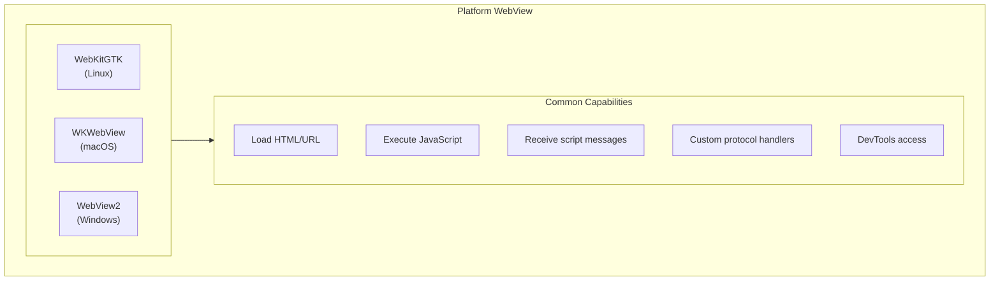
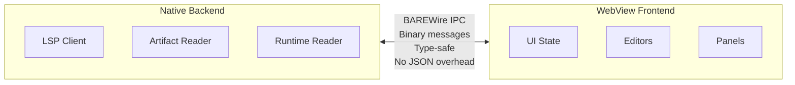
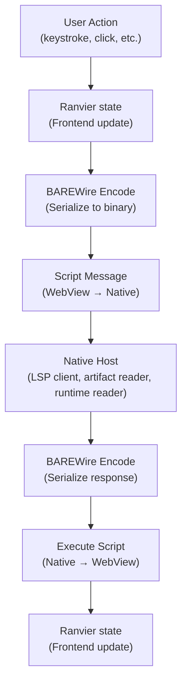
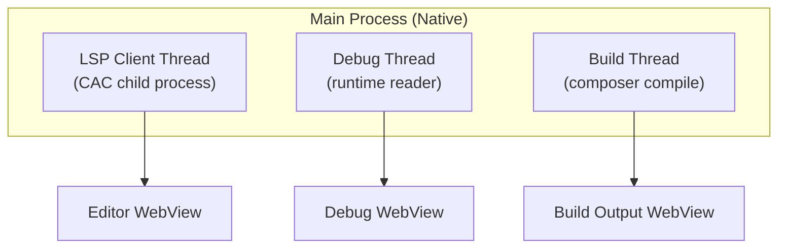

# 00 - WREN Architecture

**Frontend direction:** Ranvier's native WebCore backend gives WREN a native application path to the DOM without an application JavaScript compilation step. The Fickl/Ranvier JavaScript path serves browser deployments. The SolidJS and Fable examples in this chapter record the earlier WrenHello design. Clef's JSIR is a later browser target; a Clef-native frontend has its own view and WebCore interop work. See the [reactive frontend](06_reactive_frontend.md) and [visualization strategy](05_webgpu.md).

## The WREN Stack

**W**ebView + **R**eactive + **E**mbedded + **N**ative

WREN combines reactive views with native application services. The earlier path embeds a system WebView beside a Composer-compiled host. Ranvier's native WebCore backend offers another path: an F#/.NET NativeAOT application calls a packaged WebCore engine through a native ABI. A future Clef-native view implementation is a separate milestone.

### WRENStack in the Fidelity Ecosystem

WRENStack is a **SpeakEZ product** that uses Fidelity/Composer - it is not an extension of Fidelity itself. The architectural boundary is important:

```
Fidelity (UI-agnostic framework) ◄── uses (no coupling) ── WRENStack (product)
```

WRENStack is an interim solution for SpeakEZ's business needs while **FidelityUI** (a future native UI model) matures. Atelier uses WRENStack to bootstrap itself, demonstrating the pattern it supports.

## Why WREN?

### The Electron Problem

Electron applications bundle Chromium (~150MB) and Node.js (~30MB) into every application. A "Hello World" in Electron ships as a 180MB+ binary that consumes 300-500MB of RAM at runtime.

This is computationally irresponsible.

### The Native-Only Problem

Pure native toolkits (GTK, Qt, native F#/WinForms) offer efficiency but lack the rich, expressive UI capabilities that web technologies provide. Building a sophisticated code editor UI in pure GTK is possible but requires enormous effort.

### The WREN Solution

Every modern operating system ships with a WebView component:
- **Linux**: WebKitGTK (GTK4 integration)
- **macOS**: WKWebView (WebKit)
- **Windows**: WebView2 (Chromium-based, ships with Windows 11, downloadable for 10)

The conventional WebView path uses the platform's available engine. Ranvier Native packages its own WebCore build and, on Linux, uses WPE in its recorded tests. Package size, runtime memory and startup need to be measured for each deployment; a system-WebView estimate does not describe the packaged engine.

## Browser/WebView Architecture Layers

The following layers describe the earlier browser-hosted WREN arrangement. Ranvier Native uses the application-to-WebCore route in [the reactive frontend chapter](06_reactive_frontend.md#ranvier-native-and-the-browser-target).

### Layer 1: Platform WebView

The lowest layer will provide raw WebView access:



Each platform provides these capabilities through different APIs, but the semantics are remarkably similar.

### Layer 2: Composer-Compiled Native Backend

Atelier plans to abstract platform differences with a Clef discriminated union over opaque boundary handles. The host is compiled by **Composer** to native code - no .NET runtime dependency in the host. The compiler services it talks to (CCS, CAC) are not in this binary; see Layer 3.

Interior Clef has no raw pointer type: `nativeint`-as-pointer is not denotable, at the FFI boundary or anywhere else. A C binding that returns a pointer marshals it through `CHandle<'T>`, which is non-arithmetic and non-dereferenceable in Clef source and is only ever passed back across the boundary.

```fsharp
// Clef design sketch; handles come from the Farscape-generated bindings
type WebViewHandle =
    | WebKitGTK of CHandle<GtkWidget>       // Fidelity.WebKit (WebKit2GTK, Linux x86_64)
    | WKWebView of CHandle<WKWebView>       // macOS binding: not yet generated
    | WebView2 of CHandle<ICoreWebView2>    // Windows binding: not yet generated

type WebViewConfig = {
    Title: string
    Width: int
    Height: int
    DevTools: bool
    Transparent: bool
}

// Which binding `create` resolves to is settled in the saturated PSG from the
// target's platform description and platform predicates, not by an #if block
let create (config: WebViewConfig) : WebViewHandle = ...
```

**Key**: Platform WebView operations are Layer 2 binding libraries (Fidelity.WebKit, Fidelity.WebView, Fidelity.Gtk3; generated by Farscape from the C headers), not intrinsics of the **Clef Compiler Service**. Layer 1 intrinsics are the native type universe operations such as `Sys.write` and `Sys.exit`; external bindings carry semantic metadata CCS cannot know intrinsically (layouts, ownership, callback conventions). CCS resolves each call to its binding and its platform residence in the saturated PSG; the extern symbol is a `func.constant` on the declaration, and Composer's Alex witnesses the settled declaration. Alex decides nothing. Of these bindings only Fidelity.WebKit and Fidelity.WebView exist, for Linux x86_64.

### Layer 3: IPC Protocol (BAREWire)

Communication between the native backend and WebView frontend is intended to use BAREWire, a binary typed protocol:



Why not JSON?
- Parsing overhead on every message
- No type safety (runtime errors)
- Verbose encoding (strings for everything)

BAREWire aims to provide:
- Zero-copy deserialization where possible
- Compile-time type checking
- Minimal wire format

BAREWire already supplies shared encoding, decoding, schema and framing foundations across its .NET, JavaScript and native Clef paths. WrenHello's current integrated example uses a bounded script-message channel; connecting the chosen BAREWire protocol and transport to that application remains an integration step. The specific framing, lifecycle and transport must be established for each host. See [WREN bindings and integration](14_wren_webgpu_bindings.md).

A second boundary sits behind the host: CCS and CAC are .NET processes. The host can reach CAC as a child process over standard LSP. CCS's authoritative PSG uses its BAREWire-generated binary representation. The JSON nanopass and final-graph dumps are inspection projections of compiler facts. The graph representation and the transport, access policy and lifecycle used to deliver a scoped view are distinct contracts; the host integration must establish the latter.

### Layer 4: Reactive Frontend

Ranvier's native WebCore backend connects native application code to the DOM through its native ABI. The separate browser path uses Fickl and Ranvier. WrenHello's existing Partas.Solid/Fable implementation supplies an earlier baseline, and any retained Solid-based controls need an adapter. The following SolidJS example illustrates that earlier implementation:

```typescript
// SolidJS - components run ONCE, only signals update
const [fileContent, setFileContent] = createSignal("")
const [diagnostics, setDiagnostics] = createSignal<Diagnostic[]>([])

// This component body runs once
function Editor() {
  // Only the signal reads re-execute
  return (
    <CodeMirror
      value={fileContent()}
      extensions={[lspExtension(diagnostics())]}
    />
  )
}
```

This is fundamentally different from React's re-render model:
- **React**: Component functions re-execute on every state change
- **SolidJS**: Component functions run once; signal reads are tracked and update surgically

For an editor that anticipates thousands of updates per second (keystrokes, LSP responses, debug events), this efficiency becomes essential.

## Browser/WebView Data Flow



## Memory Model

Illustrative estimates for the earlier browser/WebView design follow. Measure actual packages and resident memory for both deployment paths.

| Component | Approximate Size |
|-----------|-----------------|
| Native binary | ~5MB |
| WebKitGTK shared libs | Depends on the Linux host and other applications |
| WebView process | ~30-50MB |
| Frontend application | To measure for each native or browser deployment |
| CodeMirror | ~3MB |
| **Total (host)** | **To measure for the selected host and frontend** |
| CAC and CCS (.NET, separate processes) | Not in the host total; present until CCS is Clef-compilable |
| Ranvier Native and packaged WebCore | Measure on each target, including engine resources and presenter |

Compare to:
- VSCode: 300-500MB
- Atom (RIP): 400-700MB
- Sublime Text: 80-100MB

## Thread Model

The multi-WebView architecture separates editing, debugging and build presentation into logical surfaces. The host and WebView engine determine their actual process and thread placement:



Schedule expensive work away from the editor's input path where the host supports it, and measure editor latency while the other surfaces are active. Separate WebViews alone do not establish process isolation or independent scheduling. The [multi-WebView design](04_multi_webview.md) describes the coordination and responsiveness tests.

For Ranvier Native, the backend design assigns the reactive graph and WebCore page to a host thread. The native ABI is thread-bound, and queued wrapper releases drain as the host loop cycles. Background computation, graph preparation and GPU work can proceed under their own contracts, then post accepted results to the host loop. Keep long operations off that loop and test input latency, cleanup and shutdown under load. [Ranvier native backend design](../../Ranvier.View/docs/superpowers/specs/2026-10-28-native-webcore-backend-design.md).

The recorded macOS implementation runs the WebCore loop and SDL event pump on the process main thread. Account for that constraint when arranging editor, build and debugging work. [Ranvier native application evidence](../../Ranvier.View/docs/superpowers/specs/2026-10-28-native-app-gaps.md).

## Fidelity Architecture Integration

One rule governs Atelier's relationship to the toolchain, the witness rule:

- The **Clef Compiler Service** builds and saturates the Program Semantic Graph. It is the sole semantic authority.
- Composer's **Alex** witnesses the saturated graph into MLIR (`func`, `scf`, `arith`, `memref`, `index`, no other dialect).
- **Lattice** (CAC and its lattice-vscode / lattice-vim clients) witnesses the same graph into the editor.
- **Atelier** witnesses the same graph into views.

Nothing downstream of CCS computes a semantic fact; the IDE reads. The Photographer Principle, the Zipper, active patterns, and Templates are Alex's vocabulary for how it reads the graph on its side of the witness boundary. They are not the PSG's structure and Atelier's backend does not follow them; an IDE that enriched, focused, and "snapped" would be building a second graph.

### PSG as the Foundation

The Program Semantic Graph (PSG) is the single source of truth for Atelier's tooling. CCS publishes a `Fidelity.PSG` revision in the BAREWire-generated binary graph representation. JSON nanopass dumps and the final JSON PSG are projections for inspection; they do not define the graph. Atelier's scoped access, subscription and delivery across a host boundary build on that graph contract. The graph's own vocabulary, as CCS carries it today:

| Feature | PSG facts read |
|---------|----------------|
| Code navigation | Structural edges (`SemanticNode.Children` / `Parent`); Reference edges with role `Definition`, `TypeDefinition`, `Symbol` (a def-use link is a Reference edge; there is no `DefUse` edge) |
| Debugging | Node annotations `Type`, `ArenaAffinity`, `LayoutHint`, `Metadata` (coeffects are annotations, not a node kind); the suspension frame and its delimiter edges once the suspension recipe lands |
| Visualization | The authoritative BAREWire PSG and its per-phase JSON inspection projections, including recipe ledgers; Provenance edges (`EnrichedWith`) group what one recipe firing minted |
| Obligations | Obligation nodes (`ObligationInfo`; `EdgeClass.Obligation`, role `Constrains`), the ledger `06a_obligations.json`, the SMT text `06b_obligations.smt2`, the cvc5 verdict per anchor, and Composer's build-time twin paired by anchor name |
| Diagnostics | `NodeId` and source range; CCS diagnostic codes, rendered through Lattice |

Hyperedges materialize only what enrichment mints (obligations, residence); structural and reference edges are projected from the one table on demand. A viewer renders that table, it does not rebuild it.

Atelier's graph delivery must establish the admitted scope, revision identity, access rights and lifecycle for each consumer. Cross-revision selection and incremental updates depend on the correspondence and delta contracts supplied by their owners; the viewer presents those results without inventing graph identity.

Atelier doesn't just *use* the PSG - it *shows* saturation phase by phase, making compiler internals observable.

## Navigation

- Previous: [README](../README.md)
- Next: [01_webview_abstraction.md](./01_webview_abstraction.md): Platform abstraction patterns from WRY
