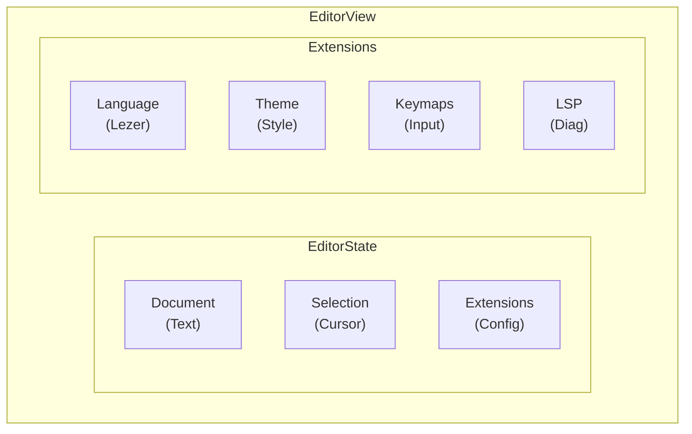
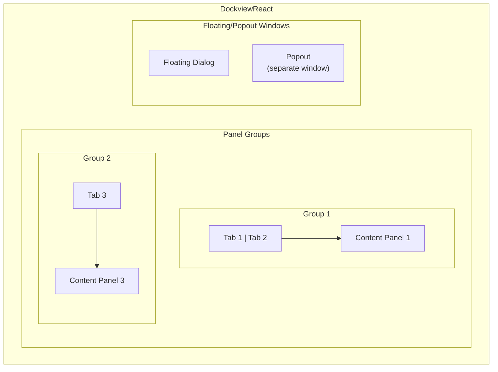

# 02 - Solid Components: CodeMirror and Dockview

## Overview

Atelier's frontend is planned to be built on two remarkable SolidJS libraries:

- **solid-codemirror**: CodeMirror 6 wrapper with reactive integration
- **solid-dockview**: VS Code-style docking panel system

Both integrate seamlessly with SolidJS's fine-grained reactivity model and would be exposed to the front end through Partas.Solid bindings. Today that front end is F# through Fable, a .NET SDK dependency, and interim; whether Composer's JSIR pathway takes on a Solid-style reactive surface so the front end can be Clef is an open decision (see 06).

## CodeMirror 6: The Editor Foundation

CodeMirror 6 is a complete rewrite of the CodeMirror editor, built with modern principles:

### Why CodeMirror 6?

| Feature | Monaco (VSCode) | CodeMirror 6 |
|---------|-----------------|--------------|
| Bundle size | ~2.5MB | ~150KB core |
| Multi-instance | Heavy (shared worker) | Lightweight |
| Extensibility | Plugin API | Composable extensions |
| Mobile support | Limited | First-class |
| Accessibility | Good | Excellent |
| Language support | ~50 via TextMate | 20+ via Lezer + TextMate |

For Atelier's planned multi-pane architecture with potentially many editor instances, CodeMirror 6's lightweight footprint would be essential.

### CodeMirror 6 Architecture



### solid-codemirror

[solid-codemirror](https://github.com/riccardoperra/solid-codemirror) wraps CodeMirror 6 with SolidJS reactivity:

```typescript
import { createCodeMirror, createEditorControlledValue } from 'solid-codemirror'
import { createSignal } from 'solid-js'

function Editor() {
  const [code, setCode] = createSignal("let x = 42")

  const { ref, editorView, createExtension } = createCodeMirror({
    value: code(),
    onValueChange: setCode
  })

  // Dynamic extension management via compartments
  const reconfigureTheme = createExtension(oneDark)

  // Later: reconfigureTheme(oneLight) to switch themes

  return <div ref={ref} />
}
```

**Key Features:**

1. **Compartments**: Dynamic extension reconfiguration without recreating the editor
2. **Controlled value**: Two-way binding between SolidJS signals and editor content
3. **Extension factory**: `createExtension` returns a reconfigure function

### Proposed Partas.Solid Bindings for solid-codemirror

The following illustrates how the bindings might look. The sketch is in the interim Fable form: F# through Fable, a .NET SDK dependency. If Composer's JSIR pathway takes on the reactive surface (an open decision), the same module becomes Clef declarations carrying the JavaScript interop attributes Composer's JavaScript design names (`[<JsImport>]`, `[<JsEmit>]`, `[<JsErase>]`), consumed by Alex's JSIR witnesses; hand-written bindings could then give way to generated ones from the library-ingestion workflow in 10_transcribe.md (its name is under review against Composer's own use of the term).

```fsharp
// Interim Fable bindings for solid-codemirror (F# through Fable)
module SolidCodeMirror

open Fable.Core
open Fable.Core.JsInterop

[<Import("createCodeMirror", "solid-codemirror")>]
let createCodeMirror: CodeMirrorOptions -> CodeMirrorResult = jsNative

[<Import("createEditorControlledValue", "solid-codemirror")>]
let createEditorControlledValue: EditorView -> (unit -> string) -> (string -> unit) -> unit = jsNative

type CodeMirrorOptions = {
    value: string option
    onValueChange: (string -> unit) option
    extensions: Extension[] option
}

type CodeMirrorResult = {
    ref: obj -> unit
    editorView: unit -> EditorView option
    createExtension: Extension -> (Extension -> unit)
}

// Higher-level F# API
module Editor =
    let create (initialValue: string) (onChange: string -> unit) =
        let options = {
            value = Some initialValue
            onValueChange = Some onChange
            extensions = Some [|
                clefLanguage        // TextMate stream language from clef-grammar; colouring only
                oneDarkTheme
                lineNumbers()
                bracketMatching()
            |]
        }
        createCodeMirror options

    let withLSP (result: CodeMirrorResult) (transport: LspTransport) =
        // The one LSP client, tunnelled over WREN IPC to CAC (see below).
        // Diagnostics, hover, completion and semantic tokens all arrive through it;
        // the editor has no second feed for any of them.
        let lspExt = createLspExtension transport
        result.createExtension lspExt
```

### CodeMirror 6 LSP Integration

CodeMirror 6 could support LSP via `@codemirror/lsp-client` or similar integration. The client speaks to CAC (ClefAutoComplete, the Lattice language server), and CAC is the only producer of editor-facing facts: diagnostics, hover, completion, semantic tokens, folding ranges, document and workspace symbols, selection ranges. The native host carries the frames and the WebView renders; neither computes a semantic fact.

```typescript
import { lspClient } from '@codemirror/lsp-client'

const lsp = lspClient({
  transport: {
    // Custom transport over WREN IPC (BAREWire frames as designed;
    // WrenHello's interim bridge carries an ASCII encoding today)
    send(message) {
      WREN.send('lsp_request', message)
    },
    onMessage(callback) {
      WREN.onMessage('lsp_response', callback)
    }
  },
  languageId: 'fsharp',   // what lattice-vscode registers today; 'clef' once the clients rename
  rootUri: 'file:///project'
})

// Add to editor extensions
createCodeMirror({
  extensions: [
    lsp,
    // Diagnostics rendered from publishDiagnostics
    // Completions integrated
    // Hover info shown
  ]
})
```

Honest baseline: every fact CAC serves today comes from FSharp.Compiler.Service typed-tree results, not from the PSG. The Lattice migration puts CAC on CCS; only then do the PSG-native facts Atelier's distinctive panels want (reachability, residence and layout offsets, escape class, proof obligations, nanopass provenance) have a source. Each is a CCS-owned contract item, not something Atelier derives.

### Clef Language Support in the Editor

CodeMirror uses [Lezer](https://lezer.codemirror.net/) for incremental parsing. Clef has no Lezer grammar, and none is the destination. The order 07 lays out is the one Atelier follows:

1. **TextMate first**: the `clef-grammar` TextMate grammar lattice-vscode already ships, loaded through `@codemirror/legacy-modes`; first paint only.
2. **CAC for truth**: `textDocument/semanticTokens` (full and range) for colouring; `foldingRange`, `documentSymbol` and `selectionRange` for folding, outline and expand-selection. All exist in CAC today (FCS-backed; PSG-backed after the Lattice migration).
3. **Lezer only for offline tree access**, and only if generated from or conformance-tested against CCS's grammar.

The hazard, named: a TextMate grammar and a Lezer grammar are each a second grammar of Clef beside CCS's lexer and parser, maintained by hand, and every construct they mis-tokenise is a visible divergence. That is tolerable only because they feed nothing but colouring, folding and bracket/comment configuration. Nothing in the editor derives a semantic fact from either.

## Dockview: Panel Management

[dockview](https://github.com/mathuo/dockview) provides VS Code-style docking with floating and popout windows.

### Dockview Architecture



### solid-dockview

[solid-dockview](https://www.npmjs.com/package/solid-dockview) is a SolidJS port of dockview:

```typescript
import { createDockview } from 'solid-dockview'

function IDE() {
  const { api, DockviewComponent } = createDockview({
    onReady: (event) => {
      // Add initial panels
      event.api.addPanel({
        id: 'editor-1',
        component: 'editor',
        params: { file: 'Program.clef' }
      })

      event.api.addPanel({
        id: 'terminal',
        component: 'terminal',
        position: { direction: 'below' }
      })
    },
    components: {
      editor: EditorPanel,
      terminal: TerminalPanel,
      psg: PSGVisualizerPanel
    }
  })

  return <DockviewComponent />
}
```

**Key Features:**

1. **Drag-and-drop**: Panels can be dragged between groups
2. **Floating windows**: Panels can float over the main layout
3. **Popout windows**: Panels can be detached to separate OS windows
4. **Layout serialization**: Save/restore layouts as JSON
5. **Resize handles**: Flexible panel sizing

### Proposed Partas.Solid Bindings for solid-dockview

```fsharp
// Interim Fable bindings for solid-dockview (F# through Fable, a .NET SDK dependency)
module SolidDockview

open Fable.Core
open Fable.Core.JsInterop

[<Import("createDockview", "solid-dockview")>]
let createDockview: DockviewOptions -> DockviewResult = jsNative

type DockviewOptions = {
    onReady: DockviewReadyEvent -> unit
    components: obj  // Record of component factories
}

type DockviewResult = {
    api: IDockviewApi
    DockviewComponent: obj  // SolidJS component
}

type IDockviewApi =
    abstract addPanel: AddPanelOptions -> IDockviewPanel
    abstract addGroup: AddGroupOptions option -> IDockviewGroup
    abstract removePanel: IDockviewPanel -> unit
    abstract toJSON: unit -> obj
    abstract fromJSON: obj -> unit
    abstract addFloatingGroup: IDockviewPanel -> FloatingGroupOptions -> unit
    abstract addPopoutGroup: IDockviewPanel -> PopoutGroupOptions -> unit

type AddPanelOptions = {
    id: string
    component: string
    title: string option
    position: PanelPosition option
    ``params``: obj option
}

type PanelPosition =
    | Left
    | Right
    | Above
    | Below
    | Within of string  // Group ID

// Higher-level F# API
module Dockview =
    let create (components: Map<string, obj -> JSX.Element>) (onReady: IDockviewApi -> unit) =
        let componentsObj = createObj (components |> Map.toList)
        createDockview {
            onReady = fun event -> onReady event.api
            components = componentsObj
        }

    let addEditorPanel (api: IDockviewApi) (file: string) =
        api.addPanel {
            id = sprintf "editor-%s" (hash file |> string)
            component = "editor"
            title = Some (Path.getFileName file)
            position = None
            ``params`` = Some (createObj ["file", file])
        }

    let addFloatingPanel (api: IDockviewApi) (panel: IDockviewPanel) =
        api.addFloatingGroup panel {
            x = 100
            y = 100
            width = 600
            height = 400
        }
```

### Layout Persistence

Dockview supports serializing layouts, which Atelier could leverage:

```fsharp
module Layout =
    let save (api: IDockviewApi) : string =
        api.toJSON() |> JSON.stringify

    let restore (api: IDockviewApi) (json: string) =
        let layout = JSON.parse json
        api.fromJSON layout

    let defaultLayout = """
    {
      "grid": {
        "orientation": "HORIZONTAL",
        "root": {
          "type": "branch",
          "data": [
            { "type": "leaf", "data": { "id": "editor-group" } },
            { "type": "leaf", "data": { "id": "sidebar-group" }, "size": 300 }
          ]
        }
      },
      "panels": {
        "editor-1": { "id": "editor-1", "component": "editor" },
        "psg": { "id": "psg", "component": "psg-viewer" }
      }
    }
    """
```

## Integrating CodeMirror with Dockview

The following examples illustrate how these components might be combined in Atelier.

### Editor Panel Component

```fsharp
// EditorPanel.fs
module EditorPanel

open Fable.Core
open SolidCodeMirror
open SolidDockview

let EditorPanel (props: {| file: string; api: IPanelApi |}) =
    let (content, setContent) = createSignal ""

    // Load file content (a host service; no semantic fact involved)
    onMount (fun () ->
        async {
            let! text = WREN.request "read_file" props.file
            setContent text
        } |> Async.StartImmediate
    )

    let { ref; editorView; createExtension } = Editor.create (content()) (fun newContent ->
        setContent newContent
        // Host-side dirty tracking only; the LSP client sends its own didChange
        WREN.send "file_changed" {| file = props.file; content = newContent |}
    )

    // One LSP client, tunnelled to CAC (lspTransport is the WREN IPC tunnel
    // defined with the LSP client above). Diagnostics for this buffer arrive
    // as publishDiagnostics through it; there is no parallel channel.
    let _ = Editor.withLSP { ref = ref; editorView = editorView; createExtension = createExtension } lspTransport

    div [ class' "editor-panel" ] [
        div [ ref ref; class' "editor-container" ] []
    ]
```

### Main IDE Component

```fsharp
// IDE.fs
module IDE

open SolidDockview
open EditorPanel
open TerminalPanel
open PSGViewer

let IDE () =
    let components = Map.ofList [
        "editor", EditorPanel
        "terminal", TerminalPanel
        "psg", PSGViewer
    ]

    let { DockviewComponent } = Dockview.create components (fun api ->
        // Restore saved layout or use default
        let savedLayout = localStorage.getItem "atelier-layout"
        if savedLayout <> null then
            Layout.restore api savedLayout
        else
            // Create default layout
            api.addPanel { id = "editor-1"; component = "editor"; title = Some "Welcome"; position = None; ``params`` = None }
            api.addPanel { id = "terminal"; component = "terminal"; title = Some "Terminal"; position = Some Below; ``params`` = None }
            api.addPanel { id = "psg"; component = "psg"; title = Some "PSG"; position = Some (Within "sidebar"); ``params`` = None }

        // Save layout on change
        api.onDidLayoutChange (fun () ->
            localStorage.setItem("atelier-layout", Layout.save api)
        )
    )

    div [ class' "ide-root" ] [
        DockviewComponent
    ]
```

## Styling with DaisyUI

While DaisyUI doesn't provide docking panels (that's Dockview's job), it provides excellent styling:

```css
/* Use DaisyUI themes */
@import "daisyui/dist/full.css";

/* Apply to dockview */
.dv-dockview {
  --dv-tab-active-background: hsl(var(--b2));
  --dv-tab-inactive-background: hsl(var(--b1));
  --dv-border-color: hsl(var(--b3));
}

.editor-panel {
  @apply bg-base-100;
}

/* CodeMirror theming via CSS variables */
.cm-editor {
  --cm-background: hsl(var(--b1));
  --cm-foreground: hsl(var(--bc));
}
```

## Summary

The combination of solid-codemirror and solid-dockview would provide:

1. **Professional editor**: CodeMirror 6 with CAC as its one source of semantic facts
2. **Flexible layout**: VS Code-style docking with floating/popout windows
3. **SolidJS integration**: Fine-grained reactivity, components run once
4. **Typed bindings**: Partas.Solid through Fable today (interim; a .NET SDK dependency), Clef declarations through Composer's JSIR pathway if that decision lands

This foundation aims to enable Atelier to rival VSCode's UX while maintaining the lean WREN Stack architecture.

## Navigation

- Previous: [01_webview_abstraction.md](./01_webview_abstraction.md): Platform WebView lessons from WRY
- Next: [03_unique_features.md](./03_unique_features.md): Delimited continuations debugging, PSG visualization
