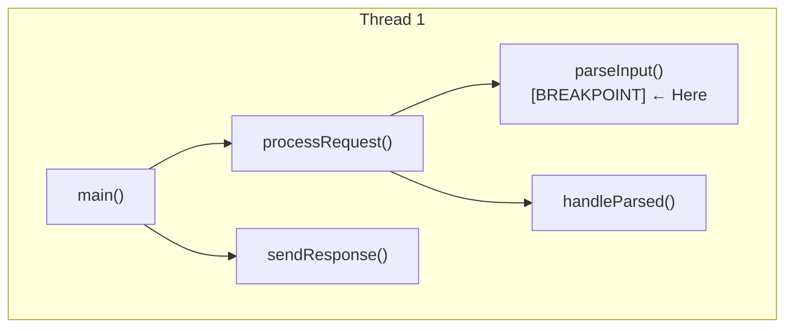
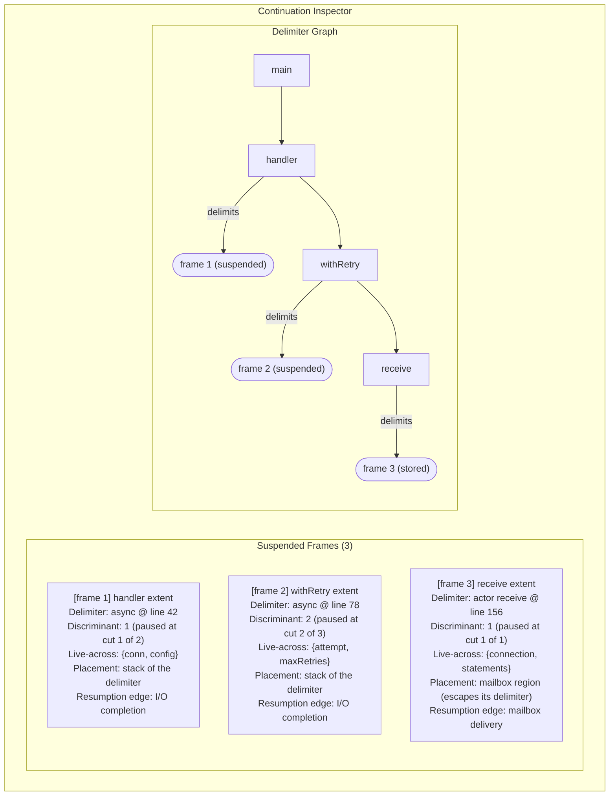
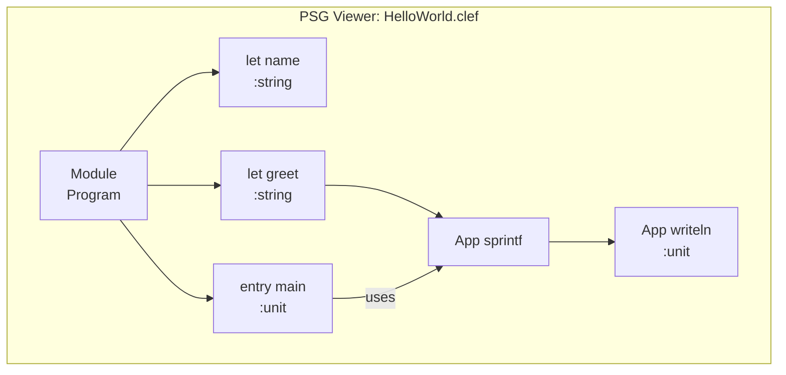
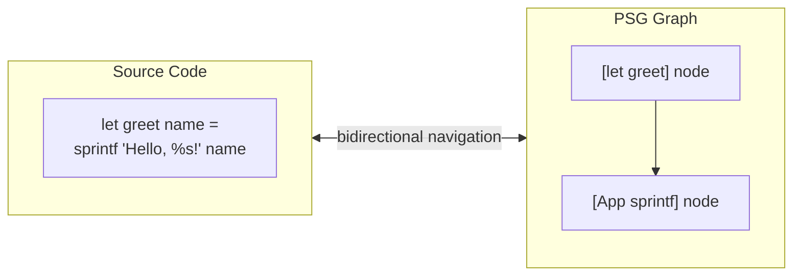
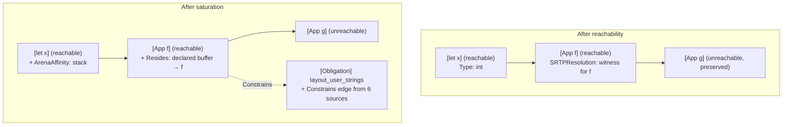
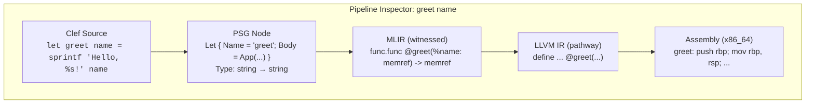
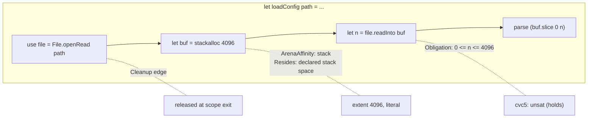
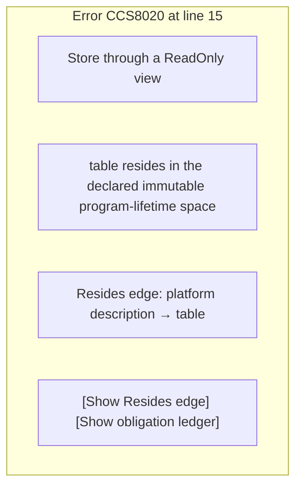

# 03 - Unique Features: Beyond VSCode and NeoVim

## The Opportunity

VSCode and NeoVim are general-purpose editors. They excel at breadth but cannot provide depth for specialized domains. Atelier, designed specifically for the Fidelity ecosystem, aspires to offer capabilities that general editors fundamentally cannot.

**Status.** Every feature below is a reader of facts the Program Semantic Graph (PSG) carries. CCS builds and saturates the graph; Composer's Alex witnesses it into MLIR; Lattice (ClefAutoComplete with the lattice-vscode and lattice-vim clients) witnesses it into the editor; Atelier witnesses it into views. Nothing downstream computes a semantic fact. Where a pane wants a fact the graph does not carry today, this document says so and names it as a CCS or Composer contract item (the host surface is tabulated in clef's `Lattice_Consumer_Contract.md` §3). Two facts gate all of it: CCS exports the graph only as JSON phase artifacts today (no stable, BAREWire-described export), and Lattice today reads the F# Compiler Service typed tree rather than the PSG. No pane here can witness the graph until the export and the ClefAutoComplete migration exist.

## Feature 1: Delimited Continuation Debugging

### The Problem with Traditional Debuggers

Traditional debuggers operate on a stack-based mental model:



This model breaks down with delimited continuations. In Clef every `let!` / `do!` inside an `async { }` extent, every actor `receive`, and every synchronous RPC reply wait is a cut: the rest of the computation from the cut to the builder's boundary is a frame, suspended until a delivery on the resumption edge (I/O completion, mailbox delivery, interrupt, DMA completion) resumes it. Between the cut and the delivery there is no call stack to show. The frame sits on the stack of its delimiter or, when it escapes (a mailbox holding suspended receives, a stored future), in a region whose lifetime covers it.

Two facts fix the model, and the inspector must not contradict them:

- A frame is resumed exactly once (VC-ONE). Multi-shot is never the silent default: a second resumption is a declared byte copy of the frame, and each copy carries its own VC-ONE.
- Handoff across threads or processes is a member of the resumption-edge class (Prospero's scheduling point), not a property of a first-class `k` the program stores. There is no `shift`, no `effect { }`, and no continuation value in Clef source; the cut is the `let!`.

```fsharp
// Clef: one async extent, two cuts. The I/O function names are illustrative.
let handler conn = async {
    let! input = readRequest conn        // cut 1: resumed by I/O completion
    let parsed = parse input
    let! reply = callService parsed      // cut 2: resumed by reply delivery
    return respond reply
}
```

### Atelier's Planned Continuation Inspector

Atelier aims to show the suspended frames of a running program by reading two things and inferring nothing: the frame node the suspension recipe mints in the PSG at saturation, and the live process's frame bytes at the offsets that node fixes.



Every field on a card is a read. Status is the discriminant at the frame's offset 0: `0` not started, `1..N` paused at that cut, done. Captures are the live-across slots for that cut, decoded at the literal offsets the graph fixes. Placement is the escape class fold-in already read. A declared multi-shot frame appears as two frames with a copy edge between them, because that is what the graph records: two frame values, two VC-ONE obligations. The inspector never shows an invocation count on one frame.

### Proposed Implementation Architecture

The compiled program carries no lifecycle events, headers, or tags; a frame is interpretable from the graph alone. So there is no debug event stream to subscribe to. There is a frame node to read, memory to read at its offsets, and segment entries to break on.

```fsharp
// Atelier reads; CCS carries. Names provisional.
module ContinuationInspector

// The frame node the suspension recipe mints at saturation (dcont-representation §6):
//   Delimiter        edge to the builder extent that owns the region
//   Cuts             (NodeId * int) list    // each suspension point and its discriminant value
//   LiveAcross       per cut, the enumerated slot set
//   InternalState    NodeId list            // let mutable across cuts
//   Segments         NodeId list            // per-cut resume code
//   ResumptionEdge   I/O | Mailbox | Interrupt | DMA
// and the layout the graph fixes for it: extent E, per-slot ByteOffset and ByteSize.

type FrameView = {
    Frame: NodeId                        // the frame node
    Discriminant: int                    // read at offset 0
    Slots: (string * SlotValue) list     // live-across slots for that cut
    Placement: Placement                 // stack of the delimiter, or the covering region
}

let view (graph: PSG) (mem: DebugMemory) (frame: NodeId) : FrameView =
    let f = graph.Frame frame                       // graph fact
    let bytes = mem.Read (f.Placement, f.Extent)    // E bytes, no more
    let d = Frame.discriminant bytes                // offset 0, literal
    { Frame = frame
      Discriminant = d
      Slots = [ for s in f.LiveAcross d -> s.Name, Slot.decode bytes s ]   // literal offsets
      Placement = f.Placement }

// Suspension and resumption are observed by breaking on a segment's entry (known from
// the graph's Segments), not by runtime events.
WREN.onMessage "debug_frame_selected" (fun frame ->
    view psg mem frame |> WREN.send "debug_frame_view")
```

What CCS must carry, and where it stands (`Lattice_Consumer_Contract.md` §3): the frame node above is specified (dcont-representation §6) and scheduled (the register's Phase 3: the seq two-shape recognizer retires into the suspension recipe in Baker), not built; the per-slot byte offsets are the layout hyperedge of `Layout_As_Joint_Constraint.md`, steps 1 to 5 pending. The debug adapter that reads the bytes is Atelier's; today it is a box in [04_multi_webview.md](./04_multi_webview.md) with no design. The inspector waits on all three.

### Why This Would Matter

No existing debugger provides this capability because:

1. **Traditional runtimes don't have delimited continuations**: .NET, JVM, V8 don't expose continuation primitives
2. **Stack-based mental models are embedded**: Debugger UIs assume call stacks
3. **General editors can't integrate deeply**: VSCode's DAP assumes traditional debugging

Atelier, designed for Fidelity, would:
- Show the frame as the graph defines it: delimiter, cuts, live-across slots, placement
- Visualize the delimiter graph instead of a call stack
- Show where a frame is paused (the discriminant) and what will resume it (the resumption edge)
- Decode captures at the graph's own offsets, with no runtime metadata

## Feature 2: PSG Visualization with D3

### The Program Semantic Graph and the Four Pillars

CCS's PSG (Program Semantic Graph) is a hypergraph and the sole semantic authority. CCS builds and saturates it; Alex witnesses it into MLIR; Lattice witnesses it into the editor; Atelier witnesses it into views. The pipeline as it stands in CCS today:

```
Clef source → NativeTypedTree (type check: native types and SRTP resolution attached on the node)
  → PSG construction (SemanticGraph/Core.fs, NodeBuilder.fs)
  → Reachability soft-delete (Reachability.fs)
  → Baker fan-out / fold-in (Nanopass/FanOut.fs, FoldIn.fs, BakerSaturation.fs)
  → obligation elaboration and discharge (ObligationElaboration.fs, ObligationDischarge.fs → cvc5)
  → Alex witness → MLIR (func, scf, arith, memref, index) → pathway → native
```

The PSG embodies the **Four Pillars** architecture:

| Pillar | PSG Manifestation |
|--------|-------------------|
| **Coeffects** (mise-en-place) | `ArenaAffinity` on every node; `Resides` and `Constrains` hyperedges; the `Cleanup` edge role; obligation nodes minted by Baker at saturation; escape class (Composer interim, scheduled to CCS under the Closure Retooling Plan) |
| **Active Patterns** | Semantic classification of node kinds, not string matching |
| **Zipper** | The cursor that navigates the graph; the viewer tracks its position |
| **Templates** | Parameterized MLIR patterns shown in the pipeline inspector |

What the graph carries at each checkpoint (CCS writes a JSON artifact per checkpoint, `ccs_phase_{N}_{suffix}.json`, and a diff between checkpoints, `ccs_diff_{N}_to_{M}.json`):
- **Construction**: nodes from the typed tree, `Type` and `SRTPResolution` attached at type check (not overlaid later); structural and reference edges
- **Reachability**: soft-delete (`IsReachable = false`; structure preserved)
- **Saturation**: Baker fan-out and fold-in; hyperedges minted (obligations, residence); `ArenaAffinity`, `LayoutHint`, and `Metadata` (`Obligation.Anchors`, `Buffer.*`, `Elaboration.Kind/For/Id`) on nodes
- **Discharge**: obligations elaborated to SMT-LIB2 and discharged with cvc5; the ledger is derived from the graph

Roadmap the viewer should be designed against: the per-node saturation lattice `Fresh < Elaborated < Saturated` replaces `IsReachable: bool` (`PSG_to_PHG_Plan.md`, Phase 1; not built).

### Envisioned PSG Viewer



*Filters: Values, Calls | Checkpoint: after saturation*

*Selected: `let greet` | Type: string | Range: HelloWorld.clef:3:5-3:42 | ArenaAffinity: stack*

### D3-Based Rendering

[D3.js](https://d3js.org/) provides the visualization engine. The viewer schema would be generated from CCS's `SemanticGraph/Types.fs` (or from the phase artifact), never hand-maintained, so hyperedge arity, obligation nodes, and residence are first-class in the pane. What feeds it today is the JSON phase artifacts; a stable, BAREWire-described graph export is a CCS contract item.

```typescript
// Generated from Types.fs; shown here for shape.
interface PSGNode {
  id: string
  kind: string                          // SemanticKind
  label: string                         // rendered from kind and name
  range: SourceRange
  type: string                          // NativeType, rendered
  srtpResolution?: string               // WitnessResolution, when present
  arenaAffinity: string
  layoutHint?: string
  metadata: Record<string, string>      // Obligation.Anchors, Buffer.*, Elaboration.Kind/For/Id
  isReachable: boolean
  emissionStrategy: string
}

interface Hyperedge {
  sources: string[]                     // S_f, enumerated at elaboration; |S_f| >= 1
  target: string
  class: 'Structural' | 'Reference' | 'Provenance' | 'Obligation'
  role: string                          // EdgeRole: Callee, Argument, ..., Definition, Resides, Constrains
  ordinal: number
}

function renderPSG(container: HTMLElement, nodes: PSGNode[], edges: Hyperedge[]) {
  const svg = d3.select(container).append('svg')

  // A hyperedge with |sources| > 1 is drawn through a hub so its arity is visible:
  // an arity-6 layout obligation renders as six sources into one hub into one target.
  const hubs = edges.filter(e => e.sources.length > 1)
    .map((e, i) => ({ id: `hub-${i}`, kind: 'hub', edge: e }))
  const links = edges.flatMap((e, i) =>
    e.sources.length === 1
      ? [{ source: e.sources[0], target: e.target, edge: e }]
      : [...e.sources.map(s => ({ source: s, target: `hub-${i}`, edge: e })),
         { source: `hub-${i}`, target: e.target, edge: e }])

  // Force-directed layout
  const simulation = d3.forceSimulation([...nodes, ...hubs])
    .force('link', d3.forceLink(links).id(d => d.id))
    .force('charge', d3.forceManyBody().strength(-300))
    .force('center', d3.forceCenter(width / 2, height / 2))

  // Render edges, classed by EdgeClass and EdgeRole
  const link = svg.selectAll('.edge')
    .data(links)
    .join('line')
    .attr('class', d => `edge edge-${d.edge.class} role-${d.edge.role}`)

  // Render nodes
  const node = svg.selectAll('.node')
    .data(nodes)
    .join('g')
    .attr('class', d => `node node-${d.kind} ${d.isReachable ? '' : 'unreachable'}`)
    .call(d3.drag())

  node.append('rect')
    .attr('width', 80)
    .attr('height', 40)

  node.append('text')
    .text(d => d.label)

  // Click to select
  node.on('click', (event, d) => {
    WREN.send('psg_node_selected', d.id)
  })
}
```

### Bidirectional Navigation

The PSG Viewer would enable bidirectional navigation:



Clicking a node would highlight the corresponding source. Clicking source would highlight the corresponding node. Both directions are reads over `SemanticNode.Range`; the position-to-node lookup is a range search, not inference.

```fsharp
// Source → PSG navigation: a range lookup over the exported nodes
WREN.onMessage "source_cursor_moved" (fun pos ->
    let node = findNodeAtPosition psg pos
    highlightNode node.Id
)

// PSG → Source navigation
WREN.onMessage "psg_node_selected" (fun nodeId ->
    let node = psg.GetNode nodeId
    jumpToSource node.Range
)
```

### Phase Comparison: The Photographer Principle in Action

The PSG accrues annotation through saturation. The viewer would load two checkpoint artifacts (or one `ccs_diff`) and show the delta, visualizing the **Photographer Principle**:

> "Nanopasses build the scene, the Zipper moves attention, Active Patterns focus the lens, Transfer snaps the picture."



**Critical insight**: reachability uses **soft-delete** (marks `IsReachable = false`) rather than physically removing nodes. Structure is preserved for saturation and the witness to navigate; under the planned lattice the mark becomes the `Latent` state and reactivation is cheap.

Switching checkpoints shows how the mise-en-place accumulates:
- **Construction**: structure, types, SRTP resolution (scene framing)
- **Reachability**: soft-delete marks (setting up the shot)
- **Saturation**: hyperedges minted, affinity and layout placed (focusing the lens)
- **Discharge**: obligations proved; the witness reads (the picture)

## Feature 3: Compilation Pipeline Inspector

### Seeing the Full Picture

Atelier envisions displaying the entire compilation pipeline for a selection:



The witnessed form is the five portable dialects only (func, scf, arith, memref, index); LLVM IR and assembly are pathway artifacts below the witness boundary, and the inspector labels them as such.

What the lane needs from the compiler: node identity carried on every emitted MLIR op and preserved through the pathway (a location attribute keyed by NodeId), so a selection maps to its ops, its LLVM, and its assembly. Alex reifies obligation anchors today (`{clef.obligations = [...]}`) and nothing else; MLIR, LLVM IR, and assembly exist as build files without node correlation. This is a Composer/Alex contract item (`Lattice_Consumer_Contract.md` §3, "provenance"), not something the inspector reconstructs by matching names.

This would allow developers to:
- Understand how Clef maps to native code
- Debug code generation issues
- Learn compiler internals
- Verify optimization decisions

## Feature 4: Coeffect Awareness

### Visualizing Coeffects

Fidelity uses **coeffects** (context requirements placed on the graph before code generation) rather than an effect system. Coeffects are "mise-en-place": the compiler knows what a value needs before any code exists. Clef has no effect types, no `IO<_>` or `[Pure]`, and no effect inference; nothing of that kind is in the spec, and Atelier would not display a fact the graph does not carry. What the graph carries at saturation:

| Carrier | Where | Meaning |
|---|---|---|
| `ArenaAffinity` | every node | the arena, and so the lifetime class, of the value's storage |
| `Resides` hyperedge | declared space or buffer → value | the value resides in a declared platform space (the Program-Lifetime Spaces of the platform description) |
| `Constrains` hyperedge, obligation node | constrained structure → obligation | a proof obligation minted by Baker: statement, logic, source refs, discharge result |
| `Cleanup` edge role | `TryFinally` handler (`use` desugars to one) | resource release at scope exit |
| Frame discriminant | suspension frame node | which cut a continuation is paused at |
| Escape class | closure, frame, DU value | stack, region, program-lifetime, or dynamic placement (Composer interim, scheduled to CCS under the Closure Retooling Plan) |

```fsharp
// Clef: what the editor would annotate inline. Library names illustrative.
let loadConfig (path: string) =
    use file = File.openRead path        // Cleanup edge: released at scope exit
    let buf = stackalloc<byte> 4096      // ArenaAffinity: stack; Resides: declared stack space, extent 4096
    let n = file.readInto buf            // obligation: 0 <= n <= 4096 (QF_LIA), discharged at saturation
    parse (buf.slice 0 n)                // the result's ArenaAffinity: the caller's arena
```

Atelier would display the annotations inline:



### Diagnostics

Diagnostics are authored by CCS (`SemanticGraph/Diagnostics.fs`) and rendered by Atelier; the IDE adds presentation, never a verdict. The facts a diagnostic draws on are graph facts: an obligation whose discharge fails (the ledger records the statement and its source refs), a lifetime error (a value that classifies as dynamic on a target with no allocator), a store through a `ReadOnly` view of a declared immutable space (CCS8020). A diagnostic could appear as:



## Summary

Atelier's unique features would arise from reading the PSG, the sole semantic authority, and from the **Four Pillars** architecture:

| Feature | Enabled By | Four Pillars Connection |
|---------|-----------|------------------------|
| Continuation debugging | the suspension recipe's frame node in the PSG (discriminant, live-across slots, delimiter edge) and a debug adapter that reads process memory at the graph's offsets | the frame is the closure environment node in its second instance |
| PSG visualization | CCS's phase and diff artifacts today; a stable BAREWire-described graph export (a CCS contract item) | Zipper traversal is observable |
| Pipeline inspection | node provenance on every witnessed op, preserved through the pathway (a Composer contract item; only obligation anchors are reified today) | Templates show MLIR patterns |
| Coeffect awareness | `ArenaAffinity`, `Resides`, `Constrains`, `Cleanup`, obligation nodes; diagnostics authored by CCS | Mise-en-place visible in graph |

These capabilities would be difficult or impossible in general-purpose editors because they require the compiler's own graph, which only purpose-built tooling reads. Each one is a pane over a fact the graph carries or is scheduled to carry (`Lattice_Consumer_Contract.md` §3); none computes a fact of its own.

### The Self-Hosting Advantage

Atelier's native host is compiled by Composer, so improvements to the native backend and to the graph export reach the IDE directly: when a new saturation rule lands in CCS, the viewer can show it; when the graph carries a new coeffect, the panes render it. That loop is a claim about the native host and the PSG export, not about the UI. The front end is F# through Fable today, a .NET dependency, and interim; whether the front end can be Clef is not decided here.

## Navigation

- Previous: [02_solid_components.md](./02_solid_components.md): CodeMirror and Dockview bindings
- Next: [04_multi_webview.md](./04_multi_webview.md): Multi-WebView architecture
