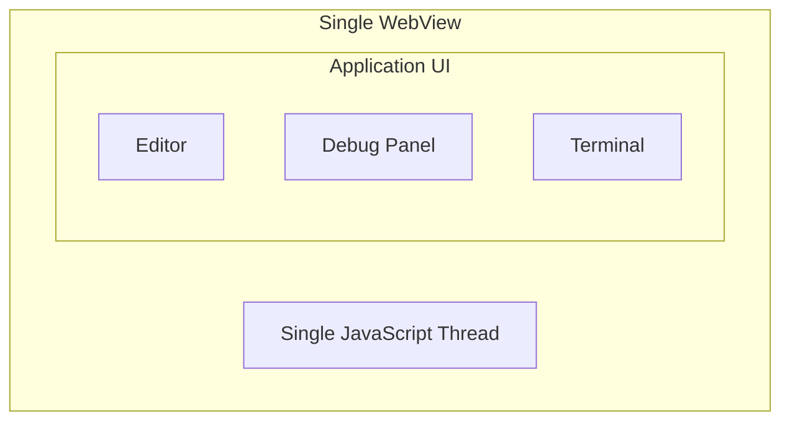
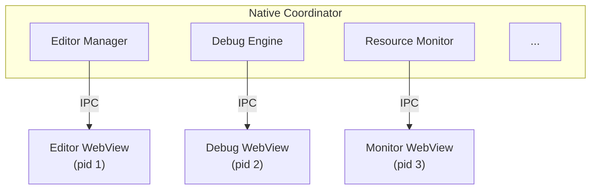
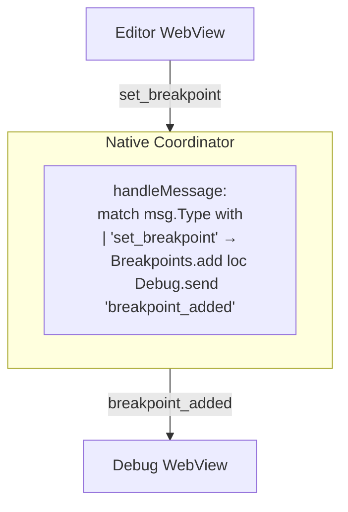

# 04 - Multi-WebView Architecture

## The Single-WebView Problem

Traditional Electron apps and simple WebView wrappers use a single WebView for the entire application:



**Problems:**

1. **Single JavaScript thread**: Heavy operations block the entire UI
2. **Shared memory space**: Memory leaks in one component affect everything
3. **No isolation**: A crash in the debugger crashes the editor
4. **Limited parallelism**: Web Workers help but have communication overhead

## The Multi-WebView Solution

Atelier is designed to use multiple WebView instances, each running in its own process:



**Benefits:**

1. **Process isolation**: Each WebView runs in its own OS process
2. **True parallelism**: Multiple JavaScript engines run simultaneously
3. **Crash isolation**: A WebView crash doesn't take down others
4. **Memory isolation**: Each WebView has its own heap
5. **Security**: Compromised WebView can't access others' memory

## Proposed WebView Roles

### Primary WebView: Editor

The main editor WebView would handle:
- Code editing (CodeMirror)
- Panel docking (Dockview)
- File tree
- Search UI
- Most user interactions

```fsharp
type EditorWebView = {
    Handle: WebViewHandle
    Dockview: IDockviewApi
    OpenEditors: Map<string, EditorInstance>
    ActiveFile: string option
}

let createEditorWebView () =
    let webview = WebView.create {
        Title = "Atelier"
        Width = 1200
        Height = 800
        DevTools = true
        Transparent = false
    }

    webview.LoadUrl "atelier://app/editor.html"
    webview.AddMessageHandler "editor" handleEditorMessage

    { Handle = webview; Dockview = None; OpenEditors = Map.empty; ActiveFile = None }
```

### Debug WebView

A separate WebView for debugging:

```fsharp
type DebugWebView = {
    Handle: WebViewHandle
    ActiveSession: DebugSession option
    Breakpoints: Set<SourceLocation>
    Frames: Map<FrameId, FrameInfo>   // suspension frames, rendered from a CCS-owned projection
}

let createDebugWebView () =
    let webview = WebView.create {
        Title = "Atelier - Debugger"
        Width = 800
        Height = 600
        DevTools = true
        Transparent = false
    }

    webview.LoadUrl "atelier://app/debugger.html"
    webview.AddMessageHandler "debug" handleDebugMessage

    { Handle = webview; ActiveSession = None; Breakpoints = Set.empty; Frames = Map.empty }
```

**Why separate?**

- Debugging involves heavy computation (stepping, evaluating expressions)
- Real-time updates (variable watches, call stacks)
- Potential for runaway debug targets
- Should never freeze the editor

**What it renders, and who owns it.** The frames the panel shows are the suspension recipe's frames as the PSG carries them (segments at cuts, a frame environment node, a delimiter edge per cut) and as Composer witnesses them (a discriminant and a byte frame). Symbol residence and layout offsets for a session, and source ranges for breakpoints, are graph facts of the same kind. All of these are CCS-owned contract items: none is exported today, the recipe itself is scheduled work, and no debug adapter exists. The panel is a view over that projection when it lands; it computes nothing of its own.

### PSG Visualization WebView

D3-based graph rendering in its own WebView:

```fsharp
type PSGWebView = {
    Handle: WebViewHandle
    Graph: PsgProjection option         // CCS-serialised projection of the graph; read-only here
    CurrentPhase: int
    SelectedNode: NodeId option
    Layout: Map<NodeId, Position>       // viewer state; never written back to the graph
}

let createPSGWebView () =
    let webview = WebView.create {
        Title = "Atelier - PSG Viewer"
        Width = 1000
        Height = 700
        DevTools = true
        Transparent = false
    }

    webview.LoadUrl "atelier://app/psg-viewer.html"
    webview.AddMessageHandler "psg" handlePSGMessage

    { Handle = webview; Graph = None; CurrentPhase = 0; SelectedNode = None; Layout = Map.empty }
```

**Why separate?**

- D3 force simulations are CPU-intensive
- Large PSGs can have thousands of nodes
- Layout computation shouldn't block editing
- Can be updated in background after saturation

The projection's schema (nodes, hyperedges, per-phase provenance, reachability) is a CCS-owned contract item; no export exists today. The layout map is keyed by node identity, which does not survive re-elaboration today (knowledge-layer/04_temporal_ledger.md); whether CCS should carry a stable identity is an open decision.

### Terminal WebView

xterm.js in its own WebView:

```fsharp
type TerminalWebView = {
    Handle: WebViewHandle
    PTY: int  // master PTY file descriptor
    Pid: int        // Shell process
}

let createTerminalWebView () =
    let webview = WebView.create {
        Title = "Atelier - Terminal"
        Width = 800
        Height = 400
        DevTools = false
        Transparent = false
    }

    // Create PTY
    let (masterFd, childPid) = PTY.fork "/bin/bash" 24 80

    webview.LoadUrl "atelier://app/terminal.html"
    webview.AddMessageHandler "terminal" (handleTerminalMessage masterFd)

    // Start reading from PTY
    startPTYReader masterFd webview

    { Handle = webview; PTY = masterFd; Pid = childPid }
```

**Why separate?**

- Terminal I/O is continuous and high-volume
- WebGL rendering (xterm.js) benefits from dedicated resources
- Shell processes may produce output at any rate
- Terminal crash shouldn't affect editor

## WebView Coordination

### Central Coordinator

The native backend would coordinate all WebViews. It holds one connection to one compiler-service instance: CAC, the ClefAutoComplete server, over the PSG that CCS builds and saturates. There is no second compiler in the process. Every editor-facing fact is witnessed by CAC once, and a compile is a request to that same service.

```fsharp
type AtelierApp = {
    Editor: EditorWebView
    Debug: DebugWebView option
    PSG: PSGWebView option
    Terminals: TerminalWebView list
    Lattice: LatticeClient   // the one CCS instance, reached through CAC
}

module Coordinator =
    let mutable app: AtelierApp option = None

    let start () =
        let editor = createEditorWebView ()

        app <- Some {
            Editor = editor
            Debug = None
            PSG = None
            Terminals = []
            Lattice = LatticeClient.connect ()
        }

    let openDebugger () =
        match app with
        | Some a when a.Debug.IsNone ->
            let debug = createDebugWebView ()
            app <- Some { a with Debug = Some debug }
        | _ -> ()

    let openPSGViewer () =
        match app with
        | Some a when a.PSG.IsNone ->
            let psg = createPSGWebView ()
            app <- Some { a with PSG = Some psg }
        | _ -> ()

    let openTerminal () =
        match app with
        | Some a ->
            let terminal = createTerminalWebView ()
            app <- Some { a with Terminals = terminal :: a.Terminals }
        | None -> ()
```

Today CAC is a .NET process built on FSharp.Compiler.Service; the coordinator would reach it as a child process speaking LSP until the Lattice migration puts it on CCS. The in-process form is the daemon 11_native_reflection.md sketches: one process, a PSG actor owning the graph, an LSP actor serving CAC's surface, Atelier's panes reading the same graph. `LatticeClient` stands for that connection in either form.

### Cross-WebView Communication

WebViews would communicate through the native coordinator:



```fsharp
// Message routing
let handleEditorMessage (msg: Message) =
    match msg.Type with
    | "set_breakpoint" ->
        let loc = msg.Payload |> deserialize<SourceLocation>
        Breakpoints.add loc
        // Forward to debug WebView if open
        match app.Debug with
        | Some debug -> debug.Send "breakpoint_added" loc
        | None -> ()

    | "lsp_request" ->
        // The editor's LSP client, tunnelled to CAC. Responses and notifications
        // (publishDiagnostics among them) return on "lsp_response".
        app.Lattice.Forward msg.Payload (fun reply -> app.Editor.Send "lsp_response" reply)

    | "open_psg_viewer" ->
        openPSGViewer ()
        // Ask the same service for its current projection
        async {
            let! graph = app.Lattice.RequestGraph ()
            app.PSG.Value.Send "load_psg" graph
        } |> Async.Start

    | "compile" ->
        // A request to the one service, not a second compiler. Saturation
        // republishes diagnostics through the LSP tunnel on its own; the
        // coordinator relays only the graph projection.
        let file = msg.Payload |> deserialize<string>
        async {
            let! graph = app.Lattice.RequestSaturation file
            match app.PSG with
            | Some viewer -> viewer.Send "load_psg" graph
            | None -> ()
        } |> Async.Start

    | _ -> ()
```

`RequestGraph` and `RequestSaturation` stand for a CCS-owned contract item: a command that triggers saturation on the service CAC witnesses and returns the graph projection. Nothing of the kind exists today; Composer offers `composer compile` as a CLI and PSG dumps as CLI artefacts, with no library or daemon API.

### Event Broadcasting

Some events would need to reach all WebViews:

```fsharp
let broadcast eventType payload =
    app.Editor.Send eventType payload
    app.Debug |> Option.iter (fun d -> d.Send eventType payload)
    app.PSG |> Option.iter (fun p -> p.Send eventType payload)
    app.Terminals |> List.iter (fun t -> t.Send eventType payload)

// Example: Theme change affects all WebViews
let changeTheme theme =
    broadcast "theme_changed" theme
```

## WebView Lifecycle

### Lazy Creation

WebViews would be created on demand:

```fsharp
// User clicks "Debug" button
handleEditorMessage { Type = "start_debug"; Payload = file }
    |> function
    | "start_debug" ->
        // Create debug WebView if not exists
        if app.Debug.IsNone then
            openDebugger ()

        // Start debug session
        let session = Debug.createSession file
        app.Debug.Value.Send "session_started" session
```

### Graceful Shutdown

```fsharp
let shutdown () =
    // Close all terminals (kill shells)
    app.Terminals |> List.iter (fun t ->
        PTY.kill t.Pid
        t.Handle.Close()
    )

    // Close optional WebViews
    app.Debug |> Option.iter (fun d -> d.Handle.Close())
    app.PSG |> Option.iter (fun p -> p.Handle.Close())

    // Close editor last
    app.Editor.Handle.Close()
```

### Crash Recovery

```fsharp
let monitorWebView (webview: WebViewHandle) onCrash =
    webview.OnProcessTerminated (fun exitCode ->
        if exitCode <> 0 then
            onCrash webview exitCode
    )

// Example: Recover from debug WebView crash
monitorWebView debugWebView.Handle (fun _ _ ->
    // Log the crash
    Logger.warn "Debug WebView crashed, recreating..."

    // Recreate the WebView
    let newDebug = createDebugWebView ()
    app <- Some { app.Value with Debug = Some newDebug }

    // Restore state if possible
    newDebug.Send "restore_breakpoints" app.Value.Editor.Breakpoints
)
```

## Performance Considerations

### IPC Overhead

Multiple WebViews mean more IPC. The design would minimize overhead:

```fsharp
// BAD: Sending every keystroke
editor.OnKeyPress (fun key ->
    coordinator.Send "key_pressed" key  // Too chatty!
)

// GOOD: Batch updates
let mutable pendingChanges = []
let flushInterval = 16  // ~60fps

editor.OnChange (fun change ->
    pendingChanges <- change :: pendingChanges
)

setInterval flushInterval (fun () ->
    if not (List.isEmpty pendingChanges) then
        coordinator.Send "changes" (List.rev pendingChanges)
        pendingChanges <- []
)
```

### Selective Updates

Don't send data to WebViews that don't need it:

```fsharp
let saturationComplete (graph: PsgProjection) =
    // Editor: nothing to send. Its diagnostics came through the LSP tunnel
    // as publishDiagnostics, from the same saturation.

    // Only if open: PSG viewer
    match app.PSG with
    | Some viewer when viewer.IsVisible ->
        viewer.Send "load_psg" graph
    | _ -> ()

    // Only if debugging: tell the debugger the graph moved; it re-requests
    // the frame and residence projection it renders from the same service
    match app.Debug with
    | Some debug when debug.ActiveSession.IsSome ->
        debug.Send "graph_updated" graph.Version
    | _ -> ()
```

## Window Management

### Floating WebViews

WebViews could be floating windows:

```fsharp
let createFloatingWebView title content =
    let webview = WebView.create {
        Title = title
        Width = 400
        Height = 300
        DevTools = false
        Transparent = false
        Decorations = true  // Window chrome
        AlwaysOnTop = false
    }

    webview.LoadHtml content
    webview
```

### Multi-Monitor Support

Dockview's popout feature combined with separate WebViews would enable true multi-monitor:

```mermaid
flowchart LR
    subgraph mon1["Monitor 1"]
        subgraph editorwv["Editor WebView"]
            code["Code"]
            term["Terminal"]
        end
    end

    subgraph mon2["Monitor 2"]
        subgraph psgwv["PSG WebView"]
            graph["PSG Graph"]
        end
    end

    subgraph mon3["Monitor 3"]
        subgraph debugwv["Debug WebView"]
            cont["Suspension frames"]
            vars["Variables"]
            stack["Call Stack"]
        end
    end
```

## Summary

The multi-WebView architecture would provide:

| Benefit | Mechanism |
|---------|-----------|
| UI responsiveness | Heavy operations in separate processes |
| Stability | Crash isolation between components |
| Parallelism | Multiple JavaScript engines |
| Memory efficiency | Separate heaps, independent GC |
| Flexibility | On-demand WebView creation |
| Multi-monitor | True separate windows |

The Native Coordinator would manage lifecycle, routing, and state synchronization, enabling the benefits of multiple processes without the complexity leaking into the frontend code. It holds one connection to one compiler service; every WebView is a view over the graph that service owns.

## Navigation

- Previous: [03_unique_features.md](./03_unique_features.md): Delimited continuations, PSG visualization
- Next: [05_webgpu.md](./05_webgpu.md): WebGPU compute integration
