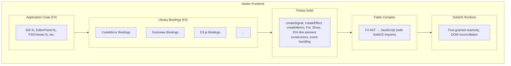

# 06 - Partas.Solid: F# to SolidJS Compilation

## Role in the Stack

Partas.Solid provides F# bindings for SolidJS, compiled through Fable. This is the **WebView frontend** layer of WRENStack applications as it stands today. Stated plainly: the front end is F# through Fable, which makes FSharp.Compiler.Service and the .NET SDK a build dependency of the toolchain's commercial home. That is interim. Composer's design of record names a second path to JavaScript, the JSIR pathway (Clef → CCS → PSG → Alex → JSIR ops → `jsir_gen --passes=hir2ast,ast2source`), and calls the WebView desktop wing a natural fit for it. Whether that pathway takes on a Solid-style reactive surface, so the front end can be Clef and the .NET dependency drops out, is an open decision. Until it is taken, this document describes the Fable form and marks where the JSIR form would differ.

### Critical Architectural Boundary

```
┌─────────────────────────────────────────────────────────────────┐
│  WRENStack Frontend (WebView)                                    │
│  ├── Partas.Solid (F# → SolidJS)                                │
│  ├── Fable (F# → JavaScript)                                    │
│  └── WRENStack.Tooling (source maps, signal inspector)          │
│       ↑ Pure UI concerns - web technology                        │
├─────────────────────────────────────────────────────────────────┤
│       BAREWire IPC boundary (binary serialization)               │
├─────────────────────────────────────────────────────────────────┤
│  WRENStack Backend (Native)                                      │
│  ├── Composer (Clef → MLIR → Native)                            │
│  ├── Fidelity Framework (CCS, PSG, coeffects)                   │
│  └── Platform bindings (GTK, WebKit, filesystem)                │
│       ↓ Core compiler/runtime concerns - native code             │
└─────────────────────────────────────────────────────────────────┘
```

**These are separate compilation pipelines today:**
- **Frontend (interim)**: F# → Fable → JavaScript (SolidJS in WebView); the .NET SDK dependency lives here
- **Frontend (candidate)**: Clef → CCS → PSG → Alex → JSIR → JavaScript, pending the reactive-surface decision
- **Backend**: Clef → Composer → MLIR → LLVM → Native binary

The runtime boundary holds under either front-end path: JavaScript in the WebView, native code in the host. What changes with the JSIR path is that one compiler and one PSG produce both sides. Shared *type definitions* flow through both pipelines either way, and BAREWire handles serialization at the IPC boundary.

## What is Partas.Solid?

[Partas.Solid](https://github.com/Partas/Partas.Solid) is a Fable binding library that enables writing SolidJS applications in F#. It compiles F# to JavaScript that uses SolidJS's reactive primitives.

```fsharp
// F# code using Partas.Solid
open Partas.Solid

let Counter () =
    let count, setCount = createSignal 0

    div [] [
        p [] [ text $"Count: {count()}" ]
        button [ onClick (fun _ -> setCount (count() + 1)) ] [
            text "Increment"
        ]
    ]
```

Compiles to:

```javascript
// Generated JavaScript (simplified)
import { createSignal } from 'solid-js'

function Counter() {
    const [count, setCount] = createSignal(0)

    return (
        <div>
            <p>Count: {count()}</p>
            <button onClick={() => setCount(count() + 1)}>
                Increment
            </button>
        </div>
    )
}
```

## Shared Types Across Compilation Targets

### Type Flow Example

The same type definitions compile to both targets. The vocabulary that crosses the bridge is a protocol module both pipelines compile, exactly as WrenHello does with `src/Shared/Protocol.fs`. For PSG-derived facts (diagnostics, nodes, edges, symbols, frames) that module is owned by CCS or Lattice and derived from the PSG's own discriminated union definitions; Atelier imports it and declares no PSG-shaped types of its own. A host that defines what a node "is" is one step from filling the fields itself.

```fsharp
// Protocol module (CCS/Lattice-owned; compiled by both the native backend and the WebView frontend)
// Illustrative shapes: the schema is derived from the PSG DUs, not authored here
type Diagnostic = {
    Range: SourceRange
    Severity: DiagnosticSeverity
    Message: string
    Code: string option
}

type PSGNode = {
    Id: NodeId              // identity as CCS assigns it
    Kind: NodeKind          // the PSG's own DU, not a string
    Label: string
    Type: string option     // a rendered form, produced by CCS
    Range: SourceRange
    IsReachable: bool       // a saturation result, never computed host-side
}

// Backend (native via Composer): relays what the service produced
let sendGraph (webview: WebViewHandle) (graph: PsgProjection) =
    WREN.send webview "load_psg" graph

// Frontend (F# via Fable + Partas.Solid, interim): renders
let DiagnosticsList () =
    let diagnostics, setDiagnostics = createSignal<Diagnostic[]> [||]

    onMount (fun () ->
        // Diagnostics reach the editor through the LSP client (publishDiagnostics);
        // a list panel subscribes to the same notification, not to a second feed
        Lsp.onPublishDiagnostics setDiagnostics
    )

    ul [] [
        For (diagnostics()) (fun diag ->
            li [ class' (severityClass diag.Severity) ] [
                text $"{diag.Range}: {diag.Message}"
            ]
        )
    ]
```

The `Diagnostic` type is defined once, in the protocol module. Composer compiles it to a native struct. Fable compiles it to a JavaScript object today; the JSIR path would compile the same declaration for the WebView side. BAREWire handles serialization at the boundary. No such projection schema exists yet; it is the first CCS/Lattice deliverable Atelier depends on. Node identity across edits is not stable today, and which of these facts CCS should carry is an open decision.

### SolidJS Reactive Primitives

Partas.Solid exposes SolidJS's fine-grained reactivity:

```fsharp
// Signals - reactive state
let count, setCount = createSignal 0

// Effects - side effects that track dependencies
createEffect (fun () ->
    printfn $"Count changed to: {count()}"
)

// Memos - computed values
let doubled = createMemo (fun () -> count() * 2)

// Resources - async data fetching
let userData = createResource userId (fun id ->
    async { return! fetchUser id }
)
```

### Component Model

```fsharp
// Components are just functions
let Button (props: {| onClick: unit -> unit; children: Node |}) =
    button [
        class' "btn btn-primary"
        onClick (fun _ -> props.onClick())
    ] [
        props.children
    ]

// Usage
Button {| onClick = (fun () -> save()); children = text "Save" |}
```

### Control Flow Components

SolidJS's control flow components are available:

```fsharp
// Conditional rendering
Show (isLoading()) (fun () ->
    Spinner ()
)

// List rendering with keyed updates
For (items()) (fun item ->
    ItemRow {| item = item |}
)

// Pattern matching
Switch [
    Match (status() = Loading) (fun () -> Spinner ())
    Match (status() = Error) (fun () -> ErrorMessage ())
    Match (status() = Ready) (fun () -> Content ())
]
```

## Binding External Libraries

Partas.Solid provides the foundation, but Atelier envisions bindings for:
- solid-codemirror
- solid-dockview
- xterm.js
- D3.js

### Binding Pattern

The following illustrates how library bindings might be structured:

```fsharp
// Interim Fable binding for solid-codemirror (F# through Fable); a Clef declaration carrying [<JsImport>] under the JSIR path, if that decision lands
module SolidCodeMirror

open Fable.Core
open Fable.Core.JsInterop
open Partas.Solid

[<Import("createCodeMirror", "solid-codemirror")>]
let private createCodeMirrorJS: obj -> obj = jsNative

type CodeMirrorOptions = {
    value: string option
    onValueChange: (string -> unit) option
}

type CodeMirrorResult = {
    ref: obj -> unit
    editorView: unit -> EditorView option
    createExtension: Extension -> (Extension -> unit)
}

let createCodeMirror (options: CodeMirrorOptions) : CodeMirrorResult =
    let jsOptions = createObj [
        if options.value.IsSome then "value" ==> options.value.Value
        if options.onValueChange.IsSome then "onValueChange" ==> options.onValueChange.Value
    ]
    let result = createCodeMirrorJS jsOptions
    {
        ref = result?ref
        editorView = fun () -> result?editorView() |> Option.ofObj
        createExtension = fun ext -> result?createExtension(ext)
    }
```

### Higher-Level F# API

```fsharp
// Idiomatic F# wrapper
module Editor

let create (initialValue: string) (onChange: string -> unit) =
    let result = createCodeMirror {
        value = Some initialValue
        onValueChange = Some onChange
    }

    // Return a component
    fun () ->
        div [ ref result.ref; class' "editor-container" ] []
```

## The Envisioned Atelier Frontend Stack



Partas.Solid maps F# constructs to SolidJS primitives. The layers above it (library bindings, application code) are written in F# and compiled through this stack in the interim form. The Fable node is the .NET dependency, and it is the node Composer's JSIR pathway would replace if the reactive-surface decision lands.

## Anticipated Build Pipeline

Interim, as WrenHello scripts it today (no Composer build orchestration exists yet):

```bash
# Frontend build (interim: F# through Fable; requires the .NET SDK)
cd frontend

# Fable compiles F# to JavaScript
dotnet fable src/App.fsproj --outDir dist/js

# Vite bundles and optimizes (with WRENStack.Tooling plugin)
npx vite build

# Output: dist/app.js (SolidJS application)
```

The F# source files are transformed by Fable into JavaScript that imports from `solid-js`. The Partas.Solid library provides the types and functions that map to SolidJS's API.

If the JSIR decision lands, the build collapses to one compiler: Composer compiles the Clef sources from one PSG twice, the LLVM pathway for the host and the JSIR pathway (`jsir_gen --passes=hir2ast,ast2source`) for the WebView bundle, with the bundler and the weld into the binary's read-only data unchanged. The .NET SDK is then not a prerequisite. That form is design, not build.

# Frontend build
cd frontend

# Fable compiles F# to JavaScript
dotnet fable src/App.fsproj --outDir dist/js

# Vite bundles and optimizes (with WRENStack.Tooling plugin)
npx vite build

# Output: dist/app.js (SolidJS application)
```

The F# source files are transformed by Fable into JavaScript that imports from `solid-js`. The Partas.Solid library provides the types and functions that map to SolidJS's API. This pipeline represents our intended approach.

## WRENStack.Tooling Integration

The [WRENStack.Tooling](https://github.com/speakeztechnologies/WRENStack.Tooling) package enhances the Partas.Solid development experience without modifying the library itself. It is bound to the Fable pipeline; under the candidate JSIR path a counterpart (source maps from PSG ranges) would be needed:

### Source Maps

Debug F# source, not generated JavaScript:

```fsharp
// In browser devtools, breakpoints hit F# lines
let Counter () =
    let count, setCount = createSignal 0  // ← Set breakpoint here
    // ...
```

WRENStack.Tooling generates Source Map v3 files that map JavaScript locations back to F# source positions.

### Signal Inspector

Browser devtools integration for SolidJS signals:

```
WRENStack Signals
─────────────────
🔵 count: 5
   Source: Counter.fs:12
   Dependents: doubled, CounterView

🔵 diagnostics: [{...}]
   Source: DiagnosticsList.fs:8
   Dependents: ListView
```

The Signal Inspector hooks into `createSignal`, `createMemo`, etc., to expose signal state and dependency graphs.

### Hot Module Replacement (HMR) State Preservation

When code changes during development, signal state is preserved:

```javascript
// Before HMR: count = 5
// After HMR: count = 5 (preserved!)
```

This prevents losing application state during iterative development.

### Design Principles

WRENStack.Tooling follows these principles:

1. **Enhancement, not modification** - Works with unmodified Partas.Solid
2. **Standalone value** - Each tool works independently
3. **No Fidelity coupling** - Works with any backend (not just Composer)
4. **Dev-mode only overhead** - Zero production impact

## Why Not Other Options?

### Why not Feliz (React)?

React's re-render model is less efficient than SolidJS's fine-grained reactivity. For an editor receiving thousands of updates per second, this matters.

### Why not Bolero (Blazor)?

Blazor requires WebAssembly or server-side rendering. We want native JavaScript in the WebView for maximum compatibility and minimal overhead.

### Why not plain Fable + manual bindings?

You could write raw Fable bindings to SolidJS, but Partas.Solid provides:
- Idiomatic F# API
- Type-safe element constructors
- Proper handling of SolidJS's reactive primitives
- Community maintenance and updates

### Why Fable today, and JSIR as the candidate destination

Composer compiles Clef to native code through the LLVM pathway and, by its design of record, to JavaScript through the JSIR pathway. The WebView runs JavaScript; the host runs native code. That runtime boundary is real under either front-end path. The compilation boundary is not fixed: today the front end is F# through Fable because Partas.Solid's reactive surface exists there, and whether the JSIR pathway carries a reactive surface of its own is undecided.

| Concern | Frontend | Backend (Composer) |
|---------|----------|-------------------|
| Target | JavaScript in WebView | Native binary |
| Compilation | Fable (interim); Composer's JSIR pathway (candidate) | CCS → PSG → Alex → MLIR → LLVM |
| Memory model | JavaScript GC | Compiler-managed (stack/arena) |
| Type fidelity | .NET types erased to JS (Fable); Clef's types, target-profile-resolved (JSIR) | Native type fidelity |

WRENStack bridges these with BAREWire IPC. Shared type *definitions* ensure the bridge is type-safe, but the execution environments remain separate.

**Future**: FidelityUI may eventually provide a native UI model, eliminating the WebView layer entirely. WRENStack is the interim solution.

## Navigation

- Previous: [05_webgpu.md](./05_webgpu.md): WebGPU compute integration
- Next: [07_lezer_parsing.md](./07_lezer_parsing.md): Lezer, CodeMirror's incremental parsing foundation

## Summary

Partas.Solid + WRENStack.Tooling offers:

| Capability | Mechanism |
|------------|-----------|
| F# frontend code | SolidJS bindings via Fable (interim; a .NET SDK dependency) |
| Type-safe UI | F# type system preserved through compilation |
| Shared types | One protocol module, CCS/Lattice-owned for PSG facts, compiled to native (Composer) and JS (Fable today) |
| Fine-grained reactivity | SolidJS primitive bindings |
| Library integration | Foundation for solid-codemirror, solid-dockview bindings |
| **F# debugging** | Source maps via WRENStack.Tooling |
| **Signal visibility** | Signal Inspector browser extension |
| **HMR state preservation** | Enhanced Vite plugin |

## References

- [Partas.Solid GitHub](https://github.com/Partas/Partas.Solid)
- [WRENStack.Tooling](https://github.com/speakeztechnologies/WRENStack.Tooling)
- [Fable](https://fable.io/): F# to JavaScript compiler
- [SolidJS](https://www.solidjs.com/): Reactive UI library
