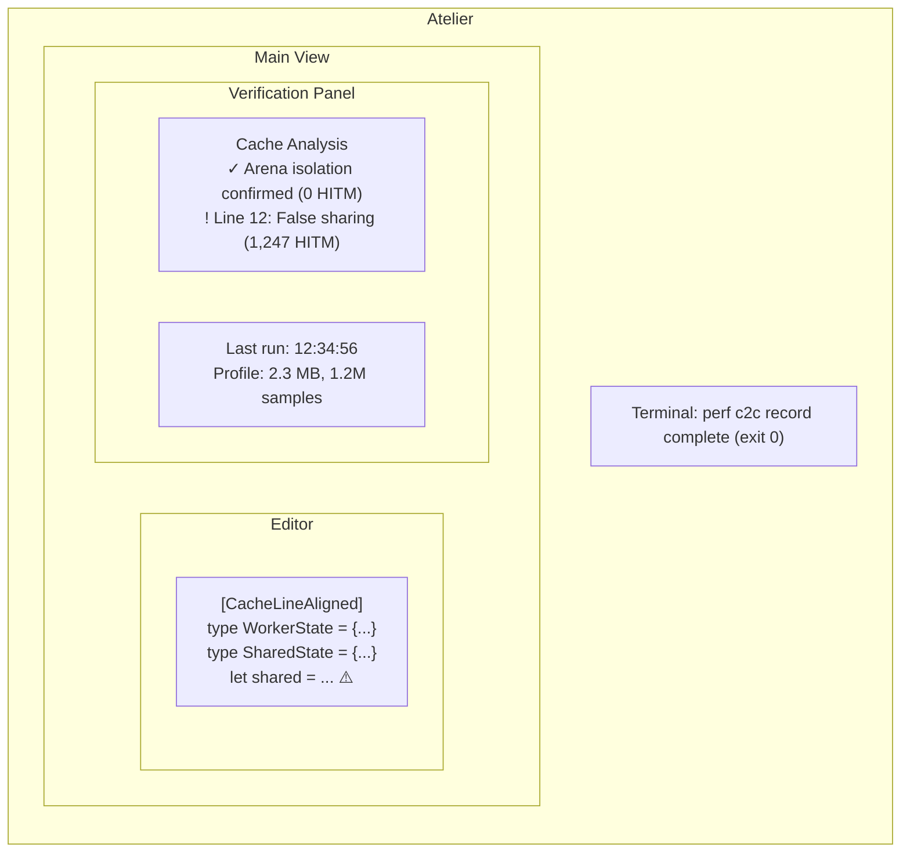
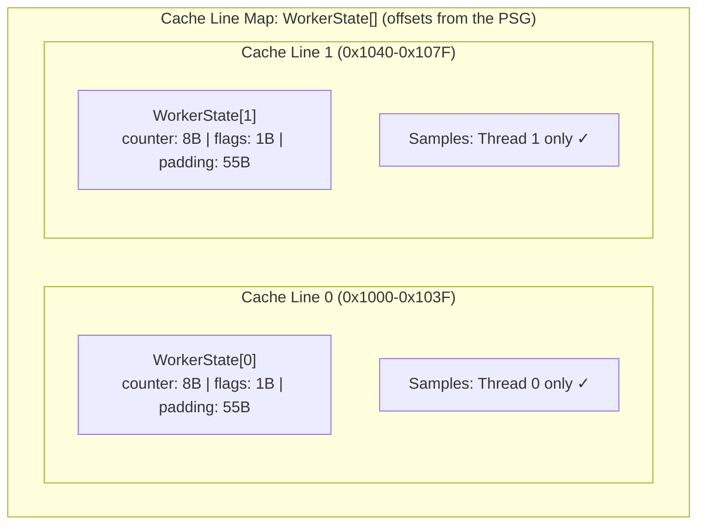

# 08 - Performance Tooling Integration

Atelier aspires to integrate with low-level performance tools to check Fidelity's compile-time layout claims against hardware. This is a collection-layer design: the host runs the collector and displays; the compile-time layout, residence, and cache-line facts are read from the saturated PSG; the verdict that pairs a measurement with a layout fact belongs to the toolchain's build-time side, not to the IDE and not to the language server. This document describes both Atelier's intended native integration and the general patterns for other editors.

## The Verification Challenge

Fidelity makes compile-time claims about cache behavior, memory layout, and concurrency correctness. Under the settled position these claims are facts of the saturated PSG, with BAREWire's platform description cross-applied to the values it governs:

- Memory layout as literal offsets, settled at saturation (the layout hyperedge; `LayoutHint` on the node)
- Residence in a declared memory space (`Resides` edges), which is what arena isolation means in the graph
- Cache-line alignment, once the cache-line size is a fact of the target's ABI profile and `[<CacheLineAligned>]` is specified

Of these, natural alignment is built in BAREWire; cache-line size, `[<CacheLineAligned>]`, and false-sharing analysis are design (BAREWire 09), and the layout hyperedge is Phase 2 of the PSG to PHG plan. A hardware measurement is not a design-time fact, so collecting samples with `perf`, VTune, or hardware performance counters is legitimately host work. Deciding what the samples mean against the layout is not: that correlation reads the same layout facts the compiler settled, and it is a toolchain step (a CCS/Composer contract item, not built) whose result the editors display.

## Integration Architecture

```mermaid
flowchart TB
    subgraph layers["Tooling Integration Layers"]
        subgraph presentation["Presentation Layer (Editor-Specific)"]
            atelier["Atelier<br/>(Native)"]
            nvim["nvim<br/>(lattice-vim)"]
            vscode["VSCode<br/>(lattice-vscode)"]
            more["..."]
        end

        subgraph protocol["Protocol Layer (Editor-Agnostic)"]
            lsp["LSP extension<br/>(proposed; named in Lattice's design first)"]
            json["Verification result format (sketch)"]
            sarif["SARIF for CI/CD"]
        end

        subgraph analysis["Correlation Layer (Toolchain)"]
            psgfacts["PSG layout and residence facts<br/>(05_psg2.json)"]
            corr["Sample-to-layout correlation<br/>(CCS/Composer contract item; not built)"]
        end

        subgraph collection["Collection Layer (Platform-Specific, host-run)"]
            perf["Linux/perf"]
            vtune["Intel/VTune"]
            instr["macOS/Instruments"]
        end
    end

    presentation --> protocol --> analysis --> collection
```



CAC appears in none of the analysis boxes on purpose. The language server witnesses the graph into the editor; it does not run a profiler or judge samples. What it can carry, once Lattice's design names the method, is the result of a toolchain run.

## Atelier Native Integration

Atelier's multi-WebView architecture is designed to enable the richest integration:

### Verification Panel WebView

A dedicated WebView is envisioned for verification results:



### Data Flow

The host owns two things: running the collector and rendering. The layout facts come from the PSG; the correlation verdict comes from the toolchain.

```fsharp
// Native host (design sketch)
module VerificationEngine =
    /// Run perf collection: host work, a runtime measurement
    let collect (binary: string) (workload: string option) : Async<ProfileData> =
        async {
            let args =
                match workload with
                | Some w -> $"c2c record -o perf.data -- {binary} {w}"
                | None -> $"c2c record -o perf.data -- {binary}"
            let! result = Process.run "perf" args
            return ProfileData.load "perf.data"
        }

    /// Read the compile-time facts the verdict was made against: layout
    /// offsets, residence, cache-line size, straight from the saturated PSG.
    /// No DWARF, no second layout source.
    let layoutFacts (psg2: string) : LayoutFacts =
        PsgArtifact.load psg2 |> PsgArtifact.layoutFacts

    /// The correlation itself is not the host's. The toolchain pairs samples
    /// with layout facts by address and by node; the host loads the result.
    let load (resultPath: string) : VerificationResult =
        VerificationResult.load resultPath

// WebView receives results via BAREWire IPC
module VerificationPanel =
    let onResults (results: VerificationResult) =
        // Update SolidJS signals
        setDiagnostics results.Diagnostics
        setSummary results.Summary
```

The address-to-node map the correlation needs (`NodeId` to MLIR location to address) is not documented as a contract today; the only recorded PSG-to-MLIR carrier is the `{clef.obligations = [...]}` attribute on string globals. It is a CCS/Composer contract item, listed here so that Atelier does not synthesise it from debug info.

### Inline Diagnostics

Verification results are intended to appear as inline diagnostics in the editor:

```fsharp
// Partas.Solid component for inline diagnostic
let InlineDiagnostic (props: {| diagnostic: Diagnostic |}) =
    let severity = props.diagnostic.Severity
    let icon =
        match severity with
        | Info -> "✓"
        | Warning -> "⚠️"
        | Error -> "❌"

    span [
        class' $"inline-diagnostic {severity.ToString().ToLower()}"
        title props.diagnostic.Message
    ] [
        text icon
    ]
```

### Cache Line Visualization

For complex layouts, Atelier aims to visualize cache line boundaries. The map is rendered from the PSG's layout facts: field offsets and padding from the layout hyperedge (`LayoutHint`), the cache-line size from the target's ABI profile as the graph records it, residence from `Resides` edges. Hardware samples are overlaid by address. Nothing in the map is derived from DWARF; debug info locates a sample, it never supplies a layout.



The 64-byte line and the `[<CacheLineAligned>]` attribute the example assumes are design in BAREWire (09 Cache-Aware Layouts); the map shows what the graph will carry, not what it carries today.

## nvim Integration

nvim integration uses the LSP protocol and Lua plugins, through the lattice-vim client:

### LSP Extension Support

A verification request is a proposed LSP extension. It does not exist: CAC's only non-standard requests today are the inherited `fsharp/*` set, and lattice-vim has none. The method is to be named in Lattice's design first; the `clef/verificationResults` name below is a placeholder for the sketch. Its scope is fixed regardless of name: it surfaces a result the toolchain produced. CAC neither runs `perf` nor analyses samples.

```lua
-- lattice-vim/lua/lattice/verification.lua (design sketch)

local M = {}

-- Fetch the latest toolchain verification result for this binary
function M.fetch_verification()
  local client = vim.lsp.get_active_clients({ name = "cac" })[1]
  if client then
    -- proposed extension; CAC exposes no such method today
    client.request("clef/verificationResults", {
      binary = vim.fn.expand("%:p:r"),  -- Binary path from source file
    }, function(err, result)
      if err then
        vim.notify("Verification result unavailable: " .. err.message, vim.log.levels.ERROR)
      else
        M.display_results(result)
      end
    end)
  end
end

-- Display results as diagnostics
function M.display_results(results)
  local diagnostics = {}
  for _, diag in ipairs(results.diagnostics) do
    table.insert(diagnostics, {
      lnum = diag.location.line - 1,
      col = diag.location.column - 1,
      message = diag.message,
      severity = M.map_severity(diag.severity),
      source = "fidelity",
    })
  end
  vim.diagnostic.set(M.namespace, 0, diagnostics)
end

function M.map_severity(sev)
  if sev == "error" then return vim.diagnostic.severity.ERROR
  elseif sev == "warning" then return vim.diagnostic.severity.WARN
  else return vim.diagnostic.severity.INFO end
end

M.namespace = vim.api.nvim_create_namespace("fidelity")

return M
```

### Keybindings

```lua
-- lattice-vim/lua/lattice/init.lua
vim.keymap.set("n", "<leader>fv", require("lattice.verification").fetch_verification,
  { desc = "Show Fidelity verification results" })
vim.keymap.set("n", "<leader>fc", require("lattice.verification").clear,
  { desc = "Clear verification diagnostics" })
```

### Terminal Fallback

For users without LSP support or preferring a terminal workflow, collection is a plain `perf` invocation; the correlation step that turns `perf.data` into a result is the toolchain's and is not built, so there is no verifier command to name here:

```lua
-- Direct terminal integration: collection only
function M.run_collection_terminal()
  local binary = vim.fn.expand("%:p:r")
  vim.cmd("terminal perf c2c record -o perf.data -- " .. binary)
  -- correlation against the PSG's layout facts: toolchain step, not built
end
```

## VSCode Integration

VSCode uses its extension API:

### Extension Structure

```
lattice-vscode/
├── src/
│   ├── extension.ts
│   ├── verification.ts
│   ├── diagnostics.ts
│   └── views/
│       └── cacheLineView.ts
├── package.json
└── tsconfig.json
```

### LSP Client Extension

The same proposed extension as above: a placeholder name until Lattice's design fixes it, fetching a toolchain result, never running one.

```typescript
// src/verification.ts (design sketch)
import * as vscode from 'vscode';
import { LanguageClient } from 'vscode-languageclient/node';

export async function fetchVerification(client: LanguageClient) {
  const editor = vscode.window.activeTextEditor;
  if (!editor) return;

  // proposed extension; CAC exposes no such method today (only the inherited fsharp/* set)
  const result = await client.sendRequest('clef/verificationResults', {
    binary: editor.document.uri.fsPath.replace(/\.[^.]+$/, ''),
  });

  displayDiagnostics(result.diagnostics);
}

function displayDiagnostics(diagnostics: FidelityDiagnostic[]) {
  const collection = vscode.languages.createDiagnosticCollection('fidelity');

  const byFile = new Map<string, vscode.Diagnostic[]>();
  for (const diag of diagnostics) {
    const uri = vscode.Uri.file(diag.location.file);
    const range = new vscode.Range(
      diag.location.line - 1, diag.location.column - 1,
      diag.location.line - 1, 100
    );
    const vsdiag = new vscode.Diagnostic(range, diag.message, mapSeverity(diag.severity));
    vsdiag.source = 'fidelity';

    const existing = byFile.get(uri.toString()) || [];
    existing.push(vsdiag);
    byFile.set(uri.toString(), existing);
  }

  for (const [uri, diags] of byFile) {
    collection.set(vscode.Uri.parse(uri), diags);
  }
}
```

### Custom WebView Panel

For cache line visualization:

```typescript
// src/views/cacheLineView.ts
export class CacheLineViewProvider implements vscode.WebviewViewProvider {
  resolveWebviewView(webviewView: vscode.WebviewView) {
    webviewView.webview.options = { enableScripts: true };
    webviewView.webview.html = this.getHtml();

    // Receive verification results
    this.onResultsReceived = (results) => {
      webviewView.webview.postMessage({
        type: 'updateResults',
        results,
      });
    };
  }

  private getHtml(): string {
    return `
      <!DOCTYPE html>
      <html>
        <head>
          <style>
            .cache-line { border: 1px solid #ccc; margin: 4px; padding: 8px; }
            .contention { border-color: #f00; background: #fee; }
            .isolated { border-color: #0f0; background: #efe; }
          </style>
        </head>
        <body>
          <div id="cache-map"></div>
          <script>
            window.addEventListener('message', event => {
              if (event.data.type === 'updateResults') {
                renderCacheMap(event.data.results);
              }
            });
          </script>
        </body>
      </html>
    `;
  }
}
```

## Common Protocol

All editors consume the same verification result format. It is produced by the toolchain's correlation step, not by an editor, and the shape below is a sketch, not a published contract:

```typescript
interface VerificationResult {
  version: "1.0";
  session: {
    binary: string;
    profile_data: string;
    timestamp: string;
  };
  diagnostics: Diagnostic[];
  summary: Summary;
}

interface Diagnostic {
  kind: "false_sharing_detected" | "false_sharing_confirmed" |
        "cache_line_crossing" | "arena_isolation_confirmed";
  severity: "info" | "warning" | "error";
  location: {
    file: string;
    line: number;
    column: number;
  };
  message: string;
  details: Record<string, unknown>;
}

interface Summary {
  total_hitm_events: number;
  confirmed_isolations: number;
  detected_issues: number;
}
```

## Workflow Patterns

Two of the steps below are built today: the Composer build and the `perf` collection. Composer has no debug-info flag (`composer compile` accepts `-o`, `-t`, `-k`, `-v`, `-T`, `--emit-mlir`, `--emit-llvm`, `--warnaserror`, `--no-color`), `composer verify` is a stub, and no verifier CLI exists in the corpus; the correlation step is a CCS/Composer contract item and is written below as a placeholder, not a command.

### Pattern 1: Development Cycle Validation

During development, run verification after significant changes:

```
1. Write code with [<CacheLineAligned>] or arena isolation
2. Build, keeping intermediates: composer compile <project>.fidproj -k
3. Run with profiling: perf c2c record -o perf.data ./program
4. Correlate perf.data against the PSG's layout facts (toolchain step; not built)
5. Review results in editor
6. Iterate if issues found
```

### Pattern 2: Pre-Commit Hook

Automated verification before commits:

```bash
#!/bin/bash
# .git/hooks/pre-commit (design sketch)

# Build and profile
composer compile <project>.fidproj -k
perf c2c record -o perf.data -- ./tests/benchmark

# Correlate against the PSG's layout facts: toolchain step, not built.
# When it exists it writes the result format above as JSON.
result=$(<correlation step> perf.data --format=json)
issues=$(echo "$result" | jq '.summary.detected_issues')

if [ "$issues" -gt 0 ]; then
  echo "Cache verification failed: $issues issues detected"
  exit 1
fi
```

### Pattern 3: CI/CD Integration

```yaml
# .github/workflows/verify.yml (design sketch)
- name: Cache verification
  run: |
    composer compile <project>.fidproj -k
    perf c2c record -o perf.data -- ./benchmarks
    # correlation step (toolchain; not built) emitting SARIF
    <correlation step> perf.data --format=sarif > verification.sarif

- name: Upload results
  uses: github/codeql-action/upload-sarif@v2
  with:
    sarif_file: verification.sarif
```

# .git/hooks/pre-commit

# Build and profile
composer compile <project>.fidproj -k
perf c2c record -o perf.data -- ./tests/benchmark

# Check for cache issues
result=$(clef-verify perf.data  # proposed; no verifier CLI exists yet --format=json)
issues=$(echo "$result" | jq '.summary.detected_issues')

if [ "$issues" -gt 0 ]; then
  echo "Cache verification failed: $issues issues detected"
  clef-verify perf.data  # proposed; no verifier CLI exists yet --format=pretty
  exit 1
fi
```

### Pattern 3: CI/CD Integration

```yaml
# .github/workflows/verify.yml
- name: Cache verification
  run: |
    composer compile <project>.fidproj -k
    perf c2c record -o perf.data -- ./benchmarks
    clef-verify perf.data  # proposed; no verifier CLI exists yet --format=sarif > verification.sarif

- name: Upload results
  uses: github/codeql-action/upload-sarif@v2
  with:
    sarif_file: verification.sarif
```

## Platform Support

| Platform | Collection Tool | Integration Level |
|----------|----------------|-------------------|
| Linux | `perf c2c` | Full |
| Intel (any OS) | VTune | Full |
| macOS | Instruments | Partial (no HITM) |
| Windows | VTune, WPA | Partial |

## Navigation

- Previous: [07_lezer_parsing.md](./07_lezer_parsing.md): Lezer, CodeMirror's incremental parsing foundation
- Next: [09_flow_loss_analysis.md](./09_flow_loss_analysis.md): Data-flow parallelism analysis

## References

- BAREWire Cache-Aware Layouts (design of record for cache-line facts): `~/repos/BAREWire/docs/09 Cache-Aware Layouts.md`
- Layout as a joint constraint (the layout hyperedge): `~/repos/clef/docs/fidelity/phg/Layout_As_Joint_Constraint.md`
- Clef Atomic Operations: `~/repos/clef-lang-spec/spec/atomic-operations.md`
- perf c2c documentation: https://man7.org/linux/man-pages/man1/perf-c2c.1.html
