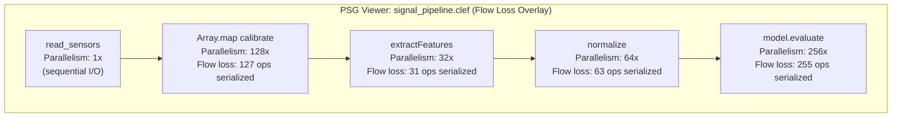
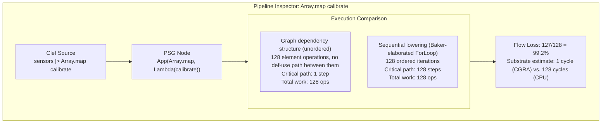
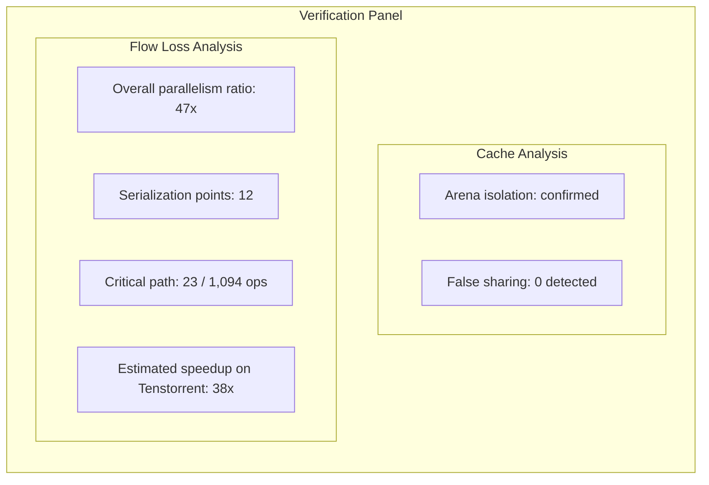

# 09 - Flow Loss Analysis

## Overview

Flow loss analysis quantifies how much data-flow parallelism a program contains that is serialized when targeting a control-flow architecture (CPU). Because Clef is graph-native, parallelism is a property of the PSG's own dependency structure: two operations with no Reference (def-use) path between them are unordered in the graph. A sequential target orders them anyway, and the ordering is visible in the same graph: a Baker-elaborated `ForLoop` / `WhileLoop` (`Elaboration.Kind = "Baker"`) over independent elements is the serialization point. Alex's output is structured `scf` over that structure, not a second representation to compare against. The delta between what the graph leaves unordered and what the lowering orders is the flow loss.

This capability is structurally unique to graph-native languages. In conventional control-flow languages, recovering the data-flow graph from imperative code requires heroic analysis. In Clef the dependency structure is already the program. There is no interaction-net representation beside it: nets are hyperedge rule structure inside the one graph, witnessed as data flow.

Under the canonical view Atelier computes none of these metrics. They are facts about the graph; the honest form is annotations placed at saturation (per-node height and critical path, per-loop serialized-operation counts) that Lattice serves and Atelier reads. Nothing places them today. Whether CCS should own them is a CCS contract item this document does not decide (`Lattice_Consumer_Contract.md` §3, "Flow-loss and cost views": not designed; if wanted, a CCS saturation pass, never an IDE computation).

## Metrics

### Parallelism Ratio

How many operations could fire simultaneously on a data-flow fabric vs. how many the CPU must serialize. A function with 200 independent operations serialized to a single thread produces a very different ratio than a function with a deep dependency chain. This metric gives developers immediate intuition about how much their code would benefit from spatial hardware.

### Critical Path vs. Total Work

The ratio between the longest dependency chain (critical path length) and total operations. This is a well-understood metric from parallel computing theory:

- Ratio near 1.0: computation is inherently sequential, minimal flow loss
- Ratio near 0.01: 99% of work could execute concurrently on a spatial architecture

The critical path length also maps directly to the minimum number of clock cycles required on a data-flow fabric, making it a natural bridge to substrate-specific performance estimates.

### Serialization Points

Specific source locations where the sequential lowering ordered operations the graph leaves unordered: a Baker-elaborated `ForLoop` / `WhileLoop` (`Elaboration.Kind = "Baker"`) over elements with no def-use path between them is the canonical case. These are the points where parallelism is lost. Each serialization point can be annotated with the number of independent operations that were sequenced, giving developers a clear target for restructuring if they choose to optimize for spatial hardware.

### Memory Movement Overhead

Data that would be local to a processing element on a spatial architecture but must traverse the CPU cache hierarchy. The NTU's memory-space and access-pattern dimensions would make this quantifiable; both are design-status axes today (only the width axis is implemented), so this metric waits on them. Streaming access patterns that would be zero-cost channels on a CGRA become cache-dependent loads on CPU. This metric bridges flow loss analysis with the existing cache verification infrastructure (see [08_tooling_integration.md](./08_tooling_integration.md)).

### Substrate Comparison Estimates

With a substrate performance model for a specific architecture, flow loss can be expressed concretely: "this subgraph: 47 cycles on Tenstorrent Wormhole, 3200 cycles on x86." A cost model is a declared field of the platform description (the declared authority), not a table the IDE keeps; hardware partners would supply those declarations, and Atelier renders the side-by-side estimate. No such field is declared today.

## Integration with Atelier

Flow loss analysis builds on Atelier's planned architecture. The PSG visualization, verification panel, inline diagnostics, and multi-editor protocol all extend naturally to support flow loss.

### PSG Viewer: Parallelism Heat Map

The D3-based PSG viewer (see [03_unique_features.md](./03_unique_features.md)) renders the program's dependency graph. Flow loss adds a heat map layer over this graph, read from per-node parallelism annotations the graph would carry: regions heavily penalized by CPU serialization glow hot, inherently sequential regions stay cool. Developers see where data-flow parallelism exists in their code at a glance.



*Color: read (cool/blue, sequential) → map/extract/normalize/predict (hot/red, high flow loss on CPU)*

### Pipeline Inspector: Ideal vs. Actual

The compilation pipeline inspector (see [03_unique_features.md](./03_unique_features.md)) shows the transformation from source through PSG to native code. Flow loss analysis adds a parallel lane showing the graph's unordered dependency structure alongside the sequential lowering the target received, with the delta highlighted.



### Inline Diagnostics

Flow loss annotations would appear directly in the editor, following the same inline diagnostic pattern as cache verification:

- "12 independent operations serialized here" at serialization points
- "Parallelism ratio: 64x (63 operations could execute concurrently on spatial hardware)" on function signatures
- "Critical path: 3 of 847 operations (99.6% parallelizable)" as code lens on modules

### Verification Panel: Flow Loss Summary

The verification panel would display aggregate flow loss metrics alongside cache verification results:



### Function-Level Summary

Each function or actor would get a flow loss score, visible in code lens or hover:

| Function | Total Ops | Critical Path | Parallelism | Flow Loss |
|---|---|---|---|---|
| `signal_pipeline` | 1,094 | 23 | 47x | 97.9% |
| `calibrate` | 12 | 12 | 1x | 0% (sequential) |
| `extractFeatures` | 384 | 12 | 32x | 96.9% |
| `model.evaluate` | 4,096 | 16 | 256x | 99.6% |

## Multi-Editor Support

Flow loss analysis would follow the same multi-editor protocol as cache verification. The metrics are not computed in Atelier's native host or in Lattice: they are annotations on the graph (see Implementation Path), read by Lattice for LSP clients and read directly by Atelier's panes.

### LSP Extension

Proposed extension methods, in the `clef/*` namespace 08 uses. None exists in ClefAutoComplete today; 08 sketches `clef/runVerification` only.

```
clef/flowLossAnalysis → request the annotations for the current file or function
clef/flowLossResults  → structured results in the common format
```

### Result Format

Flow loss results would use the same diagnostic format as cache verification, extended with parallelism-specific fields:

- `kind: "serialization_point" | "high_flow_loss" | "sequential_confirmed"`
- `severity: "info" | "warning"` (flow loss is informational, not an error)
- `details: { parallelism_ratio, critical_path, total_ops, substrate_estimates }`

### CI/CD Integration

Flow loss could be a PR quality gate via SARIF output:

- "This change increased flow loss by 15% on the critical path"
- "New serialization point introduced at line 42 (was previously parallelizable)"
- Trend tracking: flow loss over time as the codebase evolves

## Implementation Path

Flow loss metrics would derive from structure the graph carries or is scheduled to carry:

1. **PSG dependency structure** provides the data-flow graph: Structural and Reference (def-use) hyperedges, node count, dependency chains. Critical path is the longest def-use chain, for all code.
2. **Baker-elaborated loops** mark the serialization points: a `ForLoop` / `WhileLoop` with `Elaboration.Kind = "Baker"` over elements with no def-use path between them.
3. **`Incremental<'T>` height** is the critical path only of code written with `Incremental`; cite it where Incremental nodes exist, not as the general mechanism.
4. **`ArenaAffinity`, `Resides`, and the NTU memory-space and access-pattern dimensions** provide memory-movement information; the two dimensions are design-status (only width is implemented), so that metric waits on them.
5. **Substrate cost models** are declared fields of the platform description, the declared authority; none is declared today.

Where the metrics are placed is the open item. The precedent is CCS's `DepthAnalysis.fs`, a combinational-depth walk over the same graph, FPGA-only; a general height and critical-path annotation at saturation would follow that shape. Alex output is structured `scf` over the same graph and is not a second representation; there is nothing to compute by comparing artifacts.

## Hardware Partnership Strategy

Flow loss tooling creates a natural partnership opportunity with data-flow hardware companies. The IDE shows developers quantitatively how much performance they leave on the table by running on a CPU. The hardware is the answer to that gap.

Target architectures for substrate comparison estimates:

| Partner | Architecture | Why Flow Loss Matters |
|---|---|---|
| Tenstorrent | RISC-V mesh (Wormhole, Blackhole) | Data-flow oriented, directly exploits the parallelism that CPU serializes |
| NextSilicon | Runtime reconfigurable compute | Dynamically adapts to computation patterns that flow loss identifies |
| Cerebras | Wafer-scale spatial architecture | Massive parallelism that conventional languages cannot express |
| AMD XDNA | NPU tile array | Already in the multi-substrate fan-out architecture |
| AMD/Xilinx | FPGA | Spatial hardware for computations with high flow loss on CPU |

The partnership model: hardware companies supply substrate cost models as platform-description declarations; Atelier's comparison panel reads them. Developers see concrete performance estimates for specific hardware. The IDE becomes a demand generation tool for data-flow architectures.

## Navigation

- Previous: [08_tooling_integration.md](./08_tooling_integration.md): Performance tooling integration
