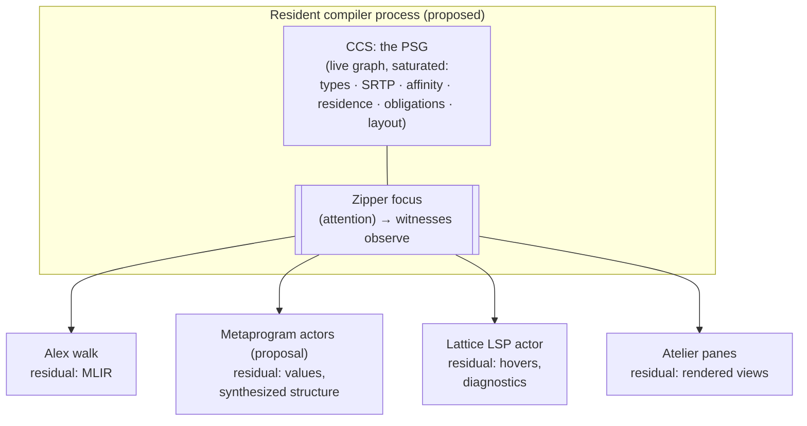

# 11 - Native Reflection: The Semantic Graph as Metadata System

> **Status:** Preliminary design. This document establishes the directional intent for Fidelity's answer to reflection. It was prompted by the adoption of compile-time static reflection into C++26 ([P2996](https://isocpp.org/files/papers/P2996R13.html)), which independently validates an architectural bet the Fidelity toolchain already made. Detailed API design will be authored as the CCS observation surface, and the resident compiler process that would host it, land; both are design-stage.

## What This Document Is

"Native reflection" in Fidelity is not a new subsystem. It is a naming exercise over machinery that exists for other reasons: the Program Semantic Graph (PSG) as persistent compiler state, quotations as typed semantic carriers, witnesses as structured injection, active patterns as classification, the Huet-style zipper as the traversal cursor, and a resident compiler process (proposed below; a roadmap line in Composer, not a fact) as the place where all of it would stay alive between keystrokes. CCS owns the graph inside whatever process hosts it.

One framing matters enough to fix before anything else: **reflection here is not a query engine.** "Query" stands to reflection as "emit" stands to lowering — an imperative verb imported from someone else's architecture, dragging that architecture's execution model behind it. Composer does not emit; it witnesses, and the code is the residual. Nothing here queries; consumers observe, and everything is pull: coeffects are placed, codata is observed. C++26 ships reflection as a flat list of functions to call; Fidelity's reflection is the observation surface of the same traversal that compiles the program, made available to consumers other than the code generator.

## The Question Reflection Actually Asks

Runtime reflection — `System.Reflection`, `java.lang.reflect` — is a request for information the compiler possessed and threw away. The compiler resolved every type, computed every layout, knew every member; then it discarded most of that knowledge and emitted a partial reconstruction into metadata tables so the program could ask diminished versions of the same questions later, at runtime cost, with runtime failure modes.

This is the same displacement pattern described in [ByRef Resolved](https://github.com/speakeztech/clef-lang-site/blob/main/hugo/content/docs/design/types/byref-resolved.md) for memory safety: when a capability lives in the wrong place, the host's limitations become the language's limitations. Runtime reflection lives in the wrong place. The right place is the compiler's own semantic state — kept alive, enriched, and observable.

## What C++26 Conceded

P2996 brings compile-time static reflection to C++26. Stripped to its core, it is three primitives forming a closed loop, confined to constant evaluation:

| Primitive | C++26 form | What it does |
|:----------|:-----------|:-------------|
| **Lift** | `^^entity` | Produces a `std::meta::info` handle to a language entity |
| **Query** | `std::meta::*` consteval functions | Interrogates the handle: identity, structure, layout, predicates |
| **Splice** | `[: r :]` | Injects the denoted entity back into the program |

Three design decisions matter for Fidelity:

1. **Reflections are handles into compiler-internal semantic state.** Not a metadata format, not a runtime table — an opaque pointer into the compiler's own data structures, valid only during translation. Zero runtime overhead is definitional: reflections cannot survive translation unless explicitly reified into static data.

2. **`info` is a single opaque type.** The committee rejected a strongly-typed reflection class hierarchy, reasoning that if C++03 had standardized a `std::meta::variable` type, C++11's references would have broken it. Evolvability won; static typing of the reflection surface lost.

3. **Synthesis is structured or deferred.** `define_aggregate` completes a type from a member description list — synthesis by description. Arbitrary token injection (P3294) was explicitly deferred to a future standard because it is unstructured.

C++26 is the mainstream's admission that reflection done right is an API over the compiler's live semantic state. But C++ ships the idea fractured by forty years of batch-compilation constraints — and shaped as a query API, because in a batch compiler there is no walk for a consumer to join.

## The Asymmetry Nobody Closed

Every mainstream ecosystem gives programs and tools **different doors** into semantic information:

| Ecosystem | Programs use | Tools use | Same state? |
|:----------|:-------------|:----------|:------------|
| C# / .NET | `System.Reflection` (runtime tables) | Roslyn (compiler API) | No — two metadata models |
| F# / .NET | Quotations + runtime reflection | FSharp.Compiler.Service symbols | No — split by phase |
| C++26 | `std::meta` (inside the TU being compiled) | libclang / Clang AST | No — the standard API is unavailable to tools |
| **Fidelity** | **PSG observation surface** | **PSG observation surface** | **Yes — one door, one live graph** |

The C++26 irony is sharpest: programs finally get the compiler-state API, but clangd and clang-tidy still enter through a different one. FCS had the inverse problem for a decade: tooling got a superb compiler-state API (`FSharpEntity`, `FSharpSymbol` — recognizably structure and identity observations avant la lettre), but programs could not observe themselves.

Fidelity closes the loop structurally, because of a fact no batch compiler can replicate: **the compiler does not exit.**

## One Mechanism, Four Residuals

What makes "compile time" a session rather than a phase is a compiler that does not exit. The process topology this document proposes for that is Atelier's, not a fact of the toolchain: one resident process; a Prospero supervisor; a PSG actor, an LSP actor, a proof actor; BAREWire shared memory between them; an eval worker spawned lazily. None of it is documented in Composer, clef, or the spec beyond a roadmap line ("daemon mode: LSP, incremental recomputation over the full PSG"), and a self-hosted Composer is a bootstrap milestone, not a fact. What is fixed regardless of topology: CCS owns the graph inside whatever process hosts it, enriched at saturation with everything the compiler knows (types, SRTP resolution, arena affinity, residence, obligations, layout; escape class interim in Composer, scheduled to CCS), and Composer receives it.

Reflection is then not an API bolted onto that state. It is the compilation mechanism itself, serving consumers beyond the code generator. The Huet-style zipper is the attention mechanism: something directs its focus; the joint constraints already resolved into the graph meet at that focus; a witness observes them; and the residual is elided. What differs per consumer is only *what directs attention* and *what the residual is*:

| Consumer | What directs attention | Residual of observation |
|:---------|:-----------------------|:------------------------|
| Alex traversal | the compilation walk itself | MLIR |
| Metaprogram actor (proposal) | the metaprogram's own navigation | compile-time values; synthesized PSG structure |
| Lattice LSP actor | the developer's cursor and edits | hovers, diagnostics, code lenses |
| Atelier panes | the viewport | rendered views: PSG pane, layout maps, escape diagnostics |



Design-time tooling is another elision target. A hover card is the residual of the same observation that, on the compilation walk, would have become an MLIR op. Nothing is computed on demand for the editor's benefit; the codata principle holds across all four columns: the enrichments were placed at saturation (mise-en-place), and every consumer *observes*.

Two properties fall out of this framing rather than needing design:

- **Attention is the freshness schedule.** What is focused is what must be kept current. The editor's cursor and Atelier's viewports tell the incremental machinery exactly which region of the graph deserves recomputation priority after an edit: the same signal, no separate invalidation protocol. The Semantic Projections (defined below) are that machinery.
- **Execution would be native.** Where C++ evaluates reflection inside the constant evaluator (an interpreter bolted into the compiler, and a notoriously slow one), a Clef metaprogram would execute through the JIT path `clefx` specifies, the same pipeline that produces ahead-of-time binaries. This is a proposal contingent on `clefx`: the spec's interactive chapter is forward-looking, no JIT exists in the corpus, and the inherited REPL project was removed. The spec's standing rule holds meanwhile: quotation metaprogramming requires no runtime evaluation, and anything a metaprogram synthesizes into the graph goes through the Baker recipe channel (the rule Synthesis and Reification Discipline states below). The zero-overhead guarantee is identical either way: nothing survives to the artifact unless reified.

## The Triad Is Already Two-Thirds Owned

Mapping P2996's primitives onto Clef's standing art:

| P2996 | Clef | Status |
|:------|:-----|:-------|
| Lift: `^^entity` → `info` | Quotations: `<@ expr @>` → `Expr<'T>` | **Exists — and typed**, where `info` is monotyped |
| Splice: `[: r :]` | Quotation splicing at the language level; **witness elision** at the compiler level | **Exists** — injection is structured by construction |
| The semantic handle: `info` denotes a *resolved entity* | A reference into the PSG — a place the zipper can focus | **The missing third piece** |

Quotations carry *syntax*; P2996 handles denote *resolved semantics*. Native reflection extends the quotation machinery from syntax carriers to semantic handles — references into the saturated PSG, where symbol resolution, type resolution, SRTP witness selection, coeffect annotation, and escape classification have already happened. A handle is not a ticket for asking questions; it is a place to stand. Everything downstream of it is observation at a focus.

## Active Patterns: Classification Without Commitment

P2996's monotype compromise is a real dilemma honestly resolved: a typed reflection hierarchy freezes the language's ontology into a standardized API; an opaque handle preserves evolvability but surrenders static typing of the reflection surface.

Clef dissolves the dilemma with a feature C++ does not have. A single opaque PSG handle, classified through **active patterns**, yields typed views without a frozen hierarchy:

```fsharp
// Illustrative sketch — names provisional
let describe (t: NodeRef) =
    match t with
    | RecordShape fields ->
        fields |> Seq.map (fun f -> $"{f.Name}: {display f.FieldType}")
    | UnionShape cases ->
        cases |> Seq.map (fun c -> $"| {c.Name}")
    | FunctionShape (domain, range) ->
        Seq.singleton $"{display domain} -> {display range}"
    | Opaque ->
        Seq.singleton "no structural view available"
```

The handle stays open — new node kinds, new classifications, new pattern banks can be added without breaking any existing match site, exactly the evolvability the C++ committee bought with `info`'s opacity. But every arm binds *typed* results, exactly the static discipline they gave up. Partial active patterns compose into total views; parameterized active patterns admit platform- or phase-conditioned classification.

This is also not a new idiom invented for the occasion. It is the same mechanism the compiler uses internally: Alex's semantic lenses are active patterns classifying PSG nodes during traversal, and the codata principle — *witnesses observe and return, never build or compute* — is precisely the contract an observation must satisfy. Promoting active patterns to the user-facing reflection surface means metaprograms, the LSP, and the compiler's own internals speak one idiom over one graph.

Of the three Don Syme designs that anchor the Fidelity architecture, two already had their defining role: quotations as semantic carriers (the Fidelity.Platform descriptor spec), computation expressions with `MailboxProcessor` as sugared delimited continuations (the concurrency model). Native reflection is where active patterns take the same rank: **classification without commitment is the reflection story.** And a fourth piece of standing art joins them from a different lineage — Huet's zipper (1997), thirty years a data-structure curiosity, here the attention mechanism of a graph compiler.

## The Vocabulary and the Semantic Projections

Two terms carry this design, and they name different things.

The **vocabulary** is the contract: the enumerable, versioned set of observation signatures a focus supports. Its edition travels with CCS — one can point at a CCS version and say precisely which observations exist and no others.

The **Semantic Projections** are the mechanism that would back the contract: the edit-driven re-settlement schedule of the graph's one saturation lattice (`Fresh < Elaborated < Saturated`; a hyperedge rule fires only when all its sources are Saturated), kept at design-time cadence so that observation remains a pull of already-placed structure. They are CCS-owned because the lattice is CCS's; the plan that introduces the lattice (`PSG_to_PHG_Plan.md`, Phase 1) records that nothing of it is built yet. "Projection" carries its event-sourcing sense deliberately: as a materialized view stands to an event store, a Semantic Projection stands to the edit stream — a fast, read-only model, rapidly updated as the underlying graph changes, and rebuildable from it at any time. Projections hold no authority; the PSG remains the single source of truth, and every projection is disposable cache. The same word is also the codata word, and the two senses agree: in the copatterns tradition, codata is *defined by its projections* — observation is the application of a projection that has already settled. In both traditions the verb belongs to the maintainer, not the observer: the compiler projects when edits arrive; consumers only observe.

The plural is about dirty regions, not about separate settlement algebras. There is one lattice and one monotone driver; what differs per annotation is which edge classes an edit dirties: a def-use edge for a width, a capture or call edge for an escape class, a type-flow edge for a dimensional constraint, a per-target context for a platform-conditioned layout. A projection is the slice of the lattice one consumer reads, indexed by the edge classes that can dirty it, so an edit that dirties only widths does not invalidate an escape answer that never depended on it. The observation groups in the tables below are, in implementation terms, those slices. Widths and escape class are today Composer's interim `IntervalAnalysis` and `EscapeAnalysis`, scheduled to move into CCS; until they move, the projection over them is a projection of the graph as it will be, not as it is.

The Semantic Projections are design-time mise-en-place, and the codata principle forces the layer's existence: on the batch walk, nanopasses enrich the graph before witnesses move, so witnesses only observe — but at design time edits stream in continuously, and if answers were computed when the editor looked, the witness would be computing. Something must play the nanopass role continuously between keystrokes. The invariant that keeps every consumer honest: **computation is edit-driven; observation is free.**

Because each projection is over the graph's topology, invalidation is structural, not textual: an edit dirties a region per edge class (Structural, Reference, Provenance, Obligation), and the monotone driver re-settles the affected slice only. Attention supplies the schedule: the zipper's focus, the editor's cursor, an Atelier viewport all weight which dirty regions settle first — eager where attended, deferred elsewhere. This is the Incremental keystone of the concurrency model meeting the PSG. The honest standing art for this shape is self-adjusting computation (Acar) — *placed-then-observed*. Rust-analyzer's Salsa, by way of Adapton (the demand-driven branch of Acar's line), solves the same design-time problem from the other side — demand-driven memoization, where observation triggers computation — which is precisely the architectural line this design does not cross.

Seed the vocabulary from P2996's battle-tested taxonomy rather than inventing one — every question their function list answers is an observation this surface must support — then extend it with what only this compiler's enrichments contain.

**Inherited shape (P2996 parity):**

| Group | Representative observations |
|:------|:----------------------------|
| Identity | name, source location, enclosing scope, declaring module |
| Structure | record fields, union cases, function signature, members, type parameters |
| Layout | size, alignment, field offsets |
| Predicates | is-function, is-record, is-mutable, is-inline, is-complete |

**Fidelity-only extensions (beyond any C++ capability):**

| Group | Representative observations | Why C++ cannot have it |
|:------|:----------------------------|:-----------------------|
| Coeffects | `ArenaAffinity`, `Resides` and `Constrains` edges, obligation anchors at the focus | No coeffect system |
| Memory | escape classification (Composer interim, scheduled to CCS), arena affinity, residence in a declared space | No escape analysis surface |
| Resolution | SRTP witness selection, active dispatch targets | SRTP does not exist |
| Dimensional | units-of-measure carried by a type, dimensional constraints | No dimensional types |
| Platform | **platform-conditioned layout** — offsets under NTU deferral, indexed by platform context | C++ layout queries only answer post-concretization |
| Graph | reachability, def-use edges, nanopass provenance of an enrichment | No persistent semantic graph |

The platform row deserves emphasis. Because the Native Type Universe defers widths to platform context, a layout observation in Clef is not a scalar — it is a function of the compilation target. Reflection over a deferred type algebra is a capability class C++26 cannot express, and it is exactly what Atelier's cross-target views (FPGA vs. CPU realizations of the same source) need to render. The carrier is the layout hyperedge's per-target map (`Map<TargetId, LayoutAnnotation>` in `Layout_As_Joint_Constraint.md`), pending in CCS.

## Synthesis and Reification Discipline

P2996 validated a line Fidelity already draws: **synthesis by description is in; token pasting is out.** `define_aggregate` made C++26; arbitrary token injection did not.

The Clef analog of generative reflection is derive-style synthesis through the existing structured channels:

- **BAREWire schema derivation** — a record's wire schema generated from its PSG structure, replacing runtime serializer reflection
- **`%A` formatting, equality, comparison** — the classic `System.Reflection` consumers in .NET, regenerated as compile-time SRTP/witness synthesis (the obj-elimination table's "compile-time SRTP" column, given its general mechanism)
- **Platform descriptor expansion** — quotation-carried constraints elaborated against observed structure

All of it flows through the nanopass/witness channel as PSG-node synthesis. No string generation, no token streams, ever — the same discipline that keeps elision structurally guaranteed keeps generative reflection structurally guaranteed.

**Reification** follows the same rule as C++: nothing survives to runtime unless explicitly frozen. Where P3491 adds `define_static_string`/`define_static_object` to give reflection results a runtime address, Composer already places program-lifetime values in static storage via `memref.global`. An observation whose result the program keeps becomes a static constant elided by a witness; an observation consumed entirely at compile time leaves no residue. "What you don't use, you don't pay for" holds by construction.

## Annotations

P3394 lets C++ attach user-defined compile-time metadata to declarations and query it through reflection. Clef is already there in substance: attributes and quotation-carried constraints (memory regions, peripheral descriptors, alignment demands) ride the PSG as first-class semantic information. The design task is only to make them uniformly observable at a focus — one annotation group in the vocabulary, not a parallel mechanism.

## Delivery Surfaces

The four consumers share the vocabulary; they differ in transport and in how attention is directed:

1. **Metaprogram actors** (proposal, contingent on `clefx`): full vocabulary, in-process BAREWire, compile-time only. This would be Clef's `consteval`: a metaprogram is an actor that navigates its own focus through the graph and observes, with its lifetime bounded by elaboration; anything it synthesizes enters the graph only through the Baker recipe channel.
2. **Lattice LSP actor**: the design-time subset serialized over LSP as `clef/*` extension methods. 08 sketches one today (`clef/runVerification`); the reflection methods (`clef/memoryLayout`, `clef/srtpResolution`, `clef/platformBindings`, and successors) are proposed here and exist nowhere yet, not in 08, not in ClefAutoComplete, not in lattice-vscode. Each would be a focus-and-observe pair: the request carries a position or a NodeId, the response is that node's `LayoutHint`, `SRTPResolution`, or `PlatformBinding` facts as the graph holds them. Editors get reflection without knowing it; see [08 - Tooling Integration](./08_tooling_integration.md).
3. **Atelier panes**: direct BAREWire views over shared memory, no LSP serialization. The PSG visualizer is, in this framing, simply *observation made visible*: the D3 pane renders the same focus a metaprogram would stand at. Hover cards, cache-line maps, escape diagnostics, and cross-target comparisons are all residuals of observation. With a remote host, the same views would arrive over BAREWire-over-WebSocket unchanged. This needs a BAREWire-described graph export from CCS; today the only export is the JSON phase artifacts, so the export is a CCS contract item (`Lattice_Consumer_Contract.md` §3).
4. **Alex itself** — the first and load-bearing consumer. Nothing in this document adds machinery to the compilation walk; the point is that the walk's machinery already is the reflection system.

Transcribe ([10 - Transcribe](./10_transcribe.md)) composes naturally: ingested bindings join the PSG and therefore support the same observations — a focus on a TypeScript-derived or C-derived binding is indistinguishable from a focus on hand-written Clef.

## What We Deliberately Do Not Copy

| C++26 constraint | Fidelity position |
|:-----------------|:------------------|
| Reflection as a query API (a list of functions to call) | Reflection as observation at a focus on a live walk |
| Translation-unit scope | The PSG is whole-program and persistent across edits |
| Constant-evaluator interpretation | Metaprogram actors would execute natively through the `clefx` JIT path (proposal; contingent on `clefx`, which is spec-only today) |
| Monotyped `info` with a flat function list | Opaque handle + active-pattern classification: typed views, open ontology |
| Vocabulary frozen by the standard | Vocabulary versioned with CCS; there is exactly one compiler, so compiler-specific semantics are exposable |
| Programs-only access (tools use libclang) | One observation surface for metaprograms, LSP, Atelier, and Alex itself |

## Answering "What About Reflection?"

The wrong answer is "Clef doesn't need reflection" — it concedes that reflection is a runtime facility one either needs or forgoes, and invites the follow-up "so how do you serialize?"

The right answer: **"Clef already has it — it never threw the information away."** Runtime reflection is a partial, costly reconstruction of knowledge the compiler discarded. Fidelity's compiler keeps that knowledge alive in the PSG, typed and observable, at compile time where it is complete and free. Every practical use of `System.Reflection` — serializers, formatters, comparers, dependency wiring, schema generation — is served by observation at a focus and witness synthesis, with the results frozen into the binary and nothing reconstructed at runtime. C++26 just adopted the same position for the same reasons; Fidelity's version is whole-program, session-persistent, and shared with the tooling.

## Open Questions

- **Naming.** The user-facing handle type (`NodeRef` above is a placeholder), and whether the vocabulary surfaces primarily as a module of active patterns, a module of functions, or both.
- **Phase discipline.** Which observations are legal at which elaboration phases — a layout observation against a not-yet-saturated graph must fail honestly (`TRError`-style), not answer approximately.
- **LSP subset.** Which observation groups serialize over `clef/*` versus remain daemon-local; where the line sits between Lattice-served editors and Atelier's direct views.
- **Vocabulary versioning.** The vocabulary is a public contract of CCS; how its editions are versioned against the language and against saved PSG snapshots.
- **Projection slices and eagerness.** Which edge classes dirty which annotations is a declared table, not a second settlement algebra; the table (widths read types; escape reads types) needs writing down in CCS once widths and escape class move there; and how attention weights eager settlement versus deferral remains the policy knob between wasted work and observable staleness.
- **Metaprogram authority.** A metaprogram's focus can wander the whole program's graph; whether library-published metaprograms need a capability gate on where they may stand is unresolved.
- **Metaprogram execution.** Whether user metaprograms execute at compile time at all, and through what. The `clefx` JIT path is forward-looking in the spec and no JIT exists in the corpus; the spec's standing rule is that quotation metaprogramming requires no runtime evaluation. Until settled, metaprogram actors are a proposal and synthesis stays on the Baker recipe channel.

## Related Documents

- [08 - Tooling Integration](./08_tooling_integration.md): the `clef/runVerification` sketch this surface generalizes
- [10 - Transcribe](./10_transcribe.md) — ingested bindings as observable citizens of the graph
- [CCS Architecture](https://github.com/FidelityFramework/Composer/blob/main/docs/CCS_Architecture.md) — "PSG as Design-Time Resource," the contract this document builds on
- [ByRef Resolved](https://github.com/speakeztech/clef-lang-site/blob/main/hugo/content/docs/design/types/byref-resolved.md) — the displacement argument, applied to memory safety
- [Opining Upon Reflection](https://github.com/speakeztech/clef-lang-site/blob/main/hugo/content/blog/opining-upon-reflection.md) — the public essay form of this document's position
- [Standing Art: Clef Metaprogramming](https://github.com/speakeztech/clef-lang-site/blob/main/hugo/content/docs/design/language/standing-art-clef-metaprogramming.md) — quotations, active patterns, computation expressions as the architectural backbone
- Gérard Huet, "The Zipper" (JFP, 1997) — the functional pearl behind the traversal cursor
- [P2996R13 — Reflection for C++26](https://isocpp.org/files/papers/P2996R13.html) and [bloomberg/clang-p2996](https://github.com/bloomberg/clang-p2996) — the external validation
