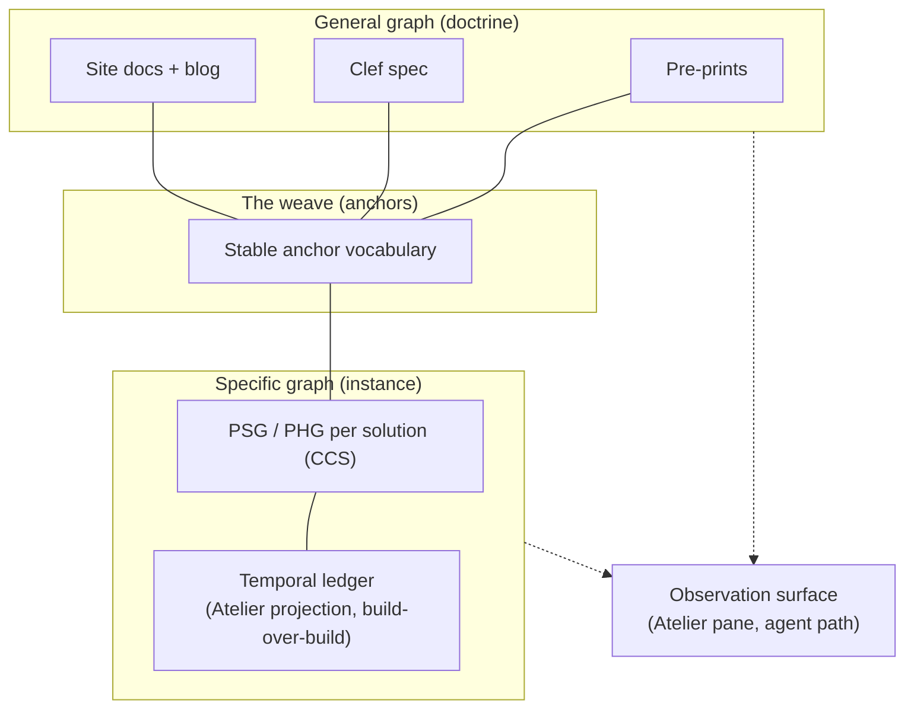

# 00 - The Two Graphs

An agent investigating a codebase needs a way to find relationships as well as text. Code knowledge graphs address that need by indexing symbols and relationships such as calls and imports. Tools such as [Graphify](https://github.com/safishamsi/graphify), [GitNexus](https://github.com/abhigyanpatwari/GitNexus), and [CodeGraph](https://github.com/colbymchenry/codegraph) explore this approach. Their findings depend on the source information and resolution methods available to each tool.

Atelier connects two complementary knowledge structures in the Fidelity ecosystem:

- **The general graph** is the corpus: the documentation and blog essays at [clef-lang.com](https://clef-lang.com/), the [Clef language specification](https://clef-lang.com/spec/draft/), and the preprint series on arXiv. Editorial cross-links, citations and shared tags connect its pages, and the site's Atlas provides a page-level view.
- **The specific graph** is the Program Semantic Graph (PSG) that the Clef Compiler Service (CCS) builds and saturates for a particular solution. CCS publishes a revision of `Fidelity.PSG` for downstream consumers. Composer uses Alex to witness settled facts into MLIR, and Lattice and Atelier can present them in editor views. The Program Hypergraph (PHG) formalization appears in [the preprint](https://arxiv.org/abs/2603.17627) and [the specification](https://clef-lang.com/spec/draft/program-hypergraph/). Graph relationships, proof premises, and discharged obligations have distinct meanings. A relationship in the graph does not by itself establish a proof.

This sub-folder designs the pairing between them. A PSG node exhibiting closure-captured escape can be related to the escape taxonomy in [the DTS+DMM paper](https://arxiv.org/abs/2603.16437). A BAREWire crossing can be related to the contract and representation rules applicable to that boundary. The general graph holds the published design and its rationale. The specific graph holds the facts and proof status for a particular program. Their connections let a developer, tool, or agent ask why code has a particular form and inspect the evidence supporting the answer.

The general graph also describes the model of the specific graph. [The PHG chapter](https://clef-lang.com/spec/draft/program-hypergraph/) describes vertex annotations and hyperedges, giving the weave a basis for connecting program facts to their definitions. Identified source passages, a versioned vocabulary, and provenance make those connections useful and reviewable.

## Three Altitudes

Both graphs, and the weave between them, resolve at three levels of granularity.

| Altitude | General graph | Specific graph |
| --- | --- | --- |
| Artifact | a blog post, a spec chapter, a pre-print | a project, a compilation unit |
| Anchor | a section, a spec clause, a numbered definition | a coeffect category, an obligation class, a symbol path |
| Symbol | a term with a stable meaning | a PSG node with resolved annotations |

The artifact level exists in production today, and the symbol level is CCS's own structure. Between them sits the anchor level: a small, curated vocabulary of stable identifiers both graphs key against. Every later document in this sub-folder keys its claims to that vocabulary.

The overall shape, with the documents that develop each part:

## The Sub-Folder

These documents build on the [repository README](../../README.md) and the [workshop entry on the site](https://clef-lang.com/docs/tooling/atelier-the-fidelity-workshop/). Together they describe a knowledge layer that brings site and compiler information into Atelier, connects it through the weave, and preserves a history developers and agents can explore.

- [01 - The General Graph](01_general_graph.md): the corpus graph as it runs today, and the anchor layer it is missing.
- [02 - The Specific Graph](02_specific_graph.md): what elaboration provides that syntax-level extraction approximates.
- [03 - The Weave](03_weave.md): the anchor vocabulary and the cross-altitude edges.
- [04 - The Temporal Ledger](04_temporal_ledger.md): revision history, evidence changes and the decisions they illuminate.
- [05 - Missions](05_missions.md): goal predicates, trajectory, and the capability-arrival advisor.
- [06 - The Reference Model](06_reference_model.md): a constrained language model paired with the graph as its authority.
- [07 - The Preservation Interface](07_preservation_interface.md): what the ledger requires of any repository substrate, and the identity question.
- [08 - The Observation Surface](08_agent_surface.md): witnesses, BAREWire, and where a protocol adapter does and does not belong.
