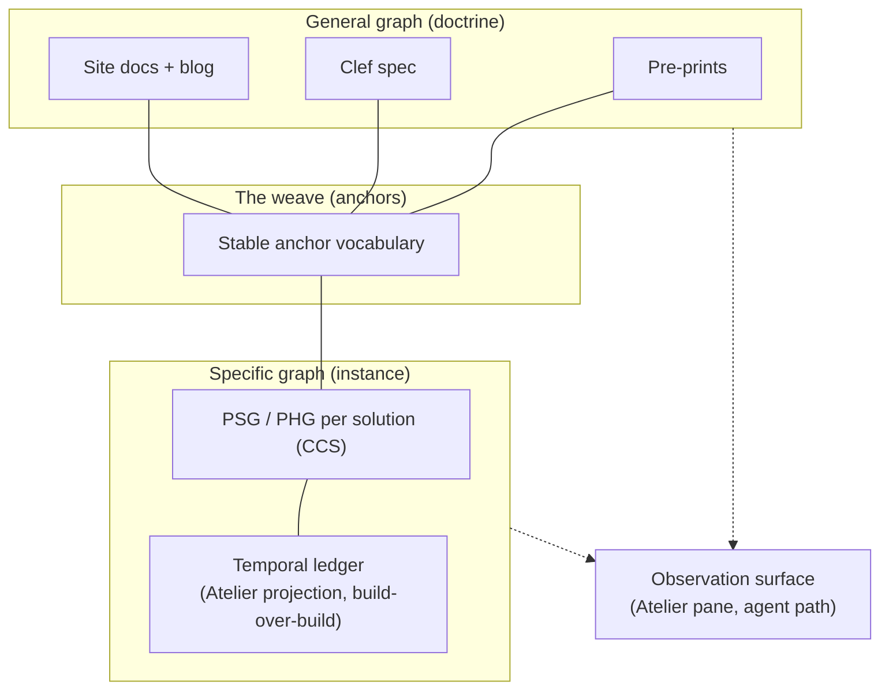

# 00 - The Two Graphs

The current generation of AI coding tools solves a real problem: an agent asked a structural question about a codebase burns fifteen tool calls grepping for text, and still misses the callback that wires everything together. The emerging fix is a code knowledge graph: nodes for functions and modules, edges for calls and imports, built by parsing source with tree-sitter and resolving references heuristically. Tools like [Graphify](https://github.com/safishamsi/graphify), [GitNexus](https://github.com/abhigyanpatwari/GitNexus), and [CodeGraph](https://github.com/colbymchenry/codegraph) all ship this pattern, and the most careful of them tags every edge with a confidence level, because each edge is a name-match inference rather than a compiler fact.

Atelier starts from a different position. In the Fidelity ecosystem, the two knowledge structures those tools try to reconstruct already exist as first-class structures (the second in-process today; its persisted form is a CCS contract item, see [04](04_temporal_ledger.md)):

- **The general graph** is the corpus: the documentation and blog essays at [clef-lang.com](https://clef-lang.com/), the [Clef language specification](https://clef-lang.com/spec/draft/), and the pre-print series on arXiv. Its cross-links are hand-curated, and a page-grained rendering of it already runs in production as the site's Atlas.
- **The specific graph** is the Program Semantic Graph (PSG) that the Clef Compiler Service (CCS) builds and saturates for a particular solution, and that Composer's Alex witnesses into MLIR, Lattice into the editor, and Atelier into views. It is formalized as the Program Hypergraph (PHG) in [our pre-print](https://arxiv.org/abs/2603.17627) and stated normatively in [the spec's PHG chapter](https://clef-lang.com/spec/draft/program-hypergraph/). Every edge in it is either a result of elaboration and typing or a decidably discharged constraint, and nothing downstream of CCS computes a semantic fact.

This sub-folder designs the pairing between them. A PSG node exhibiting closure-captured escape is an instance of the escape taxonomy in [our DTS+DMM paper](https://arxiv.org/abs/2603.16437). A BAREWire crossing in a solution is an instance of what [the contract model in the spec](https://clef-lang.com/spec/draft/discriminated-union-representation/) licenses. The general graph holds doctrine. The specific graph holds an instance of that doctrine. The relationship between them is instantiation in one direction and warrant in the other, and the machinery maintaining that relationship lets a developer, a tool, or an agent ask a question no structure-only graph answers: why is this code shaped the way it is, and what licenses it.

One recursion distinguishes this design from every tool listed above: the general graph contains the metamodel of the specific graph. [The spec's PHG chapter](https://clef-lang.com/spec/draft/program-hypergraph/) states the node schema normatively: a vertex annotation of type, dimension, coeffect, and lifetime over the node set V, and a hyperedge set F with its relational annotations. That chapter is the schema CCS's `SemanticGraph` is being brought to, with `clef/docs/fidelity/phg/PSG_to_PHG_Plan.md` as the record of the gap (today the node carries type, arena affinity, layout hint, and a reachability boolean, with dimension and coeffect riding inside the type). The deepest edges between the two graphs follow from that containment, with no curation step needed to add them.

## Three Altitudes

Both graphs, and the weave between them, resolve at three levels of granularity.

| Altitude | General graph | Specific graph |
| --- | --- | --- |
| Artifact | a blog post, a spec chapter, a pre-print | a project, a compilation unit |
| Anchor | a section, a spec clause, a numbered definition | a coeffect category, an obligation class, a symbol path |
| Symbol | a term with a stable meaning | a PSG node with resolved annotations |

The artifact level exists in production today, and the symbol level is CCS's own structure. Between them sits the anchor level: a small, curated vocabulary of stable identifiers both graphs key against. Every later document in this sub-folder keys its claims to that vocabulary.

The overall shape, with the documents that develop each part:

## The Sub-Folder

These documents assume the reader knows Atelier's framing from the [repository README](../../README.md) and the [workshop entry on the site](https://clef-lang.com/docs/tooling/atelier-the-fidelity-workshop/), and they inherit its status: this is design, with implementation sequenced but not begun. Where a capability is demonstrated today, the prose says so and links the evidence. Everything else is carried in design-stage verbs.

- [01 - The General Graph](01_general_graph.md): the corpus graph as it runs today, and the anchor layer it is missing.
- [02 - The Specific Graph](02_specific_graph.md): what elaboration provides that syntax-level extraction approximates.
- [03 - The Weave](03_weave.md): the anchor vocabulary and the cross-altitude edges.
- [04 - The Temporal Ledger](04_temporal_ledger.md): build-over-build capture and the reversible delta chain.
- [05 - Missions](05_missions.md): goal predicates, trajectory, and the capability-arrival advisor.
- [06 - The Reference Model](06_reference_model.md): a constrained language model paired with the graph as its authority.
- [07 - The Preservation Interface](07_preservation_interface.md): what the ledger requires of any repository substrate, and the identity question.
- [08 - The Observation Surface](08_agent_surface.md): witnesses, BAREWire, and where a protocol adapter does and does not belong.
