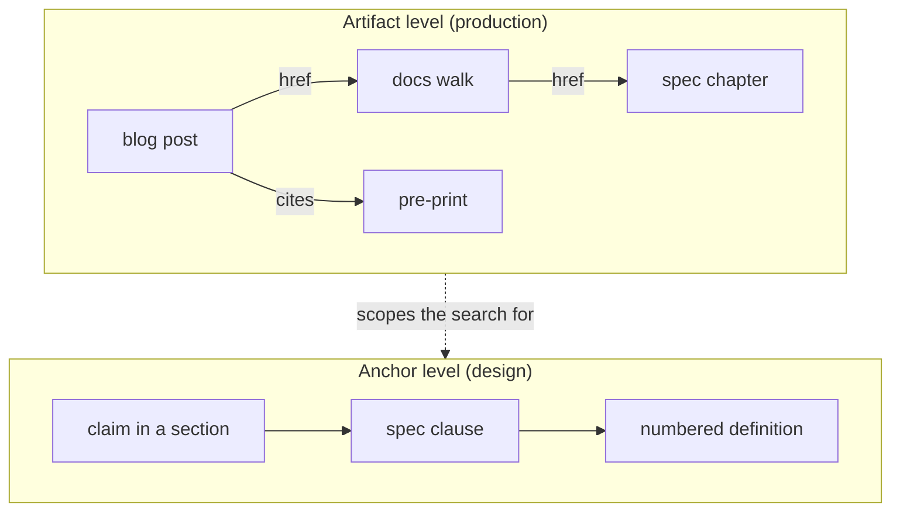

# 01 - The General Graph

The corpus behind the Fidelity Framework spans blog essays, design documentation, the [Clef specification](https://clef-lang.com/spec/draft/), and the preprint series. Its cross-links form a page-level graph rendered by the Atlas at [clef-lang.com](https://clef-lang.com/).

## The Atlas in Production

The Atlas uses page nodes and typed relationships. The site's [search schema](../../../clef-lang-site/workers/search/schema.sql) records canonical page URLs, content type, layer, title and other metadata for nodes. Edges record source and target URLs, relationship type, weight and labels. Section search uses its own identifiers and content hashes.

Three edge types carry the graph. An `href` edge records a cross-link between two pages. `cites` marks a citation to an arXiv paper, and `tag` marks shared-theme adjacency. The site extracts the content and links for the Atlas, whose visualization gives readers a way to explore the corpus.

We weight two properties of this graph over its size, and both come from how it was made.

**Links provide context.** An `href` records a link in the published content. A citation or shared tag records a different kind of relationship. These links help readers find related material, while the linked passage and its provenance establish what the source actually says. A link alone does not establish that the target proves or governs every claim on the source page.

**The corpus has distinct roles.** Specifications, research papers, design notes, and essays answer different questions. A paper may develop a theory further than an older article, while the applicable specification describes a language contract and implementation evidence establishes current behavior. Date, revision, scope, and explicit supersession matter when sources disagree. Document [06](06_reference_model.md) considers how a reference model can present those distinctions.

## The Anchor Layer

Page-grained edges route a reader between artifacts, recording that two pieces relate and nothing finer. That is the deliberate limit of the production Atlas. A working developer or agent asks a finer-grained question: which spec clause backs this blog claim, which pre-print definition supports this docs walk.

The site's section-grained search index is a useful starting point for finding finer passages. Section search results and page-level Atlas nodes have different identities, however. The anchor layer needs an explicit way to identify a passage and its document revision, associate it with a page, and represent a typed relationship to another anchor. The design must also say what happens when a heading moves or a source changes. Search can suggest candidates; the weave records the selected relationship and its provenance.

In this design the artifact graph is a useful starting point for discovery. Existing Atlas edges prioritize pairs of related pages, and section search can find additional candidates across the corpus. An editor can then review the actual passages and record the reason for each anchor-level relationship. Document [03](03_weave.md) develops the vocabulary connecting the general graph to the specific graph.
