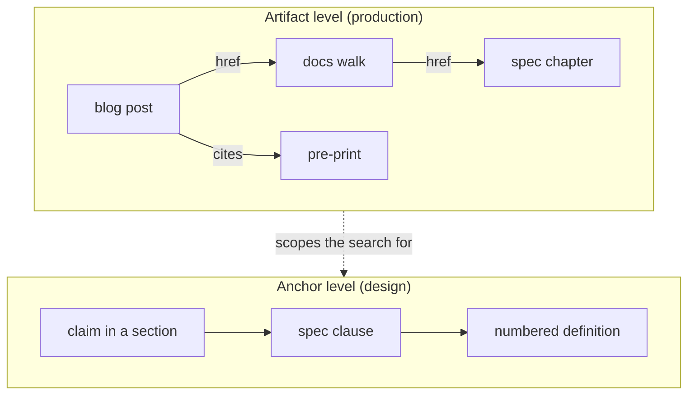

# 01 - The General Graph

The corpus behind the Fidelity Framework spans four strata: blog essays, design documentation, the [Clef specification](https://clef-lang.com/spec/draft/), and the pre-print series. Roughly 175 artifacts as of mid-2026, dense with deliberate cross-links. That link structure is a knowledge graph in the literal sense, and a page-grained rendering of it already runs in production: the Atlas, reachable from the front page of [clef-lang.com](https://clef-lang.com/).

## The Atlas in Production

The site's search worker maintains two D1 tables, rebuilt idempotently on every deploy:

```sql
CREATE TABLE IF NOT EXISTS graph_nodes (
    page_url     TEXT PRIMARY KEY,   -- canonical URL = node id
    content_type TEXT NOT NULL,      -- blog | spec | design | internals | preprint | external
    layer        TEXT NOT NULL,      -- ring assignment for the concentric rendering
    title        TEXT NOT NULL,
    ext_url      TEXT DEFAULT ''     -- for pre-print nodes: the arXiv link
);

CREATE TABLE IF NOT EXISTS graph_edges (
    source_url TEXT NOT NULL,
    target_url TEXT NOT NULL,
    edge_type  TEXT NOT NULL,        -- 'href' | 'cites' | 'tag'
    PRIMARY KEY (source_url, target_url, edge_type)
);
```

Three edge types carry the current graph. An `href` edge records a deliberate cross-link between two pages. `cites` marks a citation to an arXiv paper, with the six Fidelity pre-prints held as permanent nodes, and `tag` marks shared-theme adjacency. An extractor in the site's CLI walks the same content set the search indexer covers, resolves Hugo link shortcodes against a slug map, and pushes the result to the worker. The Cytoscape-rendered modal on the site reads it live.

We weight two properties of this graph over its size, and both come from how it was made.

**The edges are curated.** Every `href` edge was placed by hand under an explicit editorial rubric that distinguishes conceptual membership from incidental mention. Compare the tools that build document graphs automatically: Graphify's non-code edges come from an LLM extraction pass, and its per-edge confidence tags (`EXTRACTED`, `INFERRED`, `AMBIGUOUS`) exist precisely because extraction guesses. The Atlas has no confidence column. Curation is the scarce input no extractor reproduces, and it qualifies the general graph as an authority.

**The corpus is stratified.** The strata differ in age and in register, and the pre-prints sit at the apex: when an older blog essay and a pre-print disagree, the pre-print is the reconciliation target. Stratum membership rides the graph as node metadata, which gives any consumer, human or machine, an authority ordering to resolve conflicts against. Document [06](06_reference_model.md) builds the reference model's synthesis policy on exactly this ordering.

## The Anchor Layer

Page-grained edges route a reader between artifacts, recording that two pieces relate and nothing finer. That is the deliberate limit of the production Atlas. A working developer or agent asks a finer-grained question: which spec clause backs this blog claim, which pre-print definition supports this docs walk.

The infrastructure for that finer level half-exists. The site's search index is already section-grained, one row per H2 section carrying a stable id and a content hash, with both a BM25 index and a vector embedding over it. The section table already gives the graph anchor-grained nodes. The edges between them are the design gap, and they are a schema extension rather than a new system: `graph_edges` takes new edge types as plain strings, and `graph_nodes.page_url` joins to the section table's page URLs directly.



In this design the artifact graph serves as a scoping prior. Discovering anchor-level correspondences across the full corpus is a large search problem. Restricted to existing Atlas edges it becomes a small one: two artifacts the editor already linked bound the search space for anchor-level correspondence. The page graph scopes the finer search, and the rubric the editor applied to each page edge is the same discipline that will ratify each anchor edge. Document [03](03_weave.md) takes up the anchor vocabulary itself, where the general graph meets the specific one.
