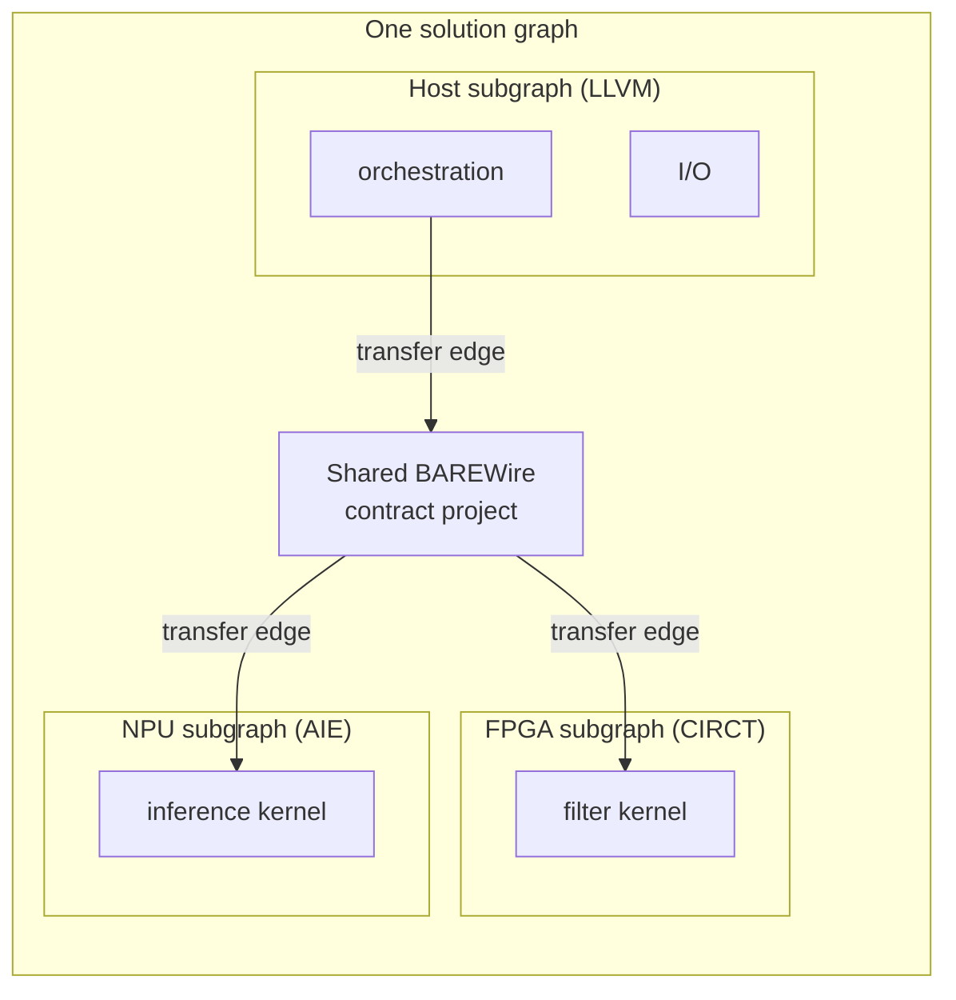

# 02 - The Specific Graph

Every code knowledge graph tool shipping in mid-2026 derives its edges from syntax. Tree-sitter parses the source, language-specific queries extract symbols, and heuristic name-matching resolves calls and imports across files. None of the three prominent tools ([Graphify](https://github.com/safishamsi/graphify), [GitNexus](https://github.com/abhigyanpatwari/GitNexus), [CodeGraph](https://github.com/colbymchenry/codegraph)) consults a typechecker, which is why the most careful of them tags every edge with its provenance: found in source, heuristically inferred, or guessed. It is also why none supports Haskell, OCaml, or F#, whose type-directed resolution defeats name-matching. The nearest compiler-grade art takes a different shape: Meta's [Glean](https://github.com/facebookincubator/Glean) stores facts emitted by real compilers and feeds production agents at monorepo scale ([KernelEvolve](https://arxiv.org/abs/2512.23236)), though it remains internal to Meta, and LSP-backed tools like [Serena](https://github.com/oraios/serena) deliver compiler-precise lookups one query at a time. In the tooling and literature we have reviewed, no shipped system exposes the compiler's full typed program graph to an agent as a persisted, traversable artifact.

For the Fidelity Framework that artifact is the Program Semantic Graph, built and saturated by the Clef Compiler Service (CCS) and the sole semantic authority for everything downstream: parsing, name resolution, and type checking run upstream of its construction inside CCS, and every later consumer reads from it exclusively. Composer's Alex witnesses it into MLIR, Lattice witnesses it into the editor, and Atelier witnesses it into views; none of them computes a semantic fact. The [pipeline walk on the site](https://clef-lang.com/docs/internals/pipeline/learning-to-walk/) narrates it end to end, the [Program Hypergraph pre-print](https://arxiv.org/abs/2603.17627) gives it a formal definition, and [the spec's PHG chapter](https://clef-lang.com/spec/draft/program-hypergraph/) states it normatively. The design consequence for Atelier: the extraction problem those tools exist to solve does not arise here. CCS emits what they approximate, and Atelier reads.

## Ground Truth by Construction

What elaboration provides, and syntax-level extraction cannot recover. Everything below is CCS's; the table at the end of the section says which annotations the graph carries today and which are scheduled.

- **Resolved references.** A reference resolves at elaboration, and the resolved result of type inference is stored on the node. When constraint solving determines that a generic parameter is a `StackBuffer<byte>`, the node carries that resolution. Today CCS projects reference edges from node kinds on demand; materializing them in the hyperedge set F is a scheduled step of `clef/docs/fidelity/phg/PSG_to_PHG_Plan.md`. Either way there is no name-matching step to tag with a confidence level.
- **Exact reachability.** Clef admits no runtime reflection and no dynamic instantiation, so the reachable set CCS computes is exact rather than conservative, per-node, across the full library graph. The [tree-shaking entry](https://clef-lang.com/docs/internals/pipeline/intelligent-tree-shaking/) develops this. The "static analysis ceiling" the tree-sitter tools share as a limit, reflection and eval defeating the graph, is a property of the languages they parse. Clef omits the features that create it.
- **Capture, escape, and context.** What a lambda captures is a CCS annotation today. Whether a value escapes and how (stack-scoped, closure-captured, return-escaping, byref-escaping) and what context a computation requires are designed as coeffects riding the graph; escape classification is computed in Composer's `PSGElaboration` as an interim step and is scheduled to move into CCS with the closure hyperedge (`clef/docs/fidelity/phg/Closure_Retooling_Plan.md`). The dynamic-dispatch patterns the extraction tools approximate with synthesizer heuristics, callbacks and handler registration, are ordinary resolved edges here.
- **Saturated semantics.** [Baker's saturation](https://clef-lang.com/docs/internals/pipeline/baker-saturation-engine/) expands language constructs into sub-graphs of primitives for everything reachable, so the graph a consumer traverses holds the program's actual semantic content, with surface sugar already resolved away. Obligations are minted only there, by Baker over the saturated graph, and discharged from the graph as SMT-LIB2 to cvc5.

The hypergraph generalization matters for the relationships a binary edge understates. A three-way join, a co-location constraint over the nodes sharing an NPU tile, a synchronization barrier: each is one hyperedge with a source set, and the PHG paper shows why the pairwise decomposition is semantically weaker (pairwise co-location does not entail joint co-location). CCS's `SemanticGraph` carries the hyperedge set F today, and a binary edge is its degenerate case, so the formalism is backward-compatible with the graph as built.

What CCS carries today versus what this sub-folder keys against:

| Annotation or structure | Today | Owner and plan |
| --- | --- | --- |
| Resolved types, SRTP resolution, captures | CCS, on the node | settled |
| Hyperedge set F | CCS: obligation, residence, and layout edges; reference edges projected from node kinds | CCS; materialization in F scheduled (`PSG_to_PHG_Plan.md`) |
| Proof obligations | CCS: the Increment 1 families (string-literal storage and consecutive layout, declared-buffer capacity and input bounds), discharged to cvc5 | CCS; further families per recipe |
| Platform residence | CCS, read from the `PlatformDescription` record | settled |
| Layout as joint constraint | CCS, string literals only | CCS; closures next (`Closure_Retooling_Plan.md`) |
| Reachability | CCS, `IsReachable: bool` per node, single target | CCS; per-target bitvector on edges and the Live/Latent/Fresh model scheduled (`PSG_to_PHG_Plan.md` Phase 1) |
| Escape class, lifetime, dimensional resolution, emission strategy | Composer `PSGElaboration`, interim | CCS, as hyperedge consequences; a CCS-owned contract item this sub-folder depends on |
| Cross-target transfer edges | none | CCS, from the `PlatformDescription`; DTS+DMM design only |
| A persisted, serialized saturated PSG | none (debug JSON under Composer's `-k` only) | CCS; the first contract item in the build order ([04](04_temporal_ledger.md)) |

## One Graph Across a Heterogeneous Solution

A Fidelity solution can span an x86 host, an FPGA, and an NPU, with a shared project defining the [BAREWire](https://clef-lang.com/blog/getting-the-signal-with-barewire/) contracts that govern every crossing between them. The design in [our DTS+DMM paper](https://arxiv.org/abs/2603.16437) treats that solution as one graph, target-conditioned rather than stitched:

- Every edge would carry a **reachability bitvector**, one bit per configured target. A function reachable on the host but absent from the neuromorphic target is one node whose activation varies by bit, and Lattice is designed to render the bitvector as a per-target compatibility matrix. Today CCS carries a single reachability boolean on the node; the bitvector and the three-state node model are Phase 1 of `clef/docs/fidelity/phg/PSG_to_PHG_Plan.md`, and until they land the per-target facts in this sub-folder are design.
- Unreachable nodes would be **latent, never deleted**. Their saturated annotations would persist, so a configuration change reactivates them at the cost of the boundary rather than a fresh analysis. Document [05](05_missions.md) builds the capability-arrival advisor on this preserved tier.
- **Cross-target transfer edges** would carry the resolved transfer protocol, latency, bandwidth, and precision fidelity where a value crosses processors, resolved by CCS from the declared `PlatformDescription` costs rather than measured. None exists today.

The per-processor subgraphs join at the shared contract project, and because both sides of every crossing interpret the contract by construction, the boundary is a typed interior feature of the graph. Compare the multi-repo story in the extraction tools: GitNexus goes furthest, stitching separately built repository graphs into groups through heuristic cross-repo resolution, bolted on because nothing in the languages it parses makes a service boundary a typed object. The equivalent question here, change this function in the host project and what breaks on the FPGA, is an elaboration fact read off reference edges and the bitvector once CCS carries the multi-target solution graph; nothing in Atelier computes it.

## The Contract from the Cut

When a subgraph moves from one target to another, the new boundary is the set of edges crossing the partition, and in a ground-truth graph that cut set is exactly enumerable. Every crossing edge would carry its type and its layout as literal offsets, layout being a joint constraint settled in CCS at saturation (landed for string literals in `clef/docs/fidelity/phg/Layout_As_Joint_Constraint.md`; the remaining aggregates follow). The BAREWire contract for the new boundary is therefore derivable as a skeleton: the cut induces the contract. Boundary discovery in a conventional toolchain is archaeology across build scripts and wire formats. Here it is a graph partition, and the proposal machinery in document [05](05_missions.md) is designed to deliver it with the migration suggestion attached. The partition is re-saturated by CCS under the hypothetical target assignment, a CCS-owned contract item with no API today; Atelier presents the result and decides nothing.

Documents [04](04_temporal_ledger.md) and [05](05_missions.md) build the ledger and the advisor over this graph.
