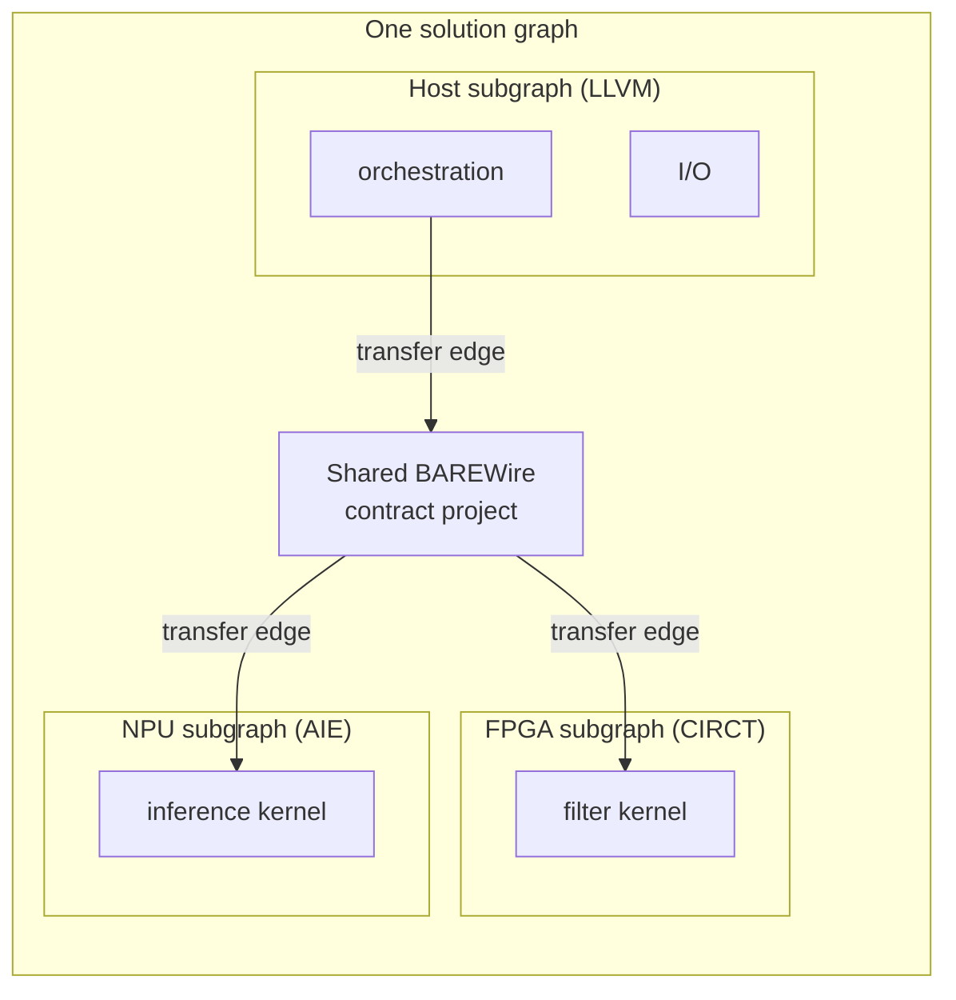

# 02 - The Specific Graph

The specific graph gives Atelier a view of the program as Clef understands it. Code knowledge tools can draw on syntax, language servers, compiler output, or a combination of sources. A compiler's semantic graph contributes resolved types, relationships, and proof premises for a particular program and configuration.

CCS elaborates and saturates the Program Semantic Graph (PSG). Baker recipes settle source semantics and proof premises, and publication assembles a `Fidelity.PSG` revision for downstream consumers. Composer uses Alex for passive Element, Pattern, and Witness composition. Atelier can query and present published facts without duplicating source-language inference. The [pipeline walk](https://clef-lang.com/docs/internals/pipeline/learning-to-walk/), [Program Hypergraph preprint](https://arxiv.org/abs/2603.17627), and [PHG specification](https://clef-lang.com/spec/draft/program-hypergraph/) provide the background.

## Compiler Facts and Proof Status

The graph gives developers and tools a common place to ask questions about a program:

- **Resolved references and types.** Elaboration can publish the declaration a reference selects and the type determined for it. A view can trace that result to the source and revision that produced it, while making unresolved references visible.
- **Reachability.** A solution graph can show what the compiler determines to be reachable for a configured target. The [tree-shaking entry](https://clef-lang.com/docs/internals/pipeline/intelligent-tree-shaking/) describes the motivation. A reachability answer is meaningful in relation to its roots, target, and external interfaces.
- **Capture, escape, and context.** Capture information and escape and coeffect classifications can explain how a closure uses its environment and which context a computation requires. The associated premises show why a particular placement or lifetime follows.
- **Saturated semantics and proof.** [Baker's saturation](https://clef-lang.com/docs/internals/pipeline/baker-saturation-engine/) elaborates constructs into the graph and establishes premises for obligations. An obligation's presence, a submitted solver query, and a discharged obligation are distinct states. A useful view identifies the obligation, its premises, its result, and the revision to which the result applies.

Hyperedges describe constraints that involve several participants together. Three tasks, for example, might fit pairwise on an NPU tile while their combined memory demand exceeds its capacity. A joint capacity constraint preserves the full set and the resource limit. Joins and synchronization barriers provide other examples of relationships over several participants.

| Information | How the knowledge layer uses it |
| --- | --- |
| Resolved types, references, and captures | Explain a program's elaborated meaning and trace dependencies. |
| Hyperedges and joint constraints | Present the participants and premises of a decision together. |
| Proof obligations and results | Show what is required, what has been discharged, and what remains open. |
| Residence, layout, lifetime, and escape | Explain target and memory decisions using CCS-settled facts. |
| Target-specific reachability | Compare a solution across configured targets. |
| Cross-target transfers | Explain a boundary, its contract, and its expected costs. |
| Persisted PSG revisions | Support repeatable queries and the history described in [04](04_temporal_ledger.md). |

Each view depends on the corresponding facts being present in the published revision. Proof status also depends on the associated evidence. A graph edge alone is not a discharged proof.

## One Graph Across a Heterogeneous Solution

A Fidelity solution can span an x86 host, an FPGA, and an NPU, with a shared project defining [BAREWire](https://clef-lang.com/blog/getting-the-signal-with-barewire/) contracts for communication between them. The design in [the DTS+DMM paper](https://arxiv.org/abs/2603.16437) treats the solution as one target-conditioned graph:

- **Reachability by target.** A bitvector can identify the configured targets for which an edge is active. A function reachable on the host and absent from the neuromorphic target remains one node, and Lattice can render the result as a compatibility matrix.
- **Latent nodes.** The compiler can retain dormant analysis internally so that a configuration change can reactivate applicable work after its dependencies and target assumptions are revalidated. Delivery to Atelier carries authorized live scopes and necessary support, rather than requiring every retained body. Document [05](05_missions.md) builds the capability-arrival advisor on this idea.
- **Cross-target transfer edges.** A transfer can carry the selected protocol and declared latency, bandwidth, and precision properties, with their source in the relevant platform description and contract. Measured performance should be identified separately from declared costs.

The shared contract gives the participating projects a common description of their boundary. A developer can ask what would be affected on the FPGA by a host change and follow resolved dependencies and target-specific facts through the graph. The answer is scoped to the published solution revision and the facts represented there.

## The Contract from the Cut

When a subgraph moves to another target, the graph cut identifies candidate crossings at the new boundary. Their resolved types, layouts, and usage provide the starting point for a proposed BAREWire contract. The proposal also needs the communication protocol, serialization and ABI choices, resource and lifetime rules, error behavior, and applicable proof obligations. Those details must come from the declared contract and CCS-settled premises. The cut alone cannot choose them.

Document [05](05_missions.md) develops the migration advisor. A hypothetical partition can be re-elaborated and saturated by CCS under the proposed target assignment, allowing Atelier to present the resulting contract skeleton, unresolved decisions, and evidence. Documents [04](04_temporal_ledger.md) and [05](05_missions.md) build the ledger and advisor over this graph.
