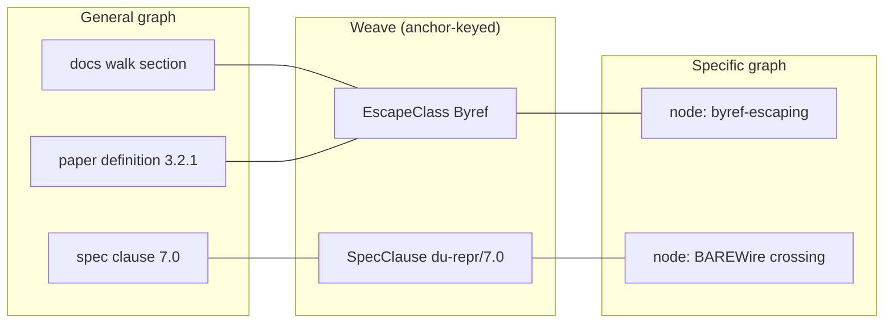

# 03 - The Weave

Structure questions concern what calls what. Warrant questions concern why the code is shaped this way and what licenses it, and they are the daily questions in a verification-forward framework. Answering one requires both graphs at once: start at a PSG node whose escape annotation reads byref-escaping with a given allocation strategy (an annotation CCS is scheduled to carry; see the status table in [02](02_specific_graph.md)), cross to the arena-placement doctrine in [the memory design docs](https://clef-lang.com/docs/design/memory/arena-hoisting/) and the escape taxonomy in [the DTS+DMM paper](https://arxiv.org/abs/2603.16437), then come back down to every node in this solution carrying the same class. One traversal yields the answer with its provenance attached. The weave is the edge set for that crossing.

## The Anchor Interface

The weave cannot reference PSG node identities. Baker's fold-in renumbers node ids as saturation merges sub-graphs, and the specific graph is regenerated at every elaboration. Durable cross-graph edges therefore key on the stable semantic vocabulary both graphs already share. Whether CCS should also carry a stable elaboration-level identity per node is an open contract question taken up in [07](07_preservation_interface.md); the weave does not depend on its answer.

```fsharp
/// Anchor keys: stable across elaborations, curated at spec cadence.
/// The class types on the specific side are CCS's own, exported from the
/// service, never re-declared here.
type AnchorKey =
    | SymbolPath of FullyQualifiedName        // Acme.Dsp.filterKernel
    | CoeffectCategory of CoeffectClass       // capture (CCS today), lifetime, SSA (scheduled)
    | EscapeClass of EscapeClassification     // stack | closure | return | byref (CCS; scheduled)
    | ObligationClass of ObligationKind       // the discharged constraint's family (CCS; exists)
    | SpecClause of ClauseId                  // discriminated-union-representation/7.0
    | PaperAnchor of ArxivId * SectionRef     // 2603.16437 section 3.2.1

type WeaveEdge =
    { Anchor: AnchorKey
      GeneralTarget: CorpusAnchor             // section id in the corpus index
      Provenance: Provenance }

and Provenance =
    | Authored                                // placed or ratified by the editor
    | Proposed of source: string              // machine-suggested, awaiting ratification

```

Three of the keys are CCS enumerations. The obligation family exists today (`ObligationInfo.Kind`, with `EdgeClass` and `EdgeRole` beside it); the escape class and the coeffect category do not yet exist in CCS and are the contract items the status table in [02](02_specific_graph.md) names. There is deliberately no key for an MLIR op. An op is what Composer's Alex witnesses a node into, below the witness boundary, and the PSG must not carry op names; doctrine about an op (one of the five witnessed dialects, a lowering form) is a general-graph anchor reached from the specific side through the node's PSG annotation, never through the emitted op.

The humble precedent is rustc's error index: `E0308` is a stable identifier that `--explain` resolves into doctrine. Clef's diagnostic and obligation vocabulary can serve as the same kind of namespace with a far richer doctrine side, since a single escape class fans out to three doctrine surfaces: the docs walk that narrates it, the spec clause that requires it, and the pre-print section that proves its decidability. The vocabulary is small, owner-curated, and changes at spec cadence rather than code cadence. That slow cadence keeps the weave maintainable. It also puts this vocabulary first in the knowledge layer's own build order, after the CCS contract items it keys against: the temporal ledger's delta types ([04](04_temporal_ledger.md)), the reference model's citation certificates ([06](06_reference_model.md)), and the preservation layer's semantic identity ([07](07_preservation_interface.md)) all key against this vocabulary.

## A Third Artifact

The weave is stored outside both graphs it connects. PSG node payloads carry symbols, ranges, and annotations, with no prose linkage. The compiler artifact stays free of documentation concerns, and the corpus stays free of per-solution instance data for the same reason. The weave is a mapping keyed by anchors, regenerated cheaply against fresh elaborations because its keys survive them. It is a derived index over PSG projections, never a second semantic graph, and it stores no fact CCS did not mint.



## Proposal and Ratification

Anchor-level edges between corpus artifacts, a blog claim to the spec clause behind it, are discovered work, and the pipeline splits the labor accordingly. A language-model pass proposes alignments, searching only along existing Atlas edges since the artifact graph bounds where correspondence can occur. Every proposed edge carries `Proposed` provenance until the editor ratifies it to `Authored`. The two-state discipline keeps the graph's authority intact: consumers that require ground truth filter to `Authored`, and the proposal queue becomes ordinary editorial workflow. This mirrors how the Atlas itself was built, an editorial rubric applied link by link, with the machine now drafting candidates instead of the editor discovering every pair by hand.

Each traversal direction serves a distinct audience. General to specific serves the newcomer and the auditor: here is the doctrine, show me where this solution exhibits it. Specific to general serves the developer mid-edit: here is this structure, show me what governs it. The same weave carries both, and the Atlas sits above as the coarse routing tier.
