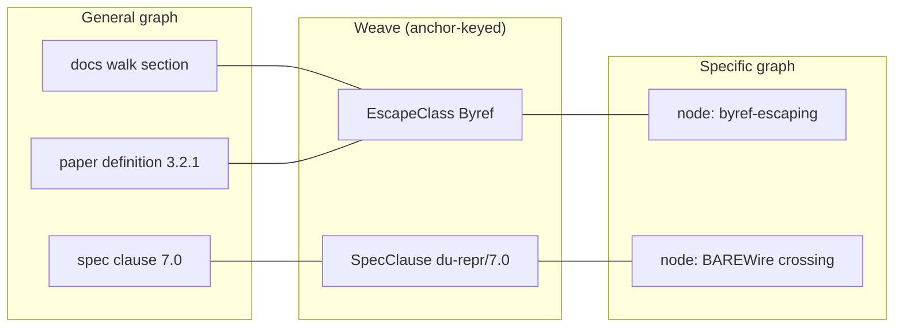

# 03 - The Weave

Structure questions concern what calls what. Warrant questions concern why code has a particular form and which conditions justify it. The weave connects those questions across the two graphs. For example, a PSG fact about a by-reference escape can lead to the applicable [arena-placement design](https://clef-lang.com/docs/design/memory/arena-hoisting/) and the escape taxonomy in [the DTS+DMM paper](https://arxiv.org/abs/2603.16437), then to other facts in the selected solution carrying the same class. The traversal retains the source revision and provenance of each connection.

## The Anchor Interface

The weave uses a semantic vocabulary to connect compiler facts to relevant passages. A projection into a particular PSG revision may refer to that revision's node identifiers. A durable connection across revisions needs an identity that remains meaningful as elaboration and saturation change the graph. Whether CCS should publish a stable elaboration-level identity is a contract question taken up in [07](07_preservation_interface.md). Until that contract exists, a projection records the revision in which its node identifier applies.

The following sketch illustrates the intended vocabulary and relationships. The names are conceptual, including the categories that CCS would need to publish for a particular query.

```fsharp
/// Anchor keys: versioned vocabulary for linking facts and passages.
/// Specific-side categories correspond to facts published by CCS.
type AnchorKey =
    | SymbolPath of FullyQualifiedName        // Acme.Dsp.filterKernel
    | CoeffectCategory of CoeffectClass
    | EscapeClass of EscapeClassification
    | ObligationClass of ObligationKind       // an obligation family
    | SpecClause of ClauseId                  // discriminated-union-representation/7.0
    | PaperAnchor of ArxivId * SectionRef     // 2603.16437 section 3.2.1

type Provenance =
    | Authored                                // placed or ratified by the editor
    | Proposed of source: string              // machine-suggested, awaiting ratification

type WeaveEdge =
    { Anchor: AnchorKey
      GeneralTarget: CorpusAnchor             // section id in the corpus index
      Provenance: Provenance }

type CorpusAlignment =
    { Source: CorpusAnchor
      Target: CorpusAnchor
      Relation: AlignmentKind
      Provenance: Provenance }

type RevisionProjection =
    { Revision: GraphRevisionId
      Node: NodeId
      Anchor: AnchorKey
      Provenance: Provenance }

```

The sketch groups source-language categories, symbol paths, and document anchors in one vocabulary. A production design must define their namespaces, source revisions, and compatibility rules. Symbol identity also needs enough scope to distinguish overloads and declarations with the same name. A proof obligation's class describes its family; its result is a separate fact tied to an obligation and revision. Lowering details can be connected to their documentation through the applicable published semantic facts, with target and backend context where needed.

Rust's error index offers a familiar precedent: `E0308` is an identifier that `--explain` resolves to an explanation. Clef's diagnostic and obligation vocabulary can connect an escape class to the documentation that explains it, the specification that governs it, and the paper that develops its theory. Versioning and ownership keep the vocabulary usable as those sources evolve. The [temporal ledger](04_temporal_ledger.md), [reference model](06_reference_model.md), and [preservation interface](07_preservation_interface.md) can then connect their observations to those same anchors.

## A Third Artifact

The weave is a mapping outside the two graphs it connects. It records two related kinds of connection: a reviewed relationship between corpus passages, and a projection from a particular PSG revision's facts to the vocabulary and its passages. The first can describe why a specification clause relates to a paper definition. The second can show which nodes or obligations in a given revision exhibit that concept. A projection records its PSG revision and the identity available in that revision. Its semantic assertions come from CCS, and the corpus mapping records its own source and editorial provenance.



## Proposal and Ratification

Anchor-level edges between corpus artifacts require interpretation. A language-model pass can propose an alignment between a blog claim and a specification clause. Existing Atlas links help prioritize candidate pages, and section search can find connections beyond those links. Each proposal records its source and the document revisions considered. An editor can review the passages, record the relationship and rationale, and ratify it. `Authored` indicates editorial provenance; a reader still needs the cited passages, their scope, and any later supersession to assess the claim.

Each traversal direction serves a distinct audience. General to specific serves the newcomer and the auditor: here is the doctrine, show me where this solution exhibits it. Specific to general serves the developer mid-edit: here is this structure, show me what governs it. The same weave carries both, and the Atlas sits above as the coarse routing tier.
