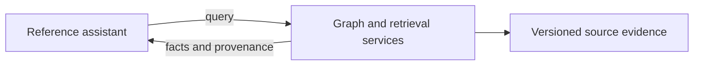

# 06 - The Reference Model

Atelier should provide a local reference assistant that helps developers navigate the Fidelity corpus and the current solution. Its first responsibility is to retrieve relevant sources, identify their revisions and status, and explain the evidence in context. A small specialist model is a promising way to make that experience fast and accessible. Its size, architecture, training, and resource requirements remain choices to validate.

The broader design draws on the [constrained machine learning series](https://clef-lang.com/docs/design/constrained-machine-learning/managing-context/) and the [Adaptive Domain Model paper](https://arxiv.org/abs/2603.18104). In that research direction a model can request structured information from a domain actor. A `StructuredFact` may include a value, dimension, confidence, and certificate. BAREWire could carry such a contract between Fidelity components once both endpoints implement it. Integrating structured facts directly into a model's internal state requires model and runtime work beyond serialization and is a separate research milestone.

## Retrieval, Judgment, and Provenance

The graph and retrieval service should locate evidence. The assistant should synthesize it, cite the relevant anchors, and state uncertainty or conflicting evidence. A certificate can identify a source, revision, location, and relationship to a claim. Checking that an anchor exists does not establish that the claim follows from it. Evaluation and, where possible, explicit checks of the cited proposition remain necessary.

Source status matters. Published papers, language specifications, current implementation, design notes, and historical articles answer different questions. A newer implementation may supersede a design note, while a paper may describe a theoretical result that implementation has not yet realized. The reference model should show dates, revisions, and stated scope when sources disagree. It should surface unresolved conflicts for review instead of applying a fixed rule that always places one document class above another.

Fine-tuning may improve vocabulary and query habits. Treat its factual recall as a hypothesis to evaluate and keep changing project facts in retrievable, revision-bound sources. The [weave](03_weave.md) supplies the proposed link and provenance model. Its authored and proposed relationships need distinct labels in answers.

## Measure Coverage and Quality

Build the evaluation harness before choosing a model. Generate probes from available specification clauses, definitions, and compiler facts, then add questions written by developers to test interpretation and practical use. Report missing coverage, retrieval quality, citation accuracy, whether evidence supports each answer, and the model's behavior when the answer is unknown. The reference corpus is versioned and enumerable only within the scope of an identified snapshot. Coverage of that snapshot is useful evidence, not a proof that answers are correct.

Include adversarial probes where familiar F# or .NET expectations can be mistakenly substituted for Clef semantics. Test questions about representations, references, evaluation strategy, and reflection against the applicable specification and current implementation, with discrepancies reported explicitly.

## Local Model Target

A CPU-resident model that works offline is an attractive goal for a WREN application. Evaluate ternary and other compact models against the same tasks and report memory, startup time, latency, power, citation fidelity, and answer quality on representative machines. Include retrieval-plus-generalist baselines. A model earns the reference role when it meets those measured requirements and can decline questions it cannot support.

Direct structured-state integration and native model compilation through Composer remain longer-term experiments. They could make the reference assistant a compelling demonstration of the framework once their runtime and verification contracts are implemented.
