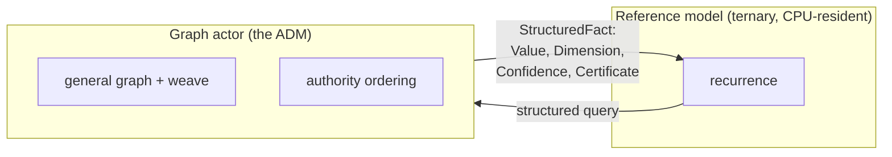

# 06 - The Reference Model

Atelier's knowledge layer includes a language model. We envision a small specialist whose weights carry familiarity with the corpus and whose authority is held entirely in the graph, an inversion of the usual retrieval-augmented arrangement, where a large generalist gets a search index bolted on. The pairing has a published skeleton in [our constrained machine learning series](https://clef-lang.com/docs/design/constrained-machine-learning/managing-context/): a recurrent model suspends mid-inference, emits a structured query to a domain-specific actor, and integrates the answer as state. The response crosses [BAREWire](https://clef-lang.com/blog/getting-the-signal-with-barewire/) as a `StructuredFact` carrying Value, Dimension, Confidence, and Certificate fields, with its structure intact rather than flattened through the tokenization path. The design pattern is the Adaptive Domain Model of [our pre-print](https://arxiv.org/abs/2603.18104), and the reference model is its most natural first instance, an ADM whose domain is the Fidelity corpus itself. The system that explains the stack would be an application of the stack's own published architecture.

## The Division of Labor

The division is strict because each side is unreliable at the other's job. Fine-tuning moves register and vocabulary dependably and moves factual recall undependably, so the fine-tune targets fluency in the house vocabulary, familiarity with the corpus's shape, and the practice of consulting before asserting. Facts arrive by retrieval with certificates, the anchor chains of [document 03](03_weave.md), and the synthesis contract rejects uncited claims structurally. This is the framework's standing guarantee discipline applied to the model's own output: confidence attaches to the deterministic side, where the graph either resolves an anchor or does not, and the model narrates over retrieved ground truth.

The corpus's stratification becomes policy at three points. In the graph, strata ride as node metadata with the pre-prints at the apex of the authority ordering. In training data, the apex weighs heavier, since an unweighted dump would teach the model the drift of older strata along with the doctrine. In synthesis, when strata disagree the answer cites the apex, which mechanizes the editorial reconciliation practice the corpus already follows. A fine-tune bakes a snapshot into the weights while the corpus re-levels, so everything that changes belongs in the graph, and the fine-tune stays small and cheaply re-runnable, retrained as routinely as the index rebuilds.

## Coverage as a Measurement

Our target is a high-confidence reference with auditable blind spots, and the auditability comes from a property generic assistants lack: the reference set is closed and enumerable. Every spec clause, numbered definition, and coeffect category can have probe questions generated from the graph itself, so blind-spot detection becomes a coverage report with failing rows. The harness can exist before the model does, baselining the retrieval-plus-generalist synthesis the site already runs, which gives the eventual fine-tune a measured target rather than an assumed one.

One probe category is specific to this corpus and easy to miss. Every base model arrives knowing mainstream F# and .NET semantics, and much of that knowledge is almost right about Clef in ways that are precisely wrong: representation of discriminated unions, byref behavior, the deliberate absence of runtime reflection. The eval harness therefore includes adversarial probes at exactly the collision points where the plausible generic answer and the Clef answer diverge, because the failure mode there is confident substitution rather than absence, and a coverage report over anchors would never surface it.

## The Ternary Fit

The task profile sits well within what small ternary-weight models demonstrate: house-vocabulary fluency, query emission, faithful synthesis under a citation contract. Traversal and closure run in the graph actor regardless. The [λ-RLM results](https://arxiv.org/abs/2603.20105) our context-management entry cites point the same direction, with structural control around bounded neural subproblems outperforming unstructured recursion. CPU residency compounds in practice: the reference model sits beside Atelier on the developer's machine, always warm. It requires no accelerator and no API dependency, and it works offline. A workshop whose reference authority required a cloud subscription would undercut the computational-responsibility argument the [WREN stack](https://clef-lang.com/blog/wren-stack/) makes. A low-wattage specialist consulting a resident graph keeps that argument intact, and when the constrained-model line compiles through Composer natively, the reference model becomes a demonstration artifact of the very series that describes its design.
