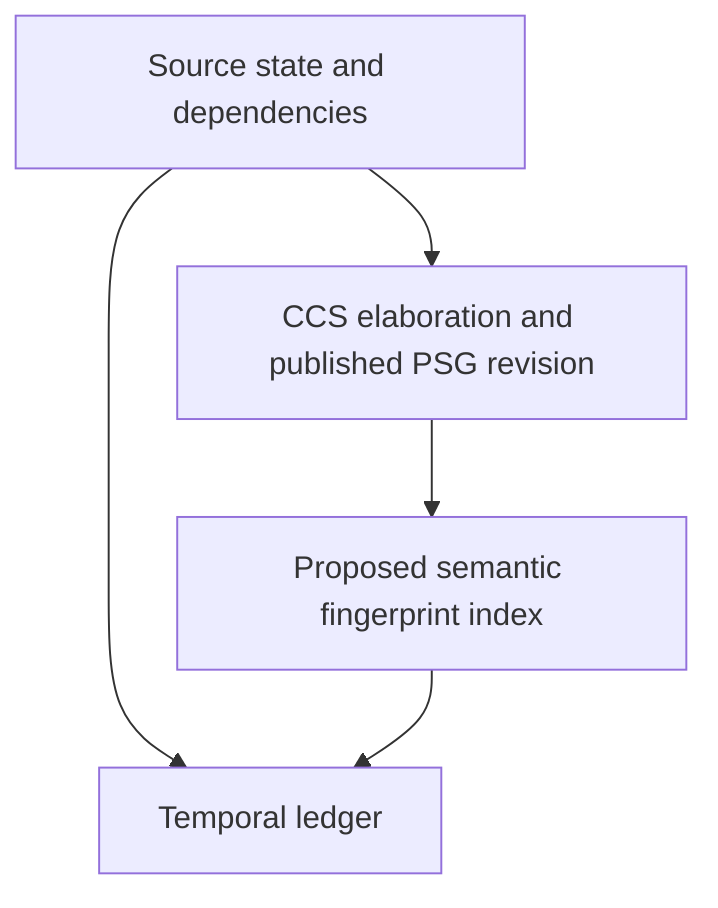

# 07 - The Preservation Interface

Atelier's [temporal ledger](04_temporal_ledger.md) needs a reliable source history and a way to connect compiler revisions to that history. It should work with a conventional Git repository while allowing other preservation systems to supply the same information. Start with a small adapter that records the capabilities actually available. Add requirements as a concrete ledger feature needs them.

The useful capabilities are:

1. **Identifiable source states:** retrieve the source and dependencies associated with a ledger entry.
2. **Change lineage:** relate revisions across rewrites where the preservation system supplies that information, while recording ambiguous or missing relationships.
3. **Operation history:** inspect recorded repository operations when supported, with retention and availability made explicit.
4. **Conflict representation:** retain and inspect unresolved conflicts where the underlying tool supports them.
5. **Programmatic access:** query these capabilities through a suitable library or adapter.

Git provides content-addressed objects and revision history. [Jujutsu](https://github.com/jj-vcs/jj) adds change identifiers, an operation log, and first-class conflict handling over a Git-compatible repository. Evaluate [jj-lib](https://lib.rs/crates/jj-lib) for embedding, including its API stability and deployment costs, before selecting it. Change identifiers and operation history are useful evidence, but divergence, rewriting, garbage collection, and retention policies still need explicit handling. A Git-only adapter can support the subset available without claiming the other properties.

## Related Approaches

Several systems offer useful ideas for the preservation adapter. [Pijul](https://pijul.org/model/) explores patch-based history and conflict representation. [Fossil](https://fossil-scm.org/) and [Dolt](https://github.com/dolthub/dolt) expose database-oriented repository models. [DeltaDB](https://zed.dev/deltadb) explores operation-level history in an agent workflow. [Grace](https://github.com/scottarbeit/grace) is an F# project exploring event-sourced and actor-oriented version control. Compare them against specific Atelier requirements and integration costs before adopting their mechanisms.

## Semantic Identity as a Derived Index

Textual content identity answers whether bytes changed. Atelier also needs to ask whether a compiler-relevant structure changed. A proposed semantic index can associate suitable elaborated structures with fingerprints while retaining the original source state and compiler revision. [Unison](https://www.unison-lang.org/docs/the-big-idea/) demonstrates the value of content-addressed definitions. Atelier can investigate similar benefits alongside ordinary source files and existing repository workflows.

The fingerprint contract needs to specify its scope before it can support a claim of equivalence. That includes the elaborated structure, binding and alpha-equivalence rules, relevant dependencies, compiler and schema versions, target configuration, and any types, coeffects, layouts, or proof premises that affect the intended comparison. It must also specify collision handling and invalidation. Published work on [hashing modulo alpha-equivalence](https://arxiv.org/abs/2105.02856) is a starting point, with its [documented correction](https://pvk.ca/Blog/2022/12/29/fixing-hashing-modulo-alpha-equivalence/) part of implementation review. A matching hash alone is not a proof of semantic equivalence.

For example, a whitespace-only edit can produce a new source revision while leaving an appropriately defined semantic fingerprint unchanged. Source locations and provenance may still change, so the ledger should retain that history while presenting no semantic delta for the scoped comparison. Establish this behavior with examples and tests before using the index to suppress downstream work.
