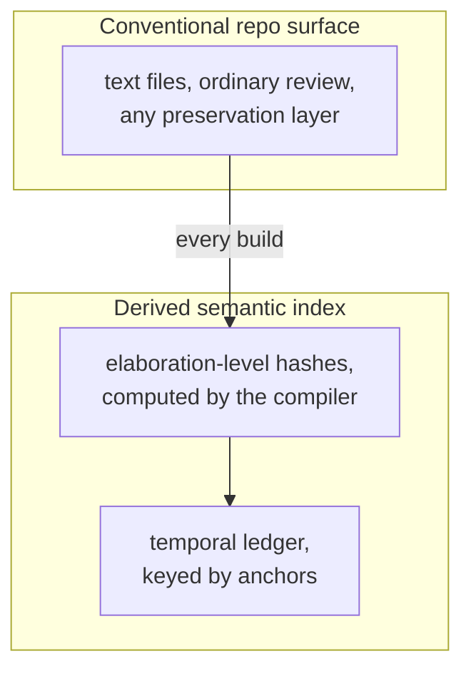

# 07 - The Preservation Interface

The temporal ledger of [document 04](04_temporal_ledger.md) sits on top of a source-preservation layer, and git appears nowhere in its requirements, deliberately. Git is one C implementation of a content-addressed Merkle DAG, carrying two decades of interface accretion, and the 2025-2026 field shows its successors arriving from several directions at once. The ledger's interface to whatever wins is five properties long:

1. **Immutable, content-addressed source states** under some Merkle discipline, so any historical state has a stable name.
2. **Change identity stable across rewrites**, so the ledger's provenance keys survive rebases and history edits.
3. **An operation-level audit log**, recording what was done to the repository as data.
4. **Conflicts as durable structure** rather than transient working-tree markers, so the fractional obligations of document 04 have something structural to bind against.
5. **Library embeddability**, so the workshop owns its access path rather than shelling out to a porcelain.

Nothing in the chain design, the anchor vocabulary, or the mission machinery depends on which system supplies these. Today git plus [jj-lib](https://lib.rs/crates/jj-lib) supplies them adequately, with Jujutsu's operation log (full repo-state snapshots per operation, strictly stronger than reflog) and change ids covering properties 2 through 4 over git's storage.

## The Successor Field

The systems competing to replace git each contribute one principled property, and the sorting is more useful than any single winner:

| System | The property it proves |
| --- | --- |
| [Pijul](https://pijul.org/model/) / [Atomic](https://github.com/atomicdotdev/atomic) | patch identity and a pushout merge algebra ([Mimram & Di Giusto](https://arxiv.org/abs/1311.3903)), conflicts in the data structure |
| [Jujutsu](https://github.com/jj-vcs/jj) | the operation log, first-class conflicts recorded in commits, an embeddable core |
| [Fossil](https://fossil-scm.org/) / [Dolt](https://github.com/dolthub/dolt) | repository as queryable database, with Dolt's prolly trees making structural diff O(changes) |
| [DeltaDB](https://zed.dev/deltadb) | operation-grain records with stable identity, every change linked to the agent conversation that produced it |
| [Grace](https://github.com/scottarbeit/grace) | event-sourced, actor-per-entity architecture with continuous background capture, written in F# |

The 2026 entrants converge on a reframing this knowledge layer shares: the unit of record moves from the commit to the operation, driven by agent workflows that require provenance for every change. Grace deserves particular attention from our vantage because it is the concept-donor in the lineage language: event sourcing, actor entities, and save-grain capture expressed in the functional idiom Clef descends from. Its cloud-first topology and byte-level identity are the two choices a Fidelity-native port would invert.

## The Identity Question

The deeper axis your choice of preservation layer fixes is what a version *is*, and there are three candidate levels. Byte-level identity, git's SHA over content, is what every mainstream system uses, Grace included. Parse-level identity is the level structural diff tools like [Difftastic](https://difftastic.wilfred.me.uk/) operate at, where formatting changes vanish from the diff. Elaboration-level identity, a hash of the type-checked structure, has exactly one production occupant: [Unison](https://www.unison-lang.org/docs/the-big-idea/), where each definition is identified by a SHA3-512 of its normalized syntax tree with variables De Bruijn-numbered, so identity is invariant under renaming and formatting, names are remappable metadata, and definition-level merge conflicts do not exist.

Unison's documented costs are the honest price list for making that identity primary: editing mediated through a codebase manager, review and hosting requiring a custom stack, whole-ecosystem buy-in. The costs follow from a specific decision, making the semantic store the only surface and retiring text as the source of truth.

We take the identity without the buy-in, because the economics invert here. The compiler elaborates every build. The PSG is already the normalized structure, and the anchor vocabulary is already the names-as-metadata surface. The efficient algorithms are published: [hashing modulo alpha-equivalence](https://arxiv.org/abs/2105.02856) computes hashes for all subterms in O(n log²n), compositionally, a child's hash deriving its parent's, which is precisely the Merkle property, with a known flaw in the paper's hash-combining scheme [documented and corrected](https://pvk.ca/Blog/2022/12/29/fixing-hashing-modulo-alpha-equivalence/) as the implementation's due-diligence note. So elaboration-level identity enters as a derived index rather than a primary store:

The reformat case shows the payoff at its cleanest. A whitespace pass changes every byte hash and mints new blobs in any conventional system, and produces no delta in the ledger at all, because the elaboration never moved and the identity the ledger keys on is fixed there. Semantic identity is computed at elaboration and nothing is reified at rest, the same annotation-lifetime discipline [our DTS+DMM paper](https://arxiv.org/abs/2603.16437) applies to dimensional types. Adjacent art proves the pieces at other scales: [Dhall's semantic integrity checks](https://docs.dhall-lang.org/discussions/Safety-guarantees.html) hash normalized expressions at import boundaries, and the Nix store demonstrates content-addressed artifact distribution ecosystem-wide.

The consequence for anyone waiting on a principled git replacement: the ledger never needed one. The properties worth waiting for are either embeddable today, published in our own pre-prints, or computed by the compiler as a byproduct, and when a successor does consolidate, the interface it must satisfy is the five properties at the top of this page.
