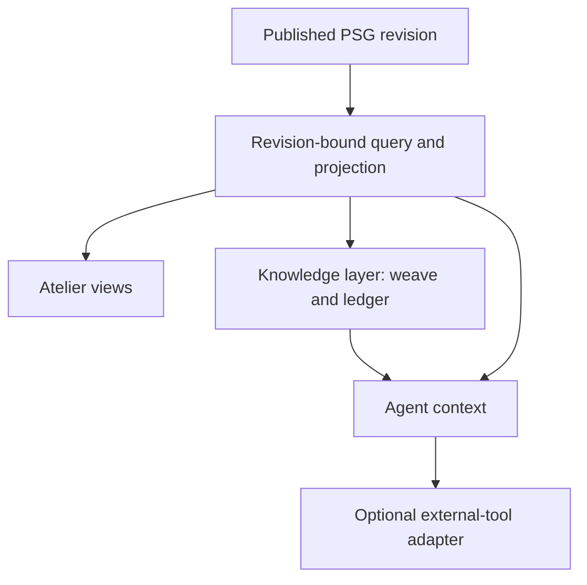

# 08 - The Observation Surface

Atelier should give developers and agents access to the same revision-bound compiler evidence. [Opining Upon Reflection](https://clef-lang.com/blog/opining-upon-reflection/) describes a saturated PSG observed by compiler and tooling consumers. A hover, a visualization, and an agent query can draw on that shared source while presenting different information for their audiences.

CCS and Baker settle source semantics and publish facts in the PSG. Alex composes over settled facts. Lattice and Atelier can project or query those facts for their consumers without repairing semantics in the reader. Queries, indexing, rendering, and context assembly still have costs. Measure them against interactive latency targets and cache results where appropriate.

## Native Access and External Tools

Use a typed BAREWire contract for structured exchanges between Fidelity components where it fits the boundary. BAREWire's existing serialization and contract work provide a useful foundation. A graph query API, snapshot semantics, query authorization, and the particular messages for the knowledge layer require their own implementation. The proposed reference assistant in [document 06](06_reference_model.md) can consume that API alongside other Atelier features.

For external tools, provide an MCP adapter when there is a concrete integration to support. MCP uses JSON-RPC and can convey structured content and schemas. The data actually presented to a model depends on the host and its integration. The adapter should preserve revision, provenance, and type information in its responses and make any conversion visible. Other integrations can use their appropriate protocols.

The constrained-model research explores a further step: incorporating structured facts into model state rather than presenting them as ordinary prompt text. That depends on the model and runtime, not just the wire format. It deserves its own experiments and acceptance criteria.

Lattice provides editor-facing capabilities. The knowledge layer extends that interface with queryable projections and explicit snapshot semantics, coordinated with the compiler and tooling owners.

## Answers With Traceable Evidence

An answer should identify the revision and distinguish three kinds of evidence: compiler facts from the published PSG, authored or proposed relationships in the [weave](03_weave.md), and historical changes calculated by the [ledger](04_temporal_ledger.md). Each has its own source and validity conditions. A proposed alignment should remain labeled as a proposal, and a historical comparison should identify the revisions and fields compared.

The agent interface returns anchors and provenance with each answer where available. This makes a claim reviewable and helps the user find the underlying specification, paper, source, or graph fact. A citation demonstrates where to look; confirming that the source supports the claim still requires checking.
