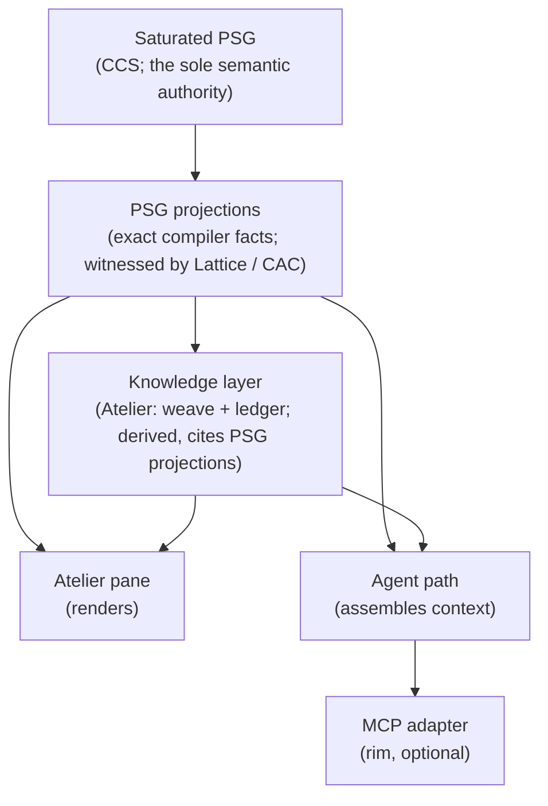

# 08 - The Observation Surface

[Opining Upon Reflection](https://clef-lang.com/blog/opining-upon-reflection/) makes the argument this document extends: runtime reflection exists because compilers discard what they know, and Clef's alternative is one observation surface over the saturated PSG serving every consumer. The essay enumerates four witnesses: the Alex traversal emitting MLIR, the metaprogram, Lattice answering editor queries, and the Atelier pane rendering views. A hover card and a lowered op are the same kind of thing in that architecture, projections of one graph.

An agent consuming the knowledge layer adds no witness to that list. It reads the same projections the Atelier pane renders, and what varies per consumer is only the formatter at the rim: a pane renders pixels, an agent path assembles context. The design constraints the reflection essay establishes carry over whole. Witnesses never compute, computation is edit-driven and observation is free, and the projection layer keeps every observation answerable between keystrokes. The tool ecosystem arrived at the same discipline from the economics side, index once and query many: the architecture we derived from first principles is the one the agent-tool market independently found necessary.

## The Contract Is Already Ours

The question of how an agent reaches the graph has a conventional answer, the Model Context Protocol, and a native one, and the design distinguishes them by who owns the endpoints.

MCP is a federation protocol: a discovery handshake plus JSON-RPC so arbitrary harnesses can reach arbitrary tools without bespoke integration. Its serialization is stringly typed JSON, which means nothing dimensional survives the crossing, and the harness re-flattens every result into prompt text regardless. Ecosystems adopt it because they lack a shared typed contract between tool and agent. This stack has one. [BAREWire](https://clef-lang.com/blog/getting-the-signal-with-barewire/) is the boundary contract both sides interpret by construction, and [our context-management design](https://clef-lang.com/docs/design/constrained-machine-learning/managing-context/) already specifies the strong form of the crossing: a `StructuredFact` arriving with its dimensional annotations intact, bypassing the tokenization path that would flatten its structure. Between two Fidelity components, interposing MCP would trade a compile-time contract for a stringly one.

The resolution sorts by horizon:

- **Commodity harnesses, today.** External agent products speak MCP and nothing else. Reaching them would take a thin adapter over projection snapshots: disposable plumbing at the rim, entirely optional. Nothing in the architecture depends on its existence. The snapshots presume a queryable projection API with snapshot semantics beyond hover and diagnostics, which Lattice (the ClefAutoComplete server, CAC) does not carry today; that API is a Lattice-owned contract item and the adapter waits on it.
- **Atelier-native.** Both ends are ours. The graph actor would answer a structured query over BAREWire, and Atelier's agent path would assemble context for whatever model is in play, with no protocol hop. This is the design center, and the reference model of [document 06](06_reference_model.md) is its resident consumer.
- **The designed far end.** The porous recurrence of the constrained-model series, where structured facts enter inference as state rather than as tokens, and the oracle-memory direction [the refinery essay](https://clef-lang.com/blog/fidelity-as-ai-refinery/) sketches at research stage. No protocol in the current landscape addresses that horizon. It is ours to build.

Two sources feed the surface, and they carry different warrant. A PSG projection is a compiler fact, minted by CCS and read through Lattice. A weave edge is editorial data, `Authored` or `Proposed` ([03](03_weave.md)), and a ledger delta is computed history ([04](04_temporal_ledger.md)); both are derived over PSG projections and neither is a graph fact. Every certificate the agent path assembles names which side each fact came from, so a `Proposed` alignment or a ledger inference can never be cited with the warrant of an elaboration result.

## Answers That Carry Their Warrant

What the agent path is designed to deliver, and a structure-only tool cannot, is the certificate. A query through the weave would return its answer with the anchor chain attached: the spec clause, the docs walk, the pre-print section, and the side each fact came from. Through the temporal ledger it would also carry the trajectory that produced the current state. An agent operating on this surface cites rather than reconstructs, and its mission context, the predicates of [document 05](05_missions.md), gives it a checkable objective whose progress is measured on ground truth. The long-horizon benchmarks show agents collapsing when the repository is opaque text and the goal is a vibe. This surface is designed to be the opposite of that condition, and this sub-folder designs the knowledge layer for exactly that purpose; none of it is built yet.
